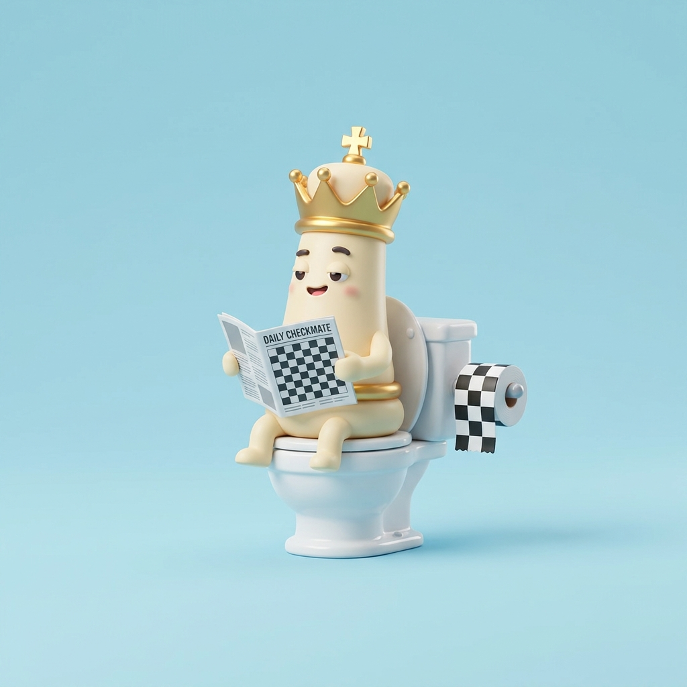
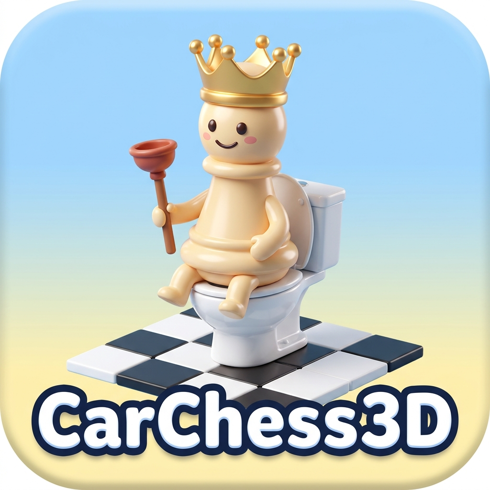

# 🏰🚽 CarChess3D: *Carlesso al Cesso* ♟️

> ### 🌐🚀 **[GIOCA SUBITO LIVE SU GITHUB PAGES → `https://palladius.github.io/carchess3d/`](https://palladius.github.io/carchess3d/)**
> - 🎮 **Partita 3D & Scazzottata**: [https://palladius.github.io/carchess3d/](https://palladius.github.io/carchess3d/)
> - 🎬 **Matrice Interattiva 6×6 (Tutti i 36 Scontri & Video 16:9)**: [https://palladius.github.io/carchess3d/battles.html](https://palladius.github.io/carchess3d/battles.html)
> - 🌟 **WOW Mode & Arena 6×6**: [https://palladius.github.io/carchess3d/?mode=wow](https://palladius.github.io/carchess3d/?mode=wow)
> - 🥊 **Demo Scazzottata 3D + Video 16:9 (Ale vs Seby)**: [https://palladius.github.io/carchess3d/?clash=b_n](https://palladius.github.io/carchess3d/?clash=b_n)
> - 🐸 **Demo Palude di Shrek (Pezzi Catturati)**: [https://palladius.github.io/carchess3d/?swamp_party=1](https://palladius.github.io/carchess3d/?swamp_party=1)
> - 🏛️ **Showcase 3 Famiglie (18 Pezzi 3D `.glb`)**: [https://palladius.github.io/carchess3d/showcase/](https://palladius.github.io/carchess3d/showcase/)
> - 📸 **Visual Progress & Critic Gallery**: [https://palladius.github.io/carchess3d/progress.html](https://palladius.github.io/carchess3d/progress.html)
> - ✍️ **Articolo ("Come ho generato CarChess3D in 2 giorni")**: [`docs/ARTICLE.md`](docs/ARTICLE.md)

<p align="center">
  
</p>

A **3D chess game for the Carlesso family**, playable offline. The pieces are the
family and their pets: Riccardo is the king, Kate the queen, Ale the bishop
(with his red baby dragon), Seby the knight, Pupurabbu the rook and the Puffins
are the pawns. Every capture plays a cartoon animation. Plain Three.js PWA: runs
on localhost, in the browser and on Android, even in airplane mode. ✈️

- 📐 **Spec** (source of truth):
  [`palladius/respec` → `carlesso-family/chess3d/SPEC.md`](https://github.com/palladius/respec/blob/main/carlesso-family/chess3d/SPEC.md)
- 🧱 **Image → 3D pipeline** (shared with the *Plastilina* spec):
  [`tools/model-pipeline/`](tools/model-pipeline/) with its
  [lab notebook](tools/model-pipeline/RUNNING_DOC.md)

## 🚦 Status

`v0.3.0`. Complete 3D Chess + All 36 (`6×6`) Bespoke 3D Brawls & 16:9 Videos (`battles.html` + in-game `🎬 Matrice 6×6`) + Visible 3D Articulated Skeletons + Shrek Swamp Party + 18 3D `.glb` models across 3 families (`carlesso`, `classic`, `swamp`).

| Piece | Character | 2D art | 3D model (`assets/models/`) |
|---|---|---|---|
| ♔ King | Riccardo | ✅ `king-riccardo-{1,2}` | 🟢 [`king-riccardo.glb`](assets/models/king-riccardo.glb) |
| ♕ Queen | Kate | ✅ `queen-kate-{1..5}` | 🟢 [`queen-kate.glb`](assets/models/queen-kate.glb) + [`queen-kate-wedding2016.glb`](assets/models/queen-kate-wedding2016.glb) |
| ♗ Bishop | Ale (+ dragon) | ✅ `bishop-ale-{1,2}` | 🟢 [`bishop-ale-rigged.glb`](assets/models/bishop-ale-rigged.glb) + [`bishop-ale-1.glb`](assets/models/bishop-ale-1.glb) |
| ♘ Knight | Seby | ✅ `knight-seby-{1..5}` | 🟢 [`knight-seby.glb`](assets/models/knight-seby.glb) |
| ♖ Rook | Pupurabbu | ✅ `rook-pupurabbu` | 🟢 [`rook-pupurabbu.glb`](assets/models/rook-pupurabbu.glb) |
| ♙ Pawn | Puffin guard | ✅ `pawn-puffin` | 🟢 [`pawn-puffin.glb`](assets/models/pawn-puffin.glb) |

## 🚀 Quickstart

```bash
just          # list recipes
just test     # sanity checks (GLB validity, secret scan)
just serve    # static server on http://localhost:8000
```

## 🗂️ Layout

```
assets/characters/   2D "cutie / Nano Banana" art, <piece>-<character>[-N].jpg
assets/models/       canonical GLB pieces used by the game
docs/logo/           logo (C, the badge) + the two alternatives, and the prompt
tools/model-pipeline image→3D experiments: scripts next to their inputs/outputs
scripts/check.py     stdlib-only sanity checks run by `just test`
```

## 🎨 Logos

| Official | Alt A | Alt B |
|---|---|---|
|  |  |  |
| *Carlesso al Cesso* | *Daily Checkmate* | *Plunger sceptre* |

Generated with Nano Banana Pro; the prompt is in [`docs/logo/gen_logo.py`](docs/logo/gen_logo.py).

## ⚖️ License & IP

Apache-2.0 (see [LICENSE](LICENSE)). The faces are fictional and stylised. No
third-party brands or characters (see the *IP Safety* section of the spec). 3D
drafts were generated with free public models (TRELLIS, Hunyuan3D-2) through
Hugging Face Spaces; check each model's licence before any commercial use.
