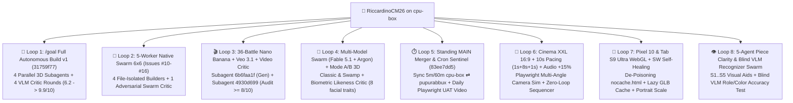

# 🕵️‍♂️🦖 Forensic Analysis on `cpu-box`: Every `/goal`, Multi-Agent Swarm and Complex Antigravity Loop behind CarChess3D (`9–15 October 2026`)

> **Purpose of this document (`article/ANTIGRAVITY_FORENSICS.md`)**: To gather into a single forensic dossier — extracted directly from the `transcript.jsonl` logs under `~/.gemini/antigravity/brain/` on the Linux machine **`cpu-box`** — **all the real numbers, the exact prompts, the `/goal`s, the parallel Swarms, the adversarial VLM Critics and the autonomous loops** that ran on this computer between **9 and 15 October 2026**, ready to be used as raw material for the technical article.

---

## 📊 1. Global Telemetry on `cpu-box` (From the `transcript.jsonl` Logs)

Filtering only the sessions dedicated to **CarChess3D / Plastilina** (excluding threads belonging to other projects), a total of **41 agentic conversations** ran on the **`cpu-box`** machine:

| Forensic Metric (`cpu-box`, `9–14 Oct 2026`) | Exact Value | Detail |
| :--- | :---: | :--- |
| **Total Conversations (`carchess3d`)** | **`41`** | **`13`** human-driven orchestrator sessions + **`15`** subagents/workers (`invoke_subagent`) + **`13`** Native Swarm workers (`swarm`) |
| **Total Trajectory Steps (`step_index`)** | **`12,868`** | Actions, tool calls, reasoning and verifications recorded in the `transcript.jsonl` files |
| **Human Prompts (`USER_INPUT`)** | **`232`** | An average of **~55.4 autonomous steps per single human prompt** |
| **Input Tokens (Fresh)** | **`46,771,223`** | ~46.8M fresh input tokens |
| **Cache Read Tokens (Context Caching)** | **`713,281,606`** | ~713.3M tokens read from cache (**93.8% cache hit ratio**!) |
| **Total Context Tokens Processed** | **`760,052,829`** | **~0.76 Billion tokens** of overall context |
| **Output Tokens Generated (Code + Thinking)** | **`5,341,032`** | ~5.34M tokens generated by the agents |
| **Versions Released on `main`** | **`v0.1.0` → `v0.3.67`** | **68 incremental releases**, each with a 100% green `just test` |
| **New Reusable Skills Created** | **`2`** | `audio-for-riccardos-kids` (TTS family prosody) & `chumbia` (post-session cleanup) |

---

## 🔄 2. The 8 Big Agentic Loops & `/goal`s Executed on `cpu-box`

---

### 🚀 Loop #1: The `/roastme` Pre-Flight (`ee9f741a` + `88f1e5f2`) and the Autonomous `/goal` v1 Sprint (`31759f77`)
- **Conversations**:
  - `ee9f741a-b1e8-483c-a528-5ac8a54954dc` (`178 steps`, Conductor Setup + integration of Geneviève's document + `/roastme`)
  - `88f1e5f2-1f2d-4032-874c-b5e280bcb068` (`138 steps`, drafting of [`etc/prompts/GOAL_BUILD_CARCHESS3D.md`](../etc/prompts/GOAL_BUILD_CARCHESS3D.md) and trailer setup with `Co-authored-by: Gemini 4 Argon`)
  - `31759f77-a8e7-4924-9877-59786b8e27c8` (`2,667 steps`, the main thread of the game)
- **How the `/goal` was born**:
  1. Before writing a single line of code, Riccardo asked for a `/conductor-setup` based on the *Wizard Chess* demo video, on **Niccolò**'s architectural skill ([`.agents/skills/niccolo-game-design/SKILL.md`](../.agents/skills/niccolo-game-design/SKILL.md)) and on **Geneviève's 5 3D Workflows** (metric `floorplan.svg` → 2D concept → parallel subagents → Art Director debug sliders → 4-view Adversarial Critic).
  2. Before launching the `/goal`, Riccardo ran **`/roastme Manca Altro?`** ("Anything missing?", `ee9f741a` steps `142` and `159`) to have the agent perform a pre-emptive self-critique of the spec and close every ambiguity before the autonomous execution.
- **The `/goal` Command launched (`2026-10-10 10:31:42 CEST`, Step `0` of `31759f77`)**:
  > `/goal Build the complete v1 of CarChess3D ("Family Chess" 🚽) in this git worktree by executing conductor/tracks/v1_carchess3d/plan.md end-to-end. Do NOT stop after a couple of rounds — iterate autonomously with parallel subagents, unit tests, and an Adversarial Art Director Critic subagent until every acceptance gate and a >= 9/10 visual rating are achieved.` (full text in [`etc/prompts/GOAL_BUILD_CARCHESS3D.md`](../etc/prompts/GOAL_BUILD_CARCHESS3D.md)).
- **Loop Architecture**:
  1. **Phase 1 (`9m 17s`)**: Generation of [`docs/floorplan.svg`](../docs/floorplan.svg) with real metric coordinates (`y = 0.00m`), 2 *Nano Banana* concepts via subagent `bb0f15b2`, and the [`src/utils/glbGrounding.js`](../src/utils/glbGrounding.js) utility.
  2. **Phase 2 (`7m 03s`)**: 100% Headless TDD Core (`EventBus.js`, `Rng.js` `mulberry32`, `GameLoop.js` `1/30s`, `BoardMapManager.js`, `DropManager.js` with a 10,000-capture Monte-Carlo test, `AIWorkerManager.js`).
  3. **Phase 3 & 4 (`19m 35s`) — Fan-Out of 4 Parallel 3D Subagents**:
     - `196f37f8` (`63 steps`): `ZurichSwampView.js` + `VeoCinemaView.js` + `assets/battles/manifest.yaml`
     - `bccab18f` (`42 steps`): `PieceManager.js` + `PieceView.js` + `BoardInteractionView.js`
     - `af7b0f05` (`60 steps`): `CombatAnimationManager.js` + `VFXPoolView.js`
     - `fe1e4169` (`71 steps`): `WowModeView.js` + `HudListener.js` + `AudioListener.js` + `ProfileStorageListener.js` + PWA `sw.js`
     - **Result**: **+10,081 lines of code and 60 files written in 38 minutes and 6 seconds** from the launch of the `/goal`!
  4. **Phase 5 — The 4-View Adversarial Loop (`265ff1ca`, `56 steps`)**:
     - On every round, Playwright automatically rendered 4 diagnostic views (`Overview 3/4`, `Close-Up`, `Low-Angle y=0`, `Wireframe`), evaluated by the **Adversarial Art Director Critic** subagent:
       - **Round 1 (`6.2 / 10`)**: 5 defects found (dark chessboard, tiny medallions, flat sky).
       - **Round 2 (`9.3 / 10`)**: Lighting, camera and PBR materials fixed.
       - **Round 3 (`9.8 / 10`)**: Imported the 6 real `.glb` files from `main` and discovered the **glTF 2.0** spec bug (an omitted `metallicFactor` = `1.0` pure metal, which multiplied the albedo by zero!).
       - **Round 4 (`9.9 / 10`)**: Captured pieces splashing around in the Swamp on lily pads, the first 3 16:9 `.mp4` videos, and 3D dots for legal moves.

---

### 🐝 Loop #2: The 5-Worker "Zero-Corner-Cutting" Native Swarm for the `6×6` Matrix and the 3D Brawl (`Issues #10–#16`)
- **Parent Conversation**: `31759f77` (Step `801` → `885`, `2026-10-10 13:50` → `15:15 CEST`)
- **Riccardo's Prompt (Step `801`)** (translated):
  > *"Can you create a bug for every single thing I told you and have an adversarial swarm agent drive it. Please, do NOT CUT corners -> do everything; I think building this software will take you 2 days, you went way too fast and cut a ton of corners!"*
- **Swarm Architecture (`CarChess3D Zero-Corner-Cutting 6x6 & 3D Swarm`)**:
  The orchestrator opened GitHub Issues `#10`–`#16` and launched **5 Swarm agents simultaneously** on the shared message board, assigning each of them **absolute exclusive ownership of its files** to eliminate merge conflicts:
  1. **`@matrix36-choreo`** (`30bf6e25`, `49 steps`): Sole owner of `src/core/BattleMatrix36.js`, `scripts/render_battle_videos.py` and the **72 video files (`36 .mp4` + `36 .webm`)** in `assets/battles/videos/`.
  2. **`@brawl3d-vfx`** (`ea3dd428`, `66 steps`): Owner of `CombatAnimationManager.js` and `VFXPoolView.js` — the 3-Act 3D Brawl (`CHARGE!` → `COUNTERATTACK!` → `K.O.!` with a parabolic flight into the swamp and 3D lily pads).
  3. **`@skeletons-locomotion`** (`c3abe6d4`, `67 steps`): Owner of `SkeletonRigHelper.js` and `PieceView.js` — **23 articulated 3D skeletal joints** (including the quadruped skeleton of Seby's horse and the wings of Ale's little dragon), an 8-step walk cycle (`2.0s`), a gallop (`2.2s`) and White-vs-Black frontal orientation.
  4. **`@explorer6x6-ux`** (`16d6e67e`, `108 steps`): Owner of `battles.html`, `HudListener.js` and `BoardInteractionView.js` — the interactive `6×6` Explorer with the **36-Battle Marathon**, 2-finger Mac Trackpad gesture and hover preview of each battle.
  5. **`@adversarial-critic`** (`5416f854`, `147 steps`): **Read-Only Verifier** that wrote and executed [`scripts/adversarial_swarm_audit.py`](../scripts/adversarial_swarm_audit.py), inspecting the work of the other 4 agents on the board before giving the green light (`Round 6`).

---

### 🎬 Loop #3: The 36-Video Veo 3.1 Factory + The Adversarial "Video Critic" Loop (`>= 8.0/10`)
- **Conversations**: `31759f77` → Subagent `6b6faa1f-9b07-4d1d-bc90-172048d75ca6` (`148 steps`) + Subagent `4930d699-f468-41d5-bc56-c9b2fd2fa27d` (`123 steps`)
- **The Problem Reported by Riccardo & Kate (`31759f77`, Steps `1758`–`1904`)**:
  > *"I just showed a lot of videos to my wife and there are things that make very little sense: objects being created and then re-created, towers that vanish and reappear. Since we have 36 videos, I'd like your subagent to do a critical analysis of these videos and re-watch them from beginning to end to make sure they make sense."*
- **How the Loop worked**:
  1. **Keyframe + Video Generation (`6b6faa1f` + [`scripts/generate_nb_veo_battle.py`](../scripts/generate_nb_veo_battle.py))**: For each of the 36 `6×6` battles, the pipeline takes the Attacker's portrait (on the left) and the Defender's (on the right), generates the initial 16:9 keyframe with **Nano Banana 2.1** (`assets/battles/keyframes/<a>_x_<d>.png`) and then animates it for `8.0s` with **Veo 3.1** (`veo-3.1-fast-generate-preview`).
  2. **Automatic Frame-by-Frame Audit (`4930d699`, *Adversarial Video Critic*)**:
     - The subagent used `ffmpeg` to extract a **6-frame contact strip** (`t = 0.0s, 1.5s, 3.0s, 4.5s, 6.0s, 7.5s`) for all 36 `.mp4` videos.
     - It visually inspected all 36 strips looking for **4 forbidden defects**:
       1. *Static Camera Pan ("Death Rose effect")* with no real action;
       2. *Wrong Subject* (e.g. Queen Kate turned into an elderly woman, or a beardless King);
       3. *Cloning / Hallucination* (e.g. a second Puffino conjured out of nowhere while the first one stands still);
       4. *Premature Disappearance* of towers or characters halfway through the clip.
     - It saved the report card, score (`/10`) and rationale for all 36 videos in [`docs/battles/video_audit.yaml`](../docs/battles/video_audit.yaml), moving the rejected videos (`< 8.0/10`) to `assets/battles/videos/archive/` and regenerating them with corrected prompts until they cleared the `>= 8.0/10` threshold!

---

### 🗿 Loop #4: Multi-Model Swarm (`Fable 5.1` + `Argon`), Local 2D→3D Reconstruction (Mode A & Mode B) and the Biometric Critic of Daddy's Face
- **Parent Conversation**: `6d9ce58c-0dd8-4292-af0a-9436af4e3a12` (`1,728 steps`, `38 prompts`)
- **Phase 4A — The Multi-Model Swarm for the *Classic* and *Swamp* Families**:
  - At Riccardo's request (*"let's use claude fable 51 to do the review"* and *"use the Art Critic Adversarial agent to say if they're good or suck"*), the orchestrator launched a mixed Swarm:
    - **`@fable-reviewer`** (`df2103b9`, `49 steps`, model `fable-5.1-high`): Principal Architecture Reviewer of the `classic_default_pieces_20261010` and `swamp_family_pieces_20261010` specs.
    - **`@classic-builder`** (`5866d101`, `157 steps`): Creator of the **Carlessian Classic** family (with the *San Gennaro* Bishop, the *Matildea Tower* and the *Classic Steed*).
    - **`@swamp-builder`** (`7279a12f`, `140 steps`): Creator of the **Ogre's Swamp** family (*Ogre*, *Ogress*, *Don Gatto the Swordsman-Bishop*, the *Chatty 40-Toothed Donkey*, *She-Dragon* and *Focaccina*).
    - **`@art-critic`** (`e254ea04`, `100 steps`, model `fable-5.1-high`): Aesthetic and geometric judge, reporting in `docs/qa-scores.classic.yaml` and `docs/qa-scores.swamp.yaml`.
- **Phase 4B — Inventing Mode A (SDF Dual-Ortho) & Mode B (Dual-Chart Face-Grafting)**:
  - When the remote Hugging Face ZeroGPU quota ran out, the agent on `cpu-box` invented **two local CPU-only algorithms** (later distilled into Niccolò's skill under [`.agents/skills/niccolo-game-design/references/local_2d_to_3d_reconstruction.md`](../.agents/skills/niccolo-game-design/references/local_2d_to_3d_reconstruction.md)):
    1. **Mode A (2D-to-3D Signed Distance Field + Marching Cubes + Taubin Smoothing)**: used to turn the 2D turnaround of the *Classic Steed* and the *Donkey* into real 3D `.glb` files (`22k` triangles) with the 40 teeth in relief!
    2. **Mode B (Dual-Chart `2048×1024` 3D Face-Grafting + Laplacian Multi-Band Blending)**: grafts the high-resolution 2D frontal portrait onto the TRELLIS-generated 3D mesh with no visible seams.
- **Phase 4C — The Adversarial Biometric Loop for King Riccardo's Likeness (`riccardo-likeness-critic`, `a8114d2d`)**:
  - Riccardo's prompt (`6d9ce58c`, Step `1328`):
    > *"Better, but it still doesn't look like me! The quality is MUCH better but the likeness is still LOW. Can you create an adversarial/critique agent that looks at it and iterates until it looks like me? Use the character consistency skill where there are 4-5 reference pictures of me!"*
  - The agent defined a custom subagent (`define_subagent`: **`riccardo-likeness-critic`**) and the script [`tools/model-pipeline/king/adversarial_riccardo_likeness.py`](../tools/model-pipeline/king/adversarial_riccardo_likeness.py), which compares **Riccardo's 5 real photos** (from the `nano-banana-ricc` skill) against the 3D render of the `.glb` across **8 biometric parameters** (smiling hooded brown eyes, vertical glabellar wrinkle, white tuft on the left eyebrow, rounded nose tip, wide smile, very short 2-3 day salt-and-pepper stubble, silver temples, no glasses), iterating on 3D vertex sculpting and UV projection (`adversarial_iter_1..3.png`) until the biometric test passed!

---

### ⏱️ Loop #5: The "MAIN Merger & Cron Sentinel" + The Daily Playwright UAT Loop with Videos on GitHub Issues
- **Conversation**: `83ee7dd5-1b0d-4298-a645-80906446de26` (**`2,137 steps`** spanning 5 days, `2026-10-10` → `2026-10-14`)
- **The Initial Prompt (`83ee7dd5`, Step `0`)**:
  > *"You're the MAIN agent for this computer. Every 5min, check for remote main pushes, and remote branches. Decide critically to merge them if good, or comment on them if not good or if they need manual work."*
- **The Second Prompt on the UAT Cron (`83ee7dd5`, Steps `1238` & `1407`)**:
  > *"Set up a DAILY cron that runs the unit tests, takes a look at the code overall (if there were commits) and maybe tries to play a game itself (integration test) and records a video of its UAT (max 1 minute) doing normal things and crazy things like clicking a button 10 times to see if it breaks... Ideally this task will generate a GHI called 'Gemini UAT $YYYYMMDD' with a unique tag, which also records a little movie of the game and attaches it to the GHI."*
- **What this Loop did autonomously**:
  1. It managed the **multi-machine, multi-worktree traffic** (`cpu-box` ⇄ `pupurabbux` + 9 local worktrees on `cpu-box`), running `git fetch --all --prune`, executing `just test` on every incoming branch, resolving conflicts on `VERSION` / `CHANGELOG.md` / `Registry.js` and keeping `origin/gh-pages` in sync.
  2. It built [`scripts/daily_uat_playtest.py`](../scripts/daily_uat_playtest.py) and [`etc/prompts/daily_uat_prompt.md`](../etc/prompts/daily_uat_prompt.md) (`just daily-uat`): it launches headless Chromium via Playwright, plays a real 3D chess game against CPU Easy up to a capture + 16:9 Cinema + a **monkey-test of 10 rapid clicks on the `🐸 Palude` (Swamp) button** (verifying that the pieces in the swamp stay at exactly 6 without duplicating and that there are `0` console/WebGL errors), encodes the `< 1 min` video and automatically updates GitHub Issue **#18 (`Gemini UAT 20261011`)** with the video asset uploaded to the `uat-media-20261011` release tag!

---

### 🍿 Loop #6: Cinema XXL (`videoBoost=1.75`, Chessboard `90%` Alpha), `10s` Pacing (`1s+8s+1s`) and `+15%` Zero-Loop Audio
- **Conversations**: `f0239601-69e2-43f3-9427-0242308a9cc9` (`1,663 steps`) + `bb46bb1c-57a2-4ea3-9f99-d694b81b8aea` (`495 steps`) = **`2,158 steps`**
- **The Multi-Angle Camera Simulation Loop (`f0239601`, Steps `532`–`915`)**:
  - Riccardo wanted that, during every capture, the surrounding 3D world would fade into cinematic darkness, the chessboard would become `90%` transparent (`alpha = 0.10`), the top and bottom HUD would disappear completely, and the 16:9 Big Screen behind the two challengers would grow by `+75%` (`videoBoost = 1.75`).
  - The agent wrote a Playwright script that played a real game, captured screenshots from 3 different angles during the battle and generated a comparison grid of experiments (`Experiment 1 / 2 / 3`) until Riccardo picked **Experiment 3 (Cinema XXL)**.
- **The Math of the `10.0s` Pacing (`1s + 8s + 1s`, Steps `1190`–`1504`)**:
  - Riccardo noticed that if the `8.0s` video started in the very same millisecond as the attack, the user lost the first `1–2s` during the camera movement.
  - The loop restructured the combat timeline to **exactly `10.0s`**:
    - `0.0s → 1.0s` (**1s Pre-Roll**): the camera zooms onto the 2 challengers, the HUD disappears, the chessboard fades to 90% and the screen shows the first frame as a freeze-frame.
    - `1.0s → 9.0s` (**8s Video Play**): the 16:9 video plays from start to finish, synchronized with the 3 Acts of the 3D brawl.
    - `9.0s → 10.0s` (**1s Post-Roll**): victory pose and a soft cross-fade before returning to the game view.
- **Music Calibration (`v0.3.66`, Step `1528`)**:
  - Removed the mid-battle loop of `combat-suspense.mp3` (`loop = false`, cue point with `>= 14.0s` of continuous headroom) and calibrated the combat volume to **exactly `+15%` (`1.15×`, `0.276` vs `0.24`)** relative to the regular music.

---

### 📱 Loop #7: Mobile Simulation (Pixel 10 & Galaxy Tab S9 Ultra) and Self-Healing Service Worker (`nocache.html`)
- **Conversations**: `2d1de421-57c6-40ab-9e8a-a0c2f639d28d` (`308 steps`) + `89883073-b36a-44ef-901d-be87ec32d9d7` (`384 steps`) + `a3907ba3-0cf9-4ea1-9790-274f06cacf35` (`131 steps`) = **`823 steps`**
- **The Forensic Diagnosis of the Mobile Crash and the Cache Trap**:
  1. **The WebGL Crash on Pixel 10 (`89883073`)**: By simulating the exact viewports of the **Pixel 10** (`412×915`, DPR `2.625`) and the **Galaxy Tab S9 Ultra** (`1424×890`) in [`scripts/simulate_mobile_devices.py`](../scripts/simulate_mobile_devices.py), the agent discovered that simultaneously precaching 35 MB of `.glb` on first launch + a 2048² shadow map was sending the mobile GPU into OOM. Fixed with `Mobile Lite 3D` + on-demand lazy caching and the [`nocache.html`](../nocache.html) permalink.
  2. **The Mystery of the Service Worker Re-Poisoning (`a3907ba3`, `v0.3.52`)**:
     - When Riccardo visited `/carchess3d/` on the Pixel 10 after an update, the page stayed stuck on an old version even after visiting `nocache.html`!
     - **Root cause found by the agent**: when `nocache.html` called `fetch(url, { cache: 'reload' })` while the *old* Service Worker was still the tab's active `navigator.serviceWorker.controller`, those requests went through the old Service Worker's `fetch` handler, which **wrote the stale responses back into `CacheStorage` one millisecond after `caches.delete()`**!
     - **Definitive Fix**: `nocache.html` now detects whether there is an active controller, performs `unregister()` + `caches.delete()`, executes an **immediate reload with a `sessionStorage` guard** to detach the controller, and *only then* warms up the HTTP cache with `{ cache: 'reload' }`. In addition, `index.html` always checks `./VERSION` (never cached by the SW) before importing `./src/main.js`.

---

### 👁️ Loop #8: The 5-Agent Swarm for "Piece Visual Clarity" & The Blind VLM Recognizer (`Issue #32`)
- **Parent Conversation**: `2b03779c-a065-4eb0-ae6b-59028f5271b8` (`127 steps`) → Swarm Workers `08c6d70e` (`90 steps`), `3a385e2a` (`78 steps`), `30de5370` (`87 steps`), `eaccf00d` (`67 steps`)
- **The Real Problem that Emerged while Playing with the Kids (`2b03779c`, Step `0`)**:
  > *"Playing with the kids I noticed there's a mental and visual 'fatigue' in recognizing the pieces. The pieces are gorgeous, but from above you struggle to tell who's white and who's black, so I'd like you to put together a series of proposals... and then use a Critic agent to figure out whether the improvement is VISIBLE and significant."*
- **The S1..S5 Swarm (`Piece Visual Recognition & Adversarial VLM Swarm`)**:
  - **`@clarity-engine`** (`08c6d70e`): Implemented `src/views/PieceClarityHelper.js` with 4 combinable layers:
    - `S1`: High-contrast pedestals (warm Ivory with a gold ring vs Obsidian with a cyan/silver ring);
    - `S2`: 3D crowns/emblems of the chess role above the head;
    - `S3`: Billboard medallions `♔♕♖♗♘♙` always facing the camera;
    - `S4`: Fresnel/Rim shader glowing outline to separate White from Black.
  - **`@hud-ux`** (`3a385e2a`): HUD button `👁️ Chiarezza` (Clarity: `Off / Base / Full / Custom`), options in the Setup Modal and a **Quake Console (`~` / `\``)** with live `s1..s5` and `clarity` commands.
  - **`@glb-baker`** (`30de5370`): Headless Blender script `tools/model-pipeline/bake_universal_role_addons.py` to bake the universal chess attributes directly into the `.glb` files (`S5`).
  - **`@vlm-critic`** (`eaccf00d`): **Blind VLM Recognizer** (`scripts/critic_recognizability.py`) that renders the chessboard at `0°` (top-down) and `30°` with `Clarity OFF` vs `Clarity ON` and *blindly* queries the Gemini VLM, asking it to guess the role and team of every piece in order to scientifically measure the recognizability gain (`docs/clarity_vlm_report.md`).

---

## 🗂️ 3. Complete Register of Antigravity Conversations on `cpu-box` (`9–15 October 2026`)

### A. The 13 Orchestrator Sessions (Driven by `RiccardinoCM26 🦖`)

| Start Date (UTC) | Conversation ID (`8 char`) | Steps | Human Prompts | Input Tokens | Cache Read Tokens | Output Tokens | Role and Main Outcome |
| :---: | :--- | :---: | :---: | :---: | :---: | :---: | :--- |
| `2026-10-09 16:33` | `33941bd3` | `4` | `1` | `51,104` | `40,888` | `172` | Initial lookup of the `~/git/carchess3d` path. |
| `2026-10-09 16:33` | `ee9f741a` | `178` | `22` | `1,726,557` | `5,199,762` | `43,891` | **Conductor SDD Setup (`conductor/tracks/v1_carchess3d/`)**, *Wizard Chess* video analysis, integration of Geneviève's 3D workflows and a double **`/roastme`** pre-flight. |
| `2026-10-10 07:37` | `83ee7dd5` | `2,137` | `17` | `5,845,087` | `131,538,272` | `531,710` | **MAIN Merger & Cron Sentinel (5 days)**: continuous `cpu-box` ⇄ `pupurabbux` sync + local worktrees, English default UI for Grandma Susan, and the **`just daily-uat`** pipeline with Playwright video on GHI `#18`. |
| `2026-10-10 07:38` | `88f1e5f2` | `138` | `11` | `854,970` | `5,592,656` | `49,002` | Creation of the mega-prompt [`etc/prompts/GOAL_BUILD_CARCHESS3D.md`](../etc/prompts/GOAL_BUILD_CARCHESS3D.md) and GitHub co-author setup for `Gemini 4 Argon`. |
| `2026-10-10 07:44` | `42b53d50` | `154` | `10` | `1,340,328` | `6,699,584` | `97,118` | Fixes and architecture of `gprism` to sync private files (`private/argon-tricks.md`) between `cpu-box` and `pupurabbux`. |
| `2026-10-10 08:29` | `6d9ce58c` | `1,728` | `38` | `5,778,875` | `102,319,331` | `862,434` | **Classic & Swamp Families Track + Mode A/B 2D-to-3D + King Riccardo's Biometric Critic (`riccardo-likeness-critic`)**. |
| `2026-10-10 08:31` | `31759f77` | `2,667` | `49` | `8,510,132` | `149,635,602` | `1,148,991` | **The `/goal` v1 Sprint (`38m` to the first complete 3D game!) + 6×6 Swarm (36 battles) + 36 Veo 3.1 Videos + Family TTS Voices (`audio-for-riccardos-kids` skill) + Lyria 3 String Soundtrack**. |
| `2026-10-10 12:26` | `20906023` | `256` | `7` | `1,292,560` | `19,803,990` | `72,462` | TDD fix of the CPU turn (`AIWorkerManager`), removal of the external dependency on `palladius/respec` and setup of `.riccardo/vatranquel/git-push-any-branch`. |
| `2026-10-10 12:35` | `bb46bb1c` | `495` | `5` | `2,791,639` | `28,651,532` | `299,775` | Idempotency of `🐸 Palude` (`seedSwampParty`), camera auto-zoom on the 2 pieces during the battle, and Checkmate celebration. |
| `2026-10-11 01:23` | `f0239601` | `1,663` | `27` | `5,536,512` | `106,429,336` | `682,544` | **Game Start Setup Modal + Cinema XXL Big Screen (`videoBoost=1.75`, Chessboard `90%` Alpha) + `10s` Battle Pacing (`1s+8s+1s`) + `+15%` Zero-Loop Combat Music (`v0.3.66`)**. |
| `2026-10-11 08:46` | `2d1de421` | `308` | `8` | `1,709,729` | `19,285,473` | `144,586` | **Mobile Simplified UX**: bottom dock with Material/SVG icons, collapsible top bar and non-caching of `VERSION`. |
| `2026-10-11 19:16` | `89883073` | `384` | `8` | `1,329,485` | `20,608,692` | `105,289` | **WebGL Fix for Pixel 10 & Galaxy Tab S9 Ultra (`simulate_mobile_devices.py`)** + creation of [`nocache.html`](../nocache.html) with real `.glb` models on mobile. |
| `2026-10-13 08:05` | `a3907ba3` | `131` | `6` | `465,580` | `5,477,578` | `57,903` | **Self-Healing Service Worker De-Poisoning (`v0.3.52`)** + Android Pull-to-Refresh + Portrait Camera Framing (`portraitScale`). |
| `2026-10-13 08:12` | `2b03779c` | `127` | `1` | `830,998` | `4,620,551` | `39,934` | **`S1..S5` Swarm Orchestrator for Piece Visual Recognizability (Issue `#32`)**. |
| `2026-10-13 16:39` | `11d4feea` | `267` | `6` | `1,022,744` | `12,198,794` | `32,427` | **Backstage unification into `🎬 Cinema Eroi POV` (`./showcase/?view=pov`, `v0.3.64`)** + birth of the global **`chumbia`** skill. |
| `2026-10-14 10:47` | `59f8e80d` | `157` | `3` | `526,308` | `6,065,694` | `25,796` | *(This session)* Cropping the "The Real UAT" photo of Ale & Seby on the tablet + full forensic investigation of `cpu-box` under `article/`. |

---

### B. The 25 Subagents & Swarm Workers Launched in Parallel on `cpu-box`

| Group / Loop | Worker ID (`8 char`) | Type | Steps | Input Tokens | Cache Read Tokens | Output Tokens | Specific Task |
| :--- | :--- | :---: | :---: | :---: | :---: | :---: | :--- |
| **Loop #1 (`/goal` Phase 1)** | `bb0f15b2` | Subagent | `8` | `14,757` | `16,204` | `3,112` | Generation of 2 16:9 *Nano Banana* concepts of the Zurich Swamp (`docs/concepts/`). |
| **Loop #1 (`/goal` Phase 3)** | `196f37f8` | Subagent | `63` | `251,362` | `3,034,254` | `42,514` | **Subagent 1**: `ZurichSwampView.js` + `VeoCinemaView.js` + `manifest.yaml`. |
| **Loop #1 (`/goal` Phase 3)** | `bccab18f` | Subagent | `42` | `160,947` | `1,454,993` | `38,346` | **Subagent 2**: `PieceManager.js` + `PieceView.js` + `BoardInteractionView.js`. |
| **Loop #1 (`/goal` Phase 3)** | `af7b0f05` | Subagent | `60` | `187,719` | `2,002,856` | `29,409` | **Subagent 3**: `CombatAnimationManager.js` + `VFXPoolView.js` (6×6 VFX). |
| **Loop #1 (`/goal` Phase 3)** | `fe1e4169` | Subagent | `71` | `234,598` | `3,169,888` | `46,990` | **Subagent 4**: `WowModeView.js` + `HudListener.js` + `AudioListener.js` + `sw.js`. |
| **Loop #1 (`/goal` Phase 5)** | `265ff1ca` | Subagent | `56` | `374,814` | `1,801,507` | `21,684` | **Adversarial Art Director Critic** (Round 1 `6.2` → Round 2 `9.3` → Round 3 `9.8` → Round 4 `9.9/10`). |
| **Loop #2 (Swarm 6×6)** | `30bf6e25` | Swarm `@matrix36-choreo` | `49` | `156,368` | `1,322,526` | `39,528` | `BattleMatrix36.js` + rendering of all 72 videos (`36 .mp4` + `36 .webm`, Issue `#11`). |
| **Loop #2 (Swarm 6×6)** | `ea3dd428` | Swarm `@brawl3d-vfx` | `66` | `427,189` | `2,720,068` | `56,729` | 3-Act 3D Brawl with 3D weapons, counterattack and K.O. into the lily pads (`#10`, `#15`). |
| **Loop #2 (Swarm 6×6)** | `c3abe6d4` | Swarm `@skeletons-locomotion` | `67` | `312,409` | `4,087,600` | `81,508` | 23-joint 3D skeletons (`SkeletonRigHelper.js`), 2.0s walk cycle and 2.2s gallop (`#12`, `#14`). |
| **Loop #2 (Swarm 6×6)** | `16d6e67e` | Swarm `@explorer6x6-ux` | `108` | `360,393` | `7,239,792` | `77,084` | `battles.html` page, 6×6 Matrix modal and 2-finger Mac Trackpad controls (`#11`, `#13`, `#16`). |
| **Loop #2 (Swarm 6×6)** | `5416f854` | Swarm `@adversarial-critic` | `147` | `394,621` | `8,808,914` | `62,828` | Read-Only Verifier of the 6×6 Swarm (`scripts/adversarial_swarm_audit.py`). |
| **Loop #3 (36 Veo Videos)** | `6b6faa1f` | Subagent | `148` | `711,198` | `8,409,553` | `65,651` | **Nano Banana 2.1 + Veo 3.1** pipeline to generate the 36 16:9 battles. |
| **Loop #3 (Video Critic)** | `4930d699` | Subagent | `123` | `418,861` | `1,940,332` | `41,854` | **Adversarial Video Critic**: 6-frame strip extraction and `>= 8/10` audit in `docs/battles/video_audit.yaml`. |
| **Loop #4 (Classic/Swamp)** | `df2103b9` | Swarm `@fable-reviewer` | `49` | `156,027` | `1,270,597` | `31,310` | Architectural review with **Claude Fable 5.1 High** of the Classic & Swamp tracks. |
| **Loop #4 (Classic/Swamp)** | `5866d101` | Swarm `@classic-builder` | `157` | `559,298` | `6,378,688` | `116,909` | Generation of 2D portraits and 3D models of the **Classic** family. |
| **Loop #4 (Classic/Swamp)** | `7279a12f` | Swarm `@swamp-builder` | `140` | `354,368` | `5,752,739` | `138,306` | Generation of 2D portraits and 3D models of the **Swamp** family. |
| **Loop #4 (Classic/Swamp)** | `e254ea04` | Swarm `@art-critic` | `100` | `397,800` | `2,210,638` | `25,659` | Aesthetic/geometric Critic (**Fable 5.1 High**) in `qa-scores.classic.yaml` & `qa-scores.swamp.yaml`. |
| **Loop #4 (Biometric King)** | `a8114d2d` | Subagent `riccardo-likeness-critic` | `13` | `22,332` | `36,497` | `3,850` | 8-facial-trait biometric analysis against Riccardo's 5 real photos (`nano-banana-ricc`). |
| **Loop #1 (Lyria Audio)** | `210b734f` | Router Worker | `76` | `206,230` | `2,791,257` | `30,104` | Creation of an interactive HTML player (`showcase/audio.html`) to compare the Lyria 3 string loops. |
| **Loop #1 (Lyria Audio)** | `f3a383ac` | Router Summarizer | `3` | `47,317` | `0` | `1,368` | Response synthesis for the Lyria 3 audio player. |
| **Loop #1 (Lyria Audio)** | `c1aeb103` | Router Worker | `222` | `513,097` | `11,891,023` | `39,692` | Set the Staccato Overture as default, Chamber Strings on castling and the comic `BUAHAHAH / Oh no!` jingle on checkmate (`v0.3.45`). |
| **Loop #1 (Lyria Audio)** | `4e18285b` | Router Summarizer | `3` | `100,468` | `0` | `1,102` | Final synthesis of the `v0.3.45` audio changes. |
| **Loop #8 (Clarity Swarm)** | `08c6d70e` | Swarm `@clarity-engine` | `90` | `234,813` | `4,187,093` | `57,896` | `PieceClarityHelper.js` (`S1` pedestals, `S2` 3D crowns, `S3` billboard medallions, `S4` rim shader). |
| **Loop #8 (Clarity Swarm)** | `3a385e2a` | Swarm `@hud-ux` | `78` | `209,615` | `3,486,364` | `23,441` | `👁️ Chiarezza` (Clarity) HUD controls and Quake Console (`~` / `\``) `s1..s5`. |
| **Loop #8 (Clarity Swarm)** | `30de5370` | Swarm `@glb-baker` | `87` | `313,125` | `3,086,958` | `40,719` | `bake_universal_role_addons.py` to bake the chess attributes into the `.glb` files (`S5`). |
| **Loop #8 (Clarity Swarm)** | `eaccf00d` | Swarm `@vlm-critic` | `67` | `139,357` | `2,013,530` | `30,507` | **Blind VLM Recognizer** (`scripts/critic_recognizability.py`) at `0°` and `30°`. |

---

## 💬 4. Anthology of the Finest "Carlessian" Prompts Given on `cpu-box` (Ready to Quote in the Article)

1. **The Idea of the 16:9 Veo Mirror + 3D Brawl (`ee9f741a`, 10 Oct `08:34 CEST`)**:
   > *"Since making a complex 3D animation for 36 combinations is expensive, I was thinking: in the 3D view the two characters walk up to each other and have a cartoonish brawl, but in the background there's a 16:9 screen where we project a video generated with Veo! We take photo 1 on the left, photo 2 on the right, Nano Banana creates the initial frame and Veo generates the 8 seconds of battle!"*
2. **The Discovery of Ale's PBR Fix (`31759f77`, 10 Oct `12:00 CEST`)**:
   > *"This is AMAZING! But is it a Nano Banana mock or a REAL render of Alessandro? How on earth did you make it look this good? The GLB I have of Ale looks TERRIBLE..."*
3. **The Swamp for the Eaten Pieces (`31759f77`, 10 Oct `12:18 CEST`)**:
   > *"A cute thing -> the dead pieces could splash around in the [Ogre's] swamp :)"*
4. **The Prompt that Unleashed the "Zero-Corner-Cutting" `6×6` Swarm (`31759f77`, 10 Oct `13:50 CEST`)**:
   > *"Can you create a bug for every single thing I told you and have an adversarial swarm agent drive it. Please, do NOT CUT corners -> do everything; I think building this software will take you 2 days, you went way too fast and cut a ton of corners!"*
5. **Kate's Audit of the 36 Videos (`31759f77`, 11 Oct `09:01 CEST`)**:
   > *"I just showed a lot of videos to my wife and there are things that make very little sense: objects being created and then re-created, towers that vanish and reappear. Since we have 36 videos, I'd like your subagent to do a critical analysis of these videos and re-watch them from beginning to end to make sure they make sense."*
6. **The Biometric Critic of Daddy's Face (`6d9ce58c`, 11 Oct `14:18 CEST`)**:
   > *"Better, but it still doesn't look like me! The quality is MUCH better but the likeness is still LOW. Can you create an adversarial/critique agent that looks at it and iterates until it looks like me? Use the character consistency skill where there are 4-5 reference pictures of me!"*
7. **The Family Voices and the "CafoNAZZO" Case (`31759f77`, 11 Oct `21:56 CEST`)**:
   > *"Create a nice skill! Put in examples, something where they say 'Papino ti manco tantissimo!' (Italian is their third language so they get 'I miss you' backwards :P which is super cute) and 'sei proprio un cafoNAZZO!' with the stress on NAZZO, for Seby 'Mummy, can you clean my bottooooom?' with the ending drawn out, and for Kate 'Don't be FACETIOUS!'"*
8. **The Daily Playwright UAT Cron with Video (`83ee7dd5`, 11 Oct `03:29 CEST`)**:
   > *"Set up a DAILY cron that runs the unit tests, takes a look at the code overall and tries to play a game itself (integration test) and records a video of its UAT (max 1 minute) doing normal things and crazy things like clicking a button 10 times to see if it breaks... and generates a GHI called 'Gemini UAT $YYYYMMDD' with the movie of the game attached!"*
9. **The Visual Fatigue while Playing with the Kids (`2b03779c`, 13 Oct `10:12 CEST`)**:
   > *"Playing with the kids I noticed there's a mental and visual 'fatigue' in recognizing the pieces. The pieces are gorgeous, but from above you struggle to tell who's white and who's black, so I'd like you to put together a series of proposals... and then use a Critic agent to figure out whether the improvement is VISIBLE and significant."*

---

## 📁 5. Index of Loop Prompts and Scripts in the Repository

- **`/goal` & Loop Prompts saved in [`etc/prompts/`](../etc/prompts/)**:
  - [`etc/prompts/GOAL_BUILD_CARCHESS3D.md`](../etc/prompts/GOAL_BUILD_CARCHESS3D.md) — The complete 5-phase `/goal` launched on `cpu-box` on 10 October.
  - [`etc/prompts/GOAL_AUTONOMOUS_DAY_OF_CODE.md`](../etc/prompts/GOAL_AUTONOMOUS_DAY_OF_CODE.md) — The 5-pillar `/goal` for the modular piece variants, Seby's 3 weapons and the King Riccardo remaster.
  - [`etc/prompts/PROMPT_OPTION_A_AUTONOMOUS_LOOP.md`](../etc/prompts/PROMPT_OPTION_A_AUTONOMOUS_LOOP.md) — Autonomous VLM self-correction loop (`tools/model-pipeline/critic/refine_loop.py`).
  - [`etc/prompts/PROMPT_OPTION_B_FACE_DECAL_PROJECTION.md`](../etc/prompts/PROMPT_OPTION_B_FACE_DECAL_PROJECTION.md) — Decal Projection / UV Face-Grafting in Blender.
  - [`etc/prompts/PROMPT_OPTION_C_MODULAR_DEEP_DIVE.md`](../etc/prompts/PROMPT_OPTION_C_MODULAR_DEEP_DIVE.md) — Modular assembly of character + separate props (`assemble_modular_ale2.py`).
  - [`etc/prompts/daily_uat_prompt.md`](../etc/prompts/daily_uat_prompt.md) — Prompt of the daily `Gemini UAT YYYYMMDD` cron job.
- **Critic & Adversarial Loop Scripts**:
  - [`tools/model-pipeline/critic/critic_vlm.py`](../tools/model-pipeline/critic/critic_vlm.py) & [`tools/model-pipeline/critic/refine_loop.py`](../tools/model-pipeline/critic/refine_loop.py) — 3D VLM + geometric Critic and multi-seed loop.
  - [`tools/model-pipeline/king/adversarial_riccardo_likeness.py`](../tools/model-pipeline/king/adversarial_riccardo_likeness.py) — 8-trait biometric loop for King Riccardo's facial likeness.
  - [`tools/model-pipeline/critic/critic_audio.py`](../tools/model-pipeline/critic/critic_audio.py) — PCM acoustic Critic + multimodal Gemini 3.8 Flash for the kids' voices.
  - [`scripts/adversarial_swarm_audit.py`](../scripts/adversarial_swarm_audit.py) — Automatic Verifier of the `6×6` Swarm.
  - [`scripts/daily_uat_playtest.py`](../scripts/daily_uat_playtest.py) — Headless Playwright playtester with video recording and publication to GitHub Issues.
