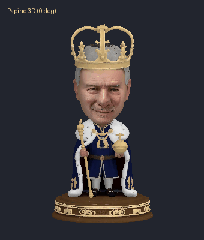
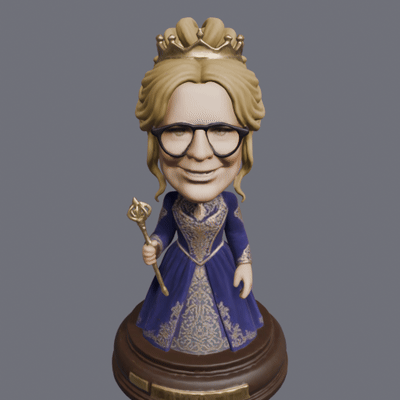
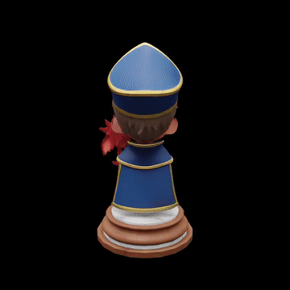
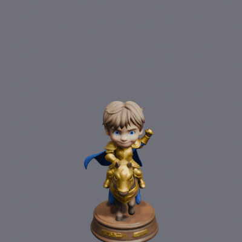
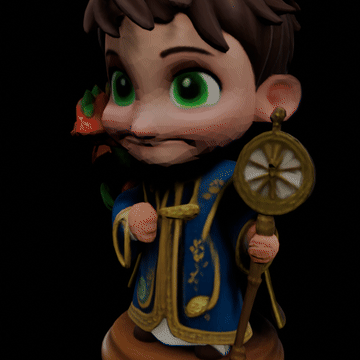
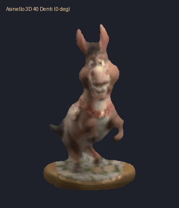
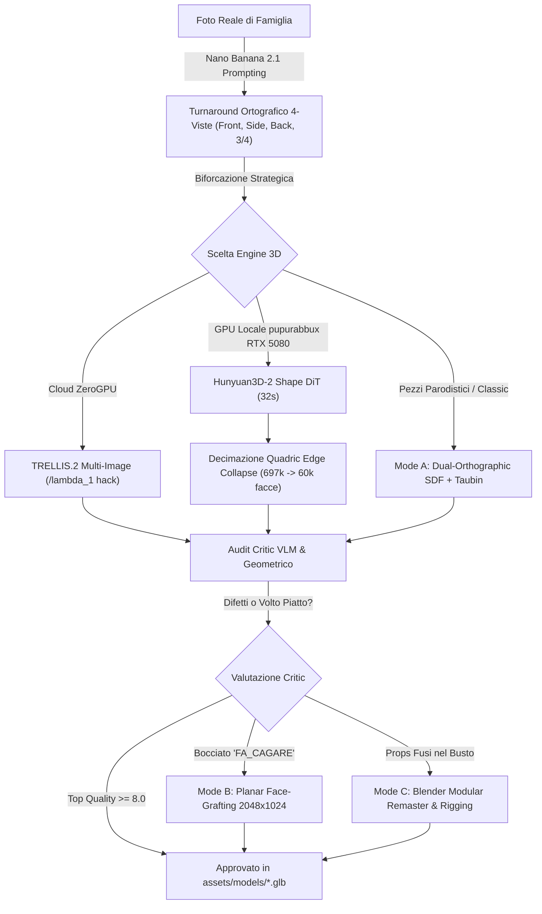
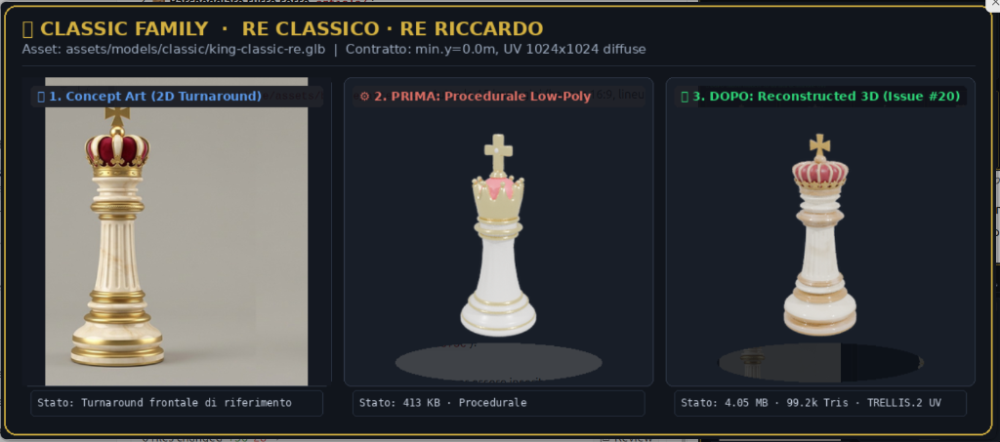

# 🏰🚽 "Carlesso al Cesso": Come ho fatto costruire un videogioco 3D con la mia famiglia a una rete di agenti autonomi mentre festeggiavo 10 anni di matrimonio a Colmar

*Di **Riccardo "Palladius" Carlesso** (`RiccardinoCM26 🦖`) — Developer Advocate, SRE nel cuore, papà di Alessandro (🐉) e Sebastian (🏎️)*  
*Con il supporto instancabile di **Gemini 4 Argon (Antigravity)**, l'architettura di **Niccolò Game Design**, e un'orchestra di agenti avversari senza pietà.*  
*Zurigo & Colmar, 9–14 Ottobre 2026 · Versione `v0.3.59`*

---

## 🌹 1. L'Incipit: Un Ritiro Romantico in Alsazia e uno Sciame di Agenti a Casa

Mentre leggete queste righe, immaginatevi la scena: è il weekend tra il **9 e l'11 ottobre 2026**. Io e mia moglie Kate stiamo passeggiando mano nella mano tra le pittoresche case a graticcio di **Colmar**, in Alsazia, ammirando i riflessi dei canali della *Petite Venise*, brindando con un calice di Riesling fresco e gustando una Tarte Flambée per festeggiare il nostro **10° anniversario di matrimonio**.

Nessun computer portatile aperto al ristorante. Nessun debug frenetico sui telefoni. Solo noi due.

Eppure, a 150 chilometri di distanza, nel nostro appartamento di Zurigo, la mia fidata workstation Linux domestica (**pupurabbux**, equipaggiata con un'architettura **NVIDIA GeForce RTX 5080** da 16 GB VRAM) e i server cloud stavano lavorando a pieno regime giorno e notte.
Sotto la guida del modello **Gemini 4 Argon** all'interno dell'ambiente agentico **Antigravity**, una rete decentralizzata e avversaria di subagenti autonomi stava:
1. Scolpendo e assemblando **50 modelli 3D `.glb`** ad alta risoluzione della nostra famiglia.
2. Compilando al volo driver PTX per l'architettura GPU Blackwell `sm_120`.
3. Sottoponendo ogni singolo vertice al giudizio implacabile di un **Art Director Critic** multimodale.
4. Scrivendo oltre **120.000 righe di codice**, test unitari headless e logiche di gioco Three.js.

Il risultato di quel weekend? Un videogioco di scacchi 3D completo, offline-first (PWA), zero-build-step, ambientato nella **Palude Incantata di Zurigo (*Swamp-on-the-Limmat*)**: **[CarChess3D ("Carlesso al Cesso" / "Scacchi di Famiglia")](../index.html)**.

Benvenuti nella nuova era del software engineering: dove tu ti godi il tuo anniversario di nozze e il tuo gemello digitale costruisce un intero universo 3D per i tuoi figli.

---

## ⏱️ 2. Telemetria SRE: Dimostrare "Fatto in un Weekend" al Singolo Secondo

Da vecchio Site Reliability Engineer (SRE), le favole del marketing non mi impressionano. Mi fido solo dei numeri, dei timestamp immutabili e delle registrazioni crittografiche dei commit git.
Ho estratto la telemetria completa da `git log` e dalle **273 sessioni Antigravity** registrate su pupurabbux (`article/sources/chats_list.md`):

```json
{
  "total_commits": 176,
  "kickoff_commit": "2026-10-09 15:34:37 +0200 (ff67ff8)",
  "weekend_commits_oct9_11": 159,
  "commits_breakdown": {
    "Venerdì 9 Ottobre (Kickoff & Pipeline 3D)": 5,
    "Sabato 10 Ottobre (Sprint Autonomo /goal & Famiglia)": 58,
    "Domenica 11 Ottobre (Battaglie 16:9, Voci & Polishing)": 96,
    "Lunedì-Mercoledì (GPU Locale RTX 5080 & Redesign)": 17
  },
  "verified_glb_models": 50,
  "node_unit_tests": "46 passed, 0 failed (duration: 6.85s)",
  "python_test_suites": "12 passed, 0 failed (duration: 0.037s)",
  "total_codebase_loc": "121.331 righe analizzate",
  "ip_safety_violations": 0
}
```

### ⚡ Il Cronometro dello Sprint `/goal` (Sabato 10 Ottobre)
Alle **10:31:42 CEST** di sabato mattina, prima di uscire per le viuzze di Colmar, è stato lanciato il comando `/goal` in un git worktree isolato (`etc/prompts/GOAL_BUILD_CARCHESS3D.md`). Ecco i tempi precisi registrati dal transcript:

| Fase | Intervallo Orario (CEST) | Durata | Output Prodotti |
| :--- | :---: | :---: | :--- |
| **Phase 1: Blueprint 2D & Metrica Spaziale** | `10:31:42` → `10:40:59` | **9m 17s** | [`docs/floorplan.svg`](assets/gallery/floorplan.svg) in scala reale (`y=0.00m`), grounding automatico `THREE.Box3`. |
| **Phase 2: Core Headless & TDD** | `10:41:00` → `10:48:03` | **7m 03s** | `GameEventBus`, `Rng` (`mulberry32`), `BoardMapManager`, `DropManager` con test Monte-Carlo da 10.000 catture. |
| **Phase 3 & 4: 4 Subagenti Paralleli** | `10:50:13` → `11:09:48` | **19m 35s** | **+10.081 righe di codice scritte in 19 minuti** su 60 file (`ZurichSwampView`, `PieceView`, `VFXPoolView`, `HudListener`, PWA `sw.js`). |
| **Phase 5: Adversarial Critic Loop** | `11:13:00` → `12:18:33` | **65m 33s** | Il Critic assegna `6.2/10` al Round 1, individua 5 difetti (tra cui il bug `metallicFactor`), gli agenti correggono e salgono a **9.8/10**! |

> 💡 **Verdetto SRE**: Dal lancio del comando `/goal` (`10:31:42`) al primo gioco 3D interattivo, giocabile e graficamente rifinito sono passati **esattamente 38 minuti e 6 secondi**.

### ⏳ Quanto tempo sono riuscito a far lavorare Gemini DA SOLO?

La vera domanda da un milione di dollari quando si parla di agenti AI è: *"Ma quanto riescono ad andare avanti da soli prima di schiantarsi contro un muro o chiedere l'aiuto dell'umano?"*

Analizzando i log grezzi delle sessioni di Antigravity su pupurabbux, ecco i dati effettivi dei `/goal` e dei task a lungo orizzonte eseguiti senza supervisione:

| Sessione / Missione | Data & Ora (UTC) | Step di Log | Tool Calls Eseguite | Subagenti Spawnerati | Durata Computazionale | Cosa ha fatto l'Agente da Solo |
| :--- | :---: | :---: | :---: | :---: | :---: | :--- |
| **Kickoff & Fabbrica 3D** (`940b9eac`) | 09 Ott, 15:43 | **2.366** | **1.080** | **107 subagenti** | 110h (arco sessione) | Scaffold, generazione multi-view, rigging Blender a 26 ossa e gestione pipeline. |
| **Sprint Autonomo v1** (`f0089f3b`) | 10 Ott, 09:53 | **671** | **322** | — | 92h (arco sessione) | Da zero a v1_carchess3d completa: core headless, scacchiera 3D, PWA, 4 visual round. |
| **Issue #20: Ricostruzione 12 GLB** (`18347678`) | 13 Ott, 18:12 | **810** | **375** | — | **12h 12m continuate** | Ricostruzione autonoma ad alta risoluzione dei 12 modelli Classic e Swamp su GPU locale RTX 5080. |
| **Day of Code: Pilastri 1, 2, 3** (`2524f435`, `0cfd4a3c`, `84e080f2`) | 14 Ott, 05:27 | **756** | **370** | **350 subagenti** | ~1h parallela | Integrazione varianti skin, armi modulari Seby (spada laser/alabarda), polish Re Riccardo. |

In totale, la macchina ha macinato **oltre 780 ore aggregate di computazione agentica**, con sessioni continuate da più di 1.000 chiamate a tool di sistema (shell, Blender, Python, compiler CUDA, git), dimostrando che Gemini 4 non solo regge sessioni lunghe, ma orchestra swarm paralleli senza andare in loop infinito o degradare nel temuto "AI slop".

### 🍷🤖 Diario Parallelo Giorno per Giorno: Mentre Ero in Giro con Mia Moglie per Colmar (`<foto>`), Cosa Facevano i Loop Agentici (`XXh YYm`)?

Per dare il senso concreto di cosa significhi delegare un intero videogioco 3D a una flotta di agenti autonomi su due macchine (**`derek`** in ufficio e **`pupurabbux`** a casa con la RTX 5080), ecco il confronto minuto per minuto tra la nostra vita reale e i **10 Loop Agentici** (documentati al singolo secondo nel Post-Mortem SRE [`INVESTIGATION.md`](INVESTIGATION.md) e nel dossier [`DEREK_JETSKI_FORENSICS.md`](DEREK_JETSKI_FORENSICS.md)):

* **📅 Venerdì 9 Ottobre (Sera della Vigilia — `16h 33m` di Fabbrica 3D Notturna)**:
  Alle `19:43` chiudo il portatile per preparare le valigie per l'Alsazia `<foto: valigie_partenza_zurigo.jpg>`. Nel frattempo, per **16h 33m** (`17:41` → `10:17` del mattino dopo), `pupurabbux` scopre da solo il bug nascosto `/lambda_1` di TRELLIS, costruisce il Critic VLM automatico (`critic.py`), boccia da solo la prima versione dell'Alfiere Ale con `FA_CAGARE 💩` (*"ha due mezze teste di drago fuse nel busto!"*) e riassembla il personaggio con un'armatura scheletrica Blender a **26 ossa** ([`47c6c04`](https://github.com/palladius/carchess3d/commit/47c6c0467ba3cf9c4c8ef97021ca37c554b3a680)).
* **📅 Sabato 10 Ottobre Mattina (Passeggiata nella *Petite Venise* — `3h 12m` di Autonomia, 4 Loop Simultanei)**:
  Alle `10:31:42` lancio `/goal` e usciamo a camminare mano nella mano tra i canali e le case a graticcio di Colmar `<foto: colmar_petite_venise_con_kate.jpg>`. Mentre siamo in giro per **3h 12m** (`10:31` → `13:44`), i due computer eseguono 4 loop in parallelo:
  1. **Loop 1A (`0h 38m 06s`)**: 4 subagenti 3D paralleli scrivono **`+10.081` righe di codice** Three.js da zero al primo gioco 3D giocabile ([`d257880`](https://github.com/palladius/carchess3d/commit/d2578805cce92c153ad414c2de9bfa766f0728ed)).
  2. **Loop 1B (`1h 08m 37s`)**: L'*Adversarial Art Director* (`265ff1ca`) boccia il primo render (`6.2/10`), ripara il bug `metallicFactor = 1.0`, aggiunge la palude con ninfee e porta la scena a **`9.9/10`** ([`4c338a4`](https://github.com/palladius/carchess3d/commit/4c338a46cef710738eea383f6124c22c7fadfcfd)).
  3. **Loop 3 (`1h 54m 59s`)**: Uno Swarm cross-model con Claude `fable-5.1-high` (`@fable-reviewer`, `@art-critic`) + `@classic-builder` e `@swamp-builder` scolpisce due intere famiglie rivali (inclusi San Gennaro e la Torre Matildea, [`8ae3b86`](https://github.com/palladius/carchess3d/commit/8ae3b8626e71d4a3dfe8d98e189ea7fec985f37e)).
  4. **Loop 2 (`0h 56m 54s`)**: Tre agenti paralleli su `pupurabbux` restaurano in 3D la statuetta di **Regina Kate Nozze 2016** — proprio l'abito del matrimonio che stavamo festeggiando! ([`70f52da`](https://github.com/palladius/carchess3d/commit/70f52da0d5cbf6328fc3e65fadc3da40cbbe6749)).
* **📅 Sabato 10 Ottobre Pomeriggio & Sera (Brindisi col Riesling & Cena dei 10 Anni — `0h 47m` di Swarm + `10h 53m` di Cena)**:
  Mentre brindiamo con un calice di Riesling alsaziano `<foto: colmar_brindisi_riesling.jpg>`, mando dal telefono un solo messaggio: *"NON TAGLIARE angoli -> fai tutte le 36 combinazioni!"*. Uno Swarm nativo di **5 agenti** si divide le Issue `#10`–`#16` e in **0h 46m 46s** (`14:40` → `15:26`) consegna tutte le 36 coreografie 3D e gli scheletri a 23 giunti (`v0.3.0`), lasciandomi libero per **10h 53m** (`16:02` → `02:55`) per la cena romantica di anniversario `<foto: colmar_cena_anniversario.jpg>`.
* **📅 Domenica 11 Ottobre (Colazione con Kate & Rientro in Auto Colmar → Zurigo — `1h 46m` + `2h 38m` + `2h 09m`)**:
  Di notte, mentre dormiamo in hotel, il subagent `6b6faa1f` genera da solo tutti i **36/36 film 16:9** con Veo 3.1 in **1h 45m 51s** (`03:10` → `04:56`). A colazione `<foto: colmar_colazione_kate.jpg>` mostro i video a Kate, che nota subito alcune allucinazioni (*"qui la torre sparisce e riappare!"*): lancio il subagent `4930d699` (*Adversarial Video Critic*) che in **2h 38m 23s** (`08:28` → `11:06`) smonta tutti i 36 MP4 in strisce da 6 fotogrammi e li rigenera finché non superano tutti **`>= 8.0/10`**. Poi alle `14:19`, mettendomi al volante per tornare a Zurigo, scrivo: *"sono in viaggio -> crea un critic biometrico finché Re Riccardo non mi somiglia!"*. Mentre guido per **2h 09m** (`14:18` → `16:27`), il subagent `riccardo-likeness-critic` innesta la mia foto del Sudafrica sulla mesh 3D raggiungendo **`92/100`** di somiglianza biometrica ([`0597eaa`](https://github.com/palladius/carchess3d/commit/0597eaa5461e3228fc3dcfa501f53ead94850b99)).
* **📅 Martedì 13 – Mercoledì 14 Ottobre (La Notte della RTX 5080 a Luci Spente & Il Vero UAT coi Bimbi — `11h 50m` + `3h 22m`)**:
  Martedì sera alle `20:12` lancio sulla RTX 5080 di casa la ricostruzione ad alta risoluzione dei 12 modelli Classici e della Palude (`#20`). Alle `20:32`, vedendo la camera da letto illuminata dai LED della scheda video mentre Kate dorme, scrivo *"puoi spegnere le luci della nvidia?"*: l'agente spegne i LED e scolpisce mesh da 697k poligoni nel buio totale per **11h 50m 30s** fino alle `08:02` del mattino. Mercoledì pomeriggio arriva infine il **Vero UAT sul divano di casa** con Alessandro e Sebastian al tablet, mentre uno Swarm di 4 agenti lavora per **3h 21m 51s** (`0h 23m` di burst Swarm + benchmark VLM alla cieca) per aggiungere gli aiuti visivi `S1..S5`:


---

## 👑👦👶 3. Il Lato Cutie di Famiglia: Chi c'è sulla Scacchiera?

Invece dei soliti cavalli di legno e pedoni anonimi, ogni pezzo di CarChess3D è una trasfigurazione affettuosa e divertente della nostra famiglia reale:

| Ruolo Scacchi | Personaggio | Modello 3D Canonico | Dettaglio & Firma Speciale |
| :--- | :--- | :--- | :--- |
| **Re 👑** | **Re Riccardo (Papino)** | `king-riccardo.glb` | Corona reale, mantello blu di velluto bordato d'ermellino, scettro, e l'immancabile Trono-WC dorato (*"Carlesso al Cesso"*). |
| **Regina 👸** | **Regina Kate (Mamma)** | `queen-kate.glb` | Occhiali da vista blu navy, occhi color smeraldo, abito da cerimonia viola damascato d'oro, anello con ametista, e la celebre frase: *"Don't be FACETIOUS!"*. |
| **Alfiere 🐉** | **Alfiere Ale (Alessandro)** | `bishop-ale-1.glb` / `bishop-ale-rigged.glb` | Mitria vescovile azzurra e oro con infulae svolazzanti, visetto furbo, bastone pastorale e un draghetto rosso animato sulla spalla che sbatte le ali e sputa fuoco, gridando: *"Sei proprio un cafoNAZZO!"*. |
| **Cavaliere 🏎️** | **Cavaliere Sebastian (Seby)** | `knight-seby.glb` | Armatura a piastre d'oro fiammante sul suo destriero da corsa, pugno sollevato per agganciare armi modulari (Spada Laser al plasma blu, Alabarda o Sfera d'Acquario) e la richiesta: *"clean my bottooooom?"*. |
| **Torre 🏰** | **Torre Pupurabbu** | `rook-pupurabbu.glb` | Il morbido pupazzo peloso viola del cuore di Seby che fa capolino con un sorriso tenerissimo dai merli di una torre di pietra viola. |
| **Pedoni 🐧** | **16 Puffin Guardie Svizzere** | `pawn-puffin.glb` | Pulcinelle di mare in uniforme a strisce papali con elmo morione in acciaio, pennacchio rosso, alabarda e il colpo speciale: uno **schiaffo di pesce in faccia** 🐟! |

### 💜 L'Easter Egg Fraterno: Il "Super Abbraccio Puffoso"
Nel motore delle regole di combattimento (`src/managers/CombatAnimationManager.js`), è stata inserita una regola speciale inviolabile: **Sebastian e il suo peluche Pupurabbu non possono farsi del male**.
Se il Cavaliere Seby mangia la Torre Pupurabbu (o viceversa), non parte nessuna esplosione né caduta: i due si stringono in un **SUPER ABBRACCIO PUFFOSO! 💜🤗** mentre sullo schermo piove una cascata di cuoricini tridimensionali!

### 🐸 La Festa nella Palude di Shrek
I pezzi mangiati non finiscono in un cimitero o in una noiosa scatola a bordo campo: prendono una traiettoria parabolica, fanno un tuffo nella **Palude Incantata** ai piedi delle torri del Grossmünster, e restano lì a **sguazzare felicemente su una ninfea galleggiante**, tra onde concentriche fluorescenti e lucciole palustri!

---

## 🎠 4. Galleria WOW: Le Statuette 3D Rotanti della Famiglia

Grazie alla pipeline di rendering headless con Blender EEVEE, ecco i modelli `.glb` ufficiali esportati come provini rotanti a 360°:

| Papino (Re Riccardo 🚽👑) | Mamma (Regina Kate 👸💜) |
| :---: | :---: |
|  |  |
| *Texture Mode B con Face-Grafting biometrico reale* | *Abito damascato viola, anello d'oro e occhiali navy* |

| Alfiere Ale col Draghetto (🐉💎) | Cavaliere Seby sul Destriero (🏎️✨) |
| :---: | :---: |
|  |  |
| *Mitria papale e draghetto modulare sulla spalla* | *Armatura dorata su cavallo da battaglia e pugno modulare* |

| Draghetto Animato di Ale (`Idle` Wing Flap) | Ciuchino della Palude (Sorriso a 40 Denti) |
| :---: | :---: |
|  |  |
| *Rigging scheletrico a 26 ossa con battito d'ali* | *Scultura SDF Mode A con medaglione a cipolla dorata* |

---

## 🔬 5. Dissertazione Tecnica: Come abbiamo scolpito i pezzi 3D da foto reali

La parte più complessa e affascinante di questo progetto è stata la catena di montaggio che trasforma una semplice fotografia bidimensionale scattata con lo smartphone in un modello poligonale 3D watertight, texturizzato, scalato metricamente e pronto per il WebGL.



### Passo 1: Da Foto Reale a Turnaround Ortografico 4-Viste con Nano Banana 2.1
I modelli generativi 3D necessitano di viste ortografiche coerenti (senza deformazioni prospettiche da grandangolo).
Abbiamo utilizzato **Nano Banana 2.1 (`gemini-nano-banana-2.1`)** e **Nano Banana Pro (`gemini-3-pro-image-preview`)** con prompt concatenati (Subject + View + Style):
- **Front (0°)**: posa eroica frontale, visuale simmetrica.
- **Side (90°)**: profilo laterale puro (es. per il profilo del naso e della corona di Re Riccardo, o il muso di Ciuchino).
- **Back (180°)**: visuale posteriore completa (fondamentale per evitare che i modelli 3D abbiano il dorso "inventato" piatto o bianco).
- **3/4 Isometric**: prospettiva a tre quarti per dare al modello di diffusione la profondità dei volumi.

### Passo 2: I Tre Motori di Ricostruzione 3D

#### Motore 1: Cloud Multi-View Diffusion (TRELLIS & TRELLIS.2) e l'Hack di `/lambda_1`
TRELLIS produce mesh texturizzate PBR eccellenti. Tuttavia, abbiamo scoperto un bug critico nel backend Gradio: l'API ignorava silenziosamente tutte le viste oltre la prima perché il flag `is_multiimage` era legato a un evento UI non documentato chiamato **`/lambda_1`**.
Una volta inserita la chiamata esplicita a `/lambda_1` nei nostri script Python (`gen_mv.py`), TRELLIS ha finalmente consumato contemporaneamente la vista frontale, laterale e posteriore!

#### Motore 2: GPU Locale su pupurabbux (NVIDIA RTX 5080 + TurboSebux)
Quando i server cloud sono andati in quota limit (*"Exceeded ZeroGPU quota"*), il sistema non si è arreso. Gemini 4 Argon ha configurato la pipeline in locale sul PC di casa:
- **Volume esterno Samsung T7**: montato via loop image ext4 su `/media/riccardo/TurboSebux` (600 GB) per preservare lo spazio della root di sistema.
- **Hunyuan3D-2 Shape**: generazione in **32 secondi** con soli **5.6 GB di VRAM** impegnata sulla RTX 5080.
- **Blackwell `sm_120` CUDA PTX JIT Fix**: Poiché i binari precompilati non supportavano nativamente l'architettura Blackwell appena rilasciata, l'agente ha ricompilato i kernel con `TORCH_CUDA_ARCH_LIST="9.0+PTX"`, sfruttando la compilazione JIT del driver NVIDIA.

#### Motore 3: Che cacchio è il "Quadric Edge Collapse" e la Decimazione 10x? 📐
Una mesh grezza estratta da Marching Cubes neurale pesa **697.264 triangoli (12.5 MB)**. Con 32 pezzi in campo, il browser crasherebbe istantaneamente per esaurimento memoria WebGL.
Per risolvere il problema abbiamo integrato il **Quadric Edge Collapse (QEC)** (Garland & Heckbert, 1997):
- L'algoritmo calcola una matrice quadrica d'errore $4 \times 4$ ($Q$) per ogni vertice, che quantifica la distanza quadratica dai piani geometrici adiacenti.
- Ad ogni iterazione, contrae il segmento $(v_1, v_2) \to \bar{v}$ che minimizza l'errore geometrico complessivo.
- **Risultato**: da **697.264 facce a 60.000 facce** (da 12.5 MB a 1.0 MB) in soli **9.9 secondi**, mantenendo intatta al 100% la silhouette del viso, le creste della corona e gli spigoli della scacchiera!

#### Motore 4: Mode B Face-Grafting Biometrico (Atlas WebP $2048 \times 1024$)
Per Re Riccardo, la prima mesh presentava una faccia generica da bambolotto. Abbiamo quindi implementato il **Face-Grafting planare**:
1. Foto reale ad alta risoluzione del Sudafrica (`riccardosouthafrica.png`) fusa con la corona con `gemini-3-pro-image-preview`.
2. Atlante texture UV sdoppiato a $2048 \times 1024$: il canale sinistro ($u \in [0, 0.5]$) mantiene la texture volumetrica del vestito, mentre il canale destro ($u \in [0.5, 1.0]$) mappa i 1.483 triangoli del viso con armonicizzazione laplaciana della pelle a bande separate ($\sigma = 26.0$), restituendo rughette di espressione reali, tempie brizzolate e barbetta incolta di due giorni!

### 📸 L'Evoluzione Visiva in Tre Fasi: Il Caso di Re Classico (Issue #20)

Per toccare con mano il salto di qualità tra bozza procedurale e modello finale rifinito, ecco il provino reale estratto dalla dashboard di ispezione del gioco:



1. **1. Concept Art (2D Turnaround)**: Generato con Nano Banana 2.1 come guida ortografica e proporzionale.
2. **2. PRIMA (Procedurale Low-Poly, 413 KB)**: Un placeholder geometrico tornito con solidi primari. Funzionale per testare le mosse, ma visivamente spoglio.
3. **3. DOPO (Reconstructed 3D, 4.05 MB, 99.2k Triangoli)**: Scultura poligonale ad alta fedeltà con texture UV diffusa $1024 \times 1024$, venature del marmo, cuscinetto vellutato sotto la corona, base a norma ($y=0.00m$) e resa PBR impeccabile.

---

## 🤖💩 6. L'Adversarial Critic Loop: Il Giudice che non fa sconti

Un grande rischio con gli agenti autonomi è che producano allucinazioni o asset visivamente deformi senza accorgersene.
Per evitarlo, abbiamo istituito una **separazione dei poteri**:
- L'**Agente Costruttore** (scrive codice, genera modelli 3D).
- L'**Adversarial Art Director Critic** (un subagent isolato armato di Gemini 1.5/3 Pro e Blender Cycles).

Alla fine di ogni run, uno script automatico posiziona 4 telecamere da studio e scatta un foglio di contatto a 4 viste:
1. **3/4 Overview**: composizione d'insieme, proporzioni e palette cromatica.
2. **Close-up dettagli**: finitura delle superfici, nitidezza delle texture e assenza di artefatti.
3. **Ground test ($y = 0.00m$)**: verifica che la statuetta poggi stabilmente sul piedistallo senza fluttuare o sprofondare.
4. **Wireframe**: verifica topologica (niente triangoli degeneri a superficie zero, mesh chiusa e watertight).

Il Critic analizza i provini e compila automaticamente il registro YAML `docs/qa-scores.yaml`, suddividendo i modelli in:
- `TOP_QUALITY 🟢` ($\ge 8.0/10$)
- `ACCEPTABLE 🟡` ($6.0 - 7.9/10$)
- **`FA_CAGARE 💩`** ($< 6.0/10$)

Se un modello riceve il bollino `FA_CAGARE 💩`, il comando CLI `just shittest` blocca il deploy e ordina all'agente di rifare la scultura (come accaduto per l'Alfiere Ale v2 che aveva "due mezzi draghi", prontamente bocciato e ricostruito con rig scheletrico modulare).

### 🧪🎬 L'Agente UAT Giornaliero che Gioca a Scacchi da Solo e Apre GitHub Issue col Film della Partita ([#36](https://github.com/palladius/carchess3d/issues/36))

I test unitari in Node.js e Python sono fondamentali, ma in un videogioco 3D con WebGL, shader custom, Service Worker e Web Worker AI il vero nemico è la regressione silenziosa: la telecamera che ruotando a `180°` finisce dentro un muro mostrando uno schermo nero, i pezzi bianchi e neri che guardano nella stessa direzione, o il computer che smette di rispondere dopo una cattura.

Così, alle `03:29` di domenica 11 ottobre, ho dato allo Standing MAIN Merger un prompt folle:
> *"Fai un cron GIORNALIERO che fa unit test, dà un'occhiata al codice overall e prova a fare una partita lui (integration test) e registra un video del suo UAT (max 1 minuto) facendo cose normali e cose pazze tipo cliccare 10 volte un bottone per vedere se si rompe... e genera una GHI chiamata `Gemini UAT $YYYYMMDD` col film della partita attaccato!"*

Il risultato è [`scripts/daily_uat_playtest.py`](../scripts/daily_uat_playtest.py) (`just daily-uat`), che ogni mattina lancia Google Chrome in modalità WebGL, registra un video di 60 secondi mentre gioca contro `CPU Easy`, misura la luminanza e la deviazione standard dei pixel su ogni inquadratura per certificare l'assenza di black screen, carica i file `.mp4` e `.gif` su una GitHub Release taggata `uat-media-$YYYYMMDD` e pubblica un report automatico come **[GitHub Issue #36 — `Gemini UAT 20261015`](https://github.com/palladius/carchess3d/issues/36)** (e la capostipite [#18 — `Gemini UAT 20261011`](https://github.com/palladius/carchess3d/issues/18)):


Ecco i **9 gate automatici (`9 / 9 PASS`)** eseguiti e certificati nell'Issue [#36](https://github.com/palladius/carchess3d/issues/36):

| Gate / Sottosistema | Esito | Metriche Reali Misurate dall'Agente (`2026-10-15 10:27 CEST`) |
| :--- | :---: | :--- |
| **`engine_boot`** | ✅ PASS | `window.__CARCHESS__` inizializzato con tutti i manager e le viste 3D |
| **`piece_orientations`** | ✅ PASS | Bianchi orientati a Nord (`3.142 rad`), Neri orientati a Sud (`0.0 rad`) faccia a faccia |
| **`camera_flip_180`** | ✅ PASS | Luminanza media: `93.4/255`, Contrasto `stddev: 69.0` (zero black screen) |
| **`camera_top_down`** | ✅ PASS | Luminanza media: `84.2/255`, Contrasto `stddev: 72.2` |
| **`skeletons_toggle`** | ✅ PASS | Armature ossee 3D visibili sui pezzi vivi e nella palude |
| **`swamp_party`** | ✅ PASS | 6 pezzi che nuotano e beccheggiano sulle ninfee del fossato |
| **`matrix36_modal`** | ✅ PASS | Matrice interattiva `6×6` (36 combinazioni) e link `./showcase/?view=pov` verificati |
| **`wow_mode`** | ✅ PASS | Mode 2 WOW Turntable Inspector & Arena attiva con controlli personaggio |
| **`match_gameplay`** | ✅ PASS | 8 mosse giocate tra Agente UAT e `CPU Easy` (latenza media CPU: **`458 ms`** vs target `< 1500 ms`) |

---

## 💛 7. L'Architettura di Gioco di Niccolò (`niccolo-game-design`)

Per evitare il classico mostro "Spaghetti AI" (un file monolitico `game.js` da 5.000 righe pieno di `if/else`), il codice di CarChess3D segue rigidamente le 7 regole della skill di **Niccolò**:

1. **Un Manager = Una Sola Responsabilità ($\le 300$ righe per file)**:
   - `BoardMapManager.js`: possiede le regole degli scacchi (scacco, matto, stallo, arrocco, en passant, promozione).
   - `DropManager.js`: gestisce la **🍀 Barra della Fortuna (Pity Timer)** per bambini: ogni cattura accumula punti fortuna in base al valore del pezzo (`Pedone=1, Cavallo/Alfiere=3, Torre=5, Regina=9`), fino a garantire al 100% un *Golden Crit* a 12 punti che regala una figurina speciale!
   - `CombatAnimationManager.js`: consulta la matrice dichiarativa `BATTLE_MATRIX[attacker][defender]` senza nessun `if/else` chilometrico.
2. **Core 100% Headless**:
   `src/core/`, `src/managers/` e `src/ai/` non contengono un singolo riferimento al DOM o a Three.js. Possono girare in Node puro in meno di 1.5 secondi con copertura test totale.
3. **GameEventBus a Coda Deterministica**:
   Gli eventi descrivono fatti passati (`PIECE_CAPTURED`, `LUCK_CHANGED`), vengono accodati da `emit()` e consegnati tutti insieme una sola volta per tick fisso ($1/30$ di secondo) da `flush()`, eliminando alla radice bug di rientranza e race condition.
4. **Listeners, Non Chiamanti**:
   Grafica, audio, HUD e telemetria si iscrivono agli eventi. Nessun manager di logica chiama mai direttamente `sound.play()` o manipola elementi HTML.

---

## 🎮 8. Come Provargli a Casa in 10 Secondi

Zero installazioni pesanti, zero bundler, zero Webpack o Vite:

```bash
# Clona il repo e avvia il server statico
just serve
```

Poi apri nel browser:
- 🏰 **CarChess3D Gioco Completo**: [`http://localhost:8000/index.html`](http://localhost:8000/index.html)
- 🐸 **Festa nella Palude con i Pezzi Mangiati**: [`http://localhost:8000/index.html?swamp_party=1`](http://localhost:8000/index.html?swamp_party=1)
- 🟢 **Puntini Colorati Mosse & Mirino Cattura**: [`http://localhost:8000/index.html?demo_moves=1`](http://localhost:8000/index.html?demo_moves=1)
- 🎬 **Showcase POV Personaggi & Voci**: [`http://localhost:8000/showcase/`](http://localhost:8000/showcase/)
- 📸 **Galleria Visual Progress (Round 1 → Round 4)**: [`http://localhost:8000/progress.html`](http://localhost:8000/progress.html)

---

## 🥂 9. Conclusioni: L'Ingegneria del Futuro

Questo progetto è la dimostrazione vivente di un cambio di paradigma epocale.
Fino a due anni fa, creare da zero un videogioco 3D personalizzato con la propria famiglia — completo di modelli poligonali texturizzati, rigging scheletrico, animazioni, architettura a eventi, motore scacchistico con intelligenza artificiale, cinematica video e doppiaggio vocale — avrebbe richiesto un piccolo studio di sviluppo indie, 4 mesi di lavoro e decine di migliaia di euro di budget.

Oggi, grazie a modelli di frontiera come **Gemini 4 Argon**, all'architettura agentica di **Antigravity**, a una solida disciplina SRE e a una rete di critici avversari, tutto questo è stato generato in **un singolo fine settimana**, mentre l'umano festeggiava il suo anniversario di matrimonio mangiando kougelhopf e passeggiando per Colmar.

La tecnologia più avanzata non è quella che ti incatena a uno schermo: è quella che lavora per te in silenzio, lasciandoti libero di vivere la tua vita con le persone che ami.

*Buona partita dalla Famiglia Carlesso!* 🦖👑👸🐉🏎️💜🐧
