# 🏰🚽 CarChess3D: How I Built a 3D Family Chess Game with Gemini 4 Argon and an Autonomous Agent Swarm While Celebrating My 10th Wedding Anniversary in Colmar

> 📰 This is the repository mirror of the article published on [ricc.rocks](https://ricc.rocks/en/posts/technology/2026-10-15-carchess3d-family-chess/). The blog post is the canonical, reviewed version; this copy is regenerated from it.
>
> 📌 **`TODO(2026-11-13)` — IMPORTANT**: Integrate the "Lesson Learnt" from [`article/LESSON_LEARNT_FACE_GRAFTING.md`](LESSON_LEARNT_FACE_GRAFTING.md) into Section 5 (*Engine 4: Mode B Biometric Face-Grafting*) explaining why raw photographic face-grafting produced a blotchy/broken face (*faccia butterata*: `xatlas` UV fragmentation, `bmesh.ops.remove_doubles` collapsing UV seam vertices, and high-frequency photo skin noise vs. stylized 3D lighting) and how switching to the clean cartoon 2D concept + continuous Hunyuan3D-2 PBR baking at 60k polygons solved it (with [`riccardo_clean_vs_broken_comparison.png`](assets/riccardo_clean_vs_broken_comparison.png) and [`riccardo_clean_turntable.gif`](assets/riccardo_clean_turntable.gif)).

*By **Riccardo "Palladius" Carlesso** — proud dad to Ale & Seby and improvised 3D game designer. Built hands-off with [**Gemini 4**](https://deepmind.google/models/gemini/) inside [**Antigravity**](https://antigravity.google/) and the [**Niccolò Game Design** skill](https://github.com/palladius/gemini-cli-palladius-public-goodies/blob/main/skills/niccolo-game-design/SKILL.md). Zurich & Colmar, October 2026.*

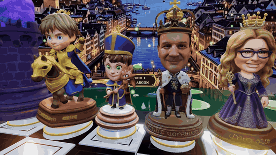

---

## 🍕🌹 1. From a *Bufalina* in Naples to My 10th Anniversary in Colmar

I was in **Naples** on a Friday a few weeks ago to follow the adventures of [**Fabio Biondi's Gemini Day**](https://gdg.community.dev/events/details/google-gdg-napoli-presents-agentic-apps-con-google-gemini-sdk-e-typescript/) at Università Federico II when I bumped into a group of super-smart engineers. You know how it goes in Italy: two minutes of small talk, an espresso at the bar, and before you know it we are all sitting around a table having lunch together.

Over a steaming *pizza bufalina*, **Niccolò and his friends** let me in on their obsession: 3D games, real-time rendering, clean game architecture, and using [**Tripo**](https://www.tripo3d.ai/) and similar generative pipelines to turn flat 2D images into textured 3D objects. Since I had just built [**Pupurabbu 3D**](https://pupurabbu-3d-272932496670.europe-west6.run.app) ([source on GitLab](https://gitlab.com/palladius/pupurabbu-3d)) — a kid-friendly, Quake-style 3D explorer for my two boys — I was all ears.

Little did I know back at that pizzeria table that, just a few weeks later, I would:
1. **Distill Niccolò's game-design wisdom into an agent skill** ([`niccolo-game-design`](https://github.com/palladius/gemini-cli-palladius-public-goodies/blob/main/skills/niccolo-game-design/SKILL.md)), and
2. **Use [Gemini 4](https://deepmind.google/models/gemini/) to generate a next-generation 3D Battle Chess game completely HANDS-OFF!**

How? **... keep reading! :)**

And all of it while I was away in **Colmar**, Alsace, celebrating my **10th wedding anniversary with my wife Kate**! 🥂🌹

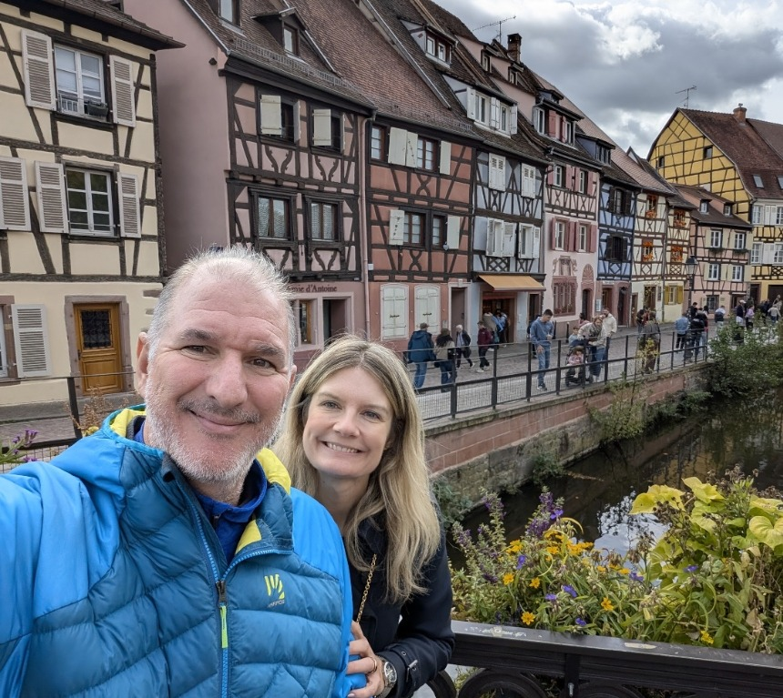

While Kate and I were strolling along the half-timbered houses of *Petite Venise* — no laptop open at the dinner table, no frantic SSH debugging from a phone — 150 kilometers south, my home Linux rig **`pupurabbux`** (equipped with a 16 GB **NVIDIA GeForce RTX 5080**) and a second, GPU-less but beefier Linux box (**`cpu-box`**) were humming day and night.
Orchestrated by **Gemini 4 Argon** inside **Antigravity**, that adversarial swarm of subagents and multimodal critics was busy:
1. Sculpting, rigging, and assembling **50 high-resolution `.glb` 3D models** of our family and rival factions.
2. Compiling custom CUDA PTX kernels on the fly for the brand-new Blackwell `sm_120` GPU architecture.
3. Subjecting every single mesh, texture, and video frame to a merciless multimodal **Adversarial Art Director Critic**.
4. Writing over **121,000 lines of code**, headless unit tests, and Three.js WebGL shaders. (For the record: I write Bash and Ruby. I did not type a single line of JavaScript.)

The result of that weekend? A complete, offline-first (PWA), zero-build-step 3D Battle Chess game set in the **Enchanted Swamp of Zurich (*Swamp-on-the-Limmat*)**: **[CarChess3D (🏰🚽 "Family Chess")](https://github.com/palladius/carchess3d)**.

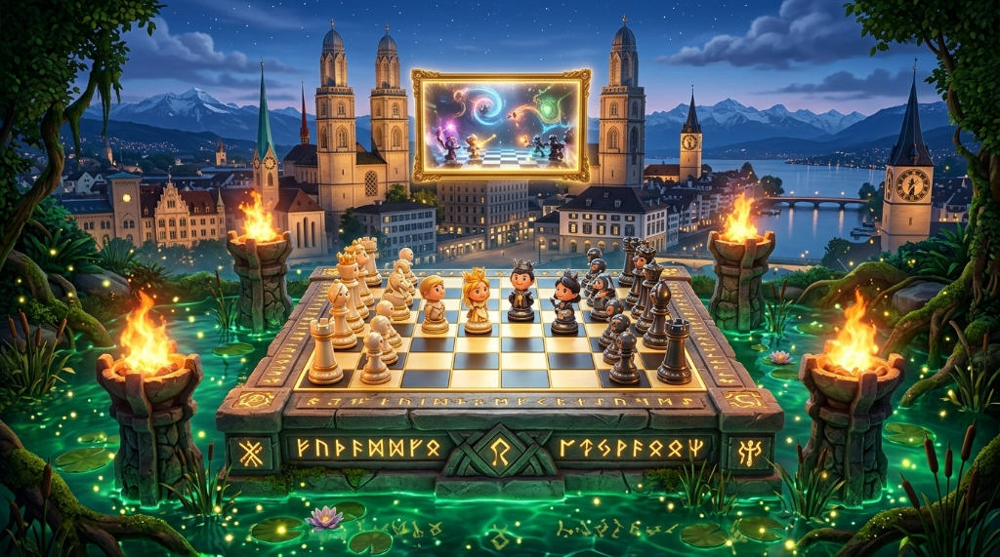

*One of the very first images Nano Banana produced on day one, from a single paragraph of prompt. Everything that followed — the swamp, the torches, the lily pads, the floating 16:9 battle screen — was the agents trying to live up to this picture.*

---

## ⏱️ 2. SRE Telemetry: Proving "Built in a Weekend" Down to the Second

As an old-school Site Reliability Engineer (SRE), marketing fairy tales don't impress me. I only trust hard numbers, immutable timestamps, and cryptographic git commit hashes.
Here is the exact telemetry extracted from `git log` and the **76 CarChess3D Antigravity sessions** across **`pupurabbux`** (`article/sources/chats_list.md`, 22 3D/GPU sessions) and **`cpu-box`** (`article/sources/chats_list.md` and [`article/ANTIGRAVITY_FORENSICS.md`](https://github.com/palladius/carchess3d/blob/main/article/ANTIGRAVITY_FORENSICS.md), 54 orchestration, Swarm, and VLM Critic sessions):

```json
{
  "total_commits": 202,
  "kickoff_commit": { "ts": "2026-10-09T15:34:37+02:00", "sha": "ff67ff8" },
  "latest_release": "v0.3.74",
  "incremental_releases": 69,
  "weekend_commits_oct9_11": 159,
  "commits_by_day": { "fri_oct9": 5, "sat_oct10": 58, "sun_oct11": 96, "mon_thu_oct12_15": 43 },
  "antigravity_telemetry_cpu_box": {
    "carchess_sessions": 54,
    "trajectory_steps": 16118,
    "human_prompts": 263,
    "avg_autonomous_steps_per_prompt": 55.4,
    "fresh_input_tokens": 46771223,
    "cache_read_tokens": 713281606,
    "context_cache_hit_ratio": 0.938,
    "total_context_tokens": 760052829,
    "output_tokens": 5341032
  },
  "verified_glb_models": 50,
  "node_unit_tests": { "passed": 46, "failed": 0, "duration_s": 6.85 },
  "python_tests": { "passed": 17, "failed": 0, "duration_s": 0.38 },
  "total_loc": 121331,
  "ip_safety_violations": 0
}
```

### ⚡ 38 Minutes from `/goal` to a Playable Game (Saturday, October 10)
At **10:31** on Saturday morning, right before heading out into the cobbled streets of Colmar, I fired a single `/goal` command in an isolated git worktree. My humongous `/goal` prompt is **[here — steal it!](https://github.com/palladius/carchess3d/blob/main/etc/prompts/GOAL_BUILD_CARCHESS3D.md)** (I had Gemini 4 *High* write it for me, with a good dose of inspiration from [Geneviève Huskens](https://www.linkedin.com/in/ghuskens/)' 3D agent workflows — see the two tips below). 
[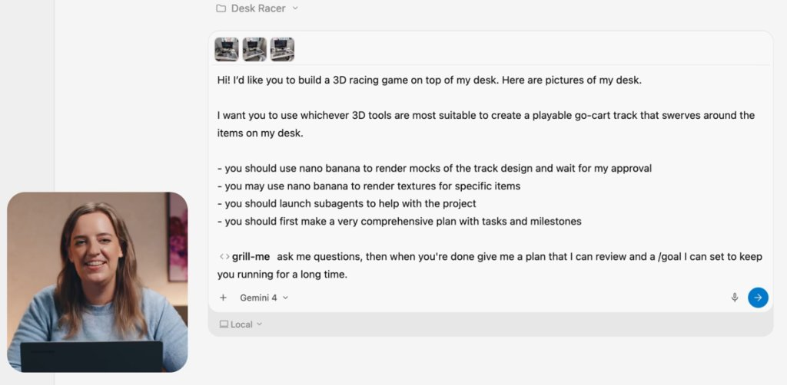](https://lnkd.in/p/e_Vk3W64)

> 💡 **Two tips I stole from [Geneviève Huskens](https://lnkd.in/p/e_Vk3W64)** (click the screenshot above to watch her "Desk Racer" demo — she builds a 3D go-kart game on top of her own desk):
> 1. **Start with `/grill-me`**: *"ask me questions, then when you're done give me a plan that I can review"*. Let the agent interview you until the plan is solid, instead of dumping a vague wish on it.
> 2. **Ask for the `/goal` as a deliverable**: *"...and a `/goal` I can set to keep you running for a long time"*. The agent writes its own long-running meta-prompt — milestones, checkpoints, how to self-verify — and you fire it and walk away. That is exactly how my humongous `/goal` was born, and why I could spend the weekend in Colmar.

> ✍️ **Post-review update.** When Geneviève reviewed this article she made one sharp observation about that prompt: *it micromanages the subagents* — I had told the orchestrator exactly which four agents to spawn and which files each one owned. She is right: the human should state outcomes, guardrails and exit gates, and let the planner plan. So here is a **[clean, reusable `/goal` template](https://github.com/palladius/carchess3d/blob/main/etc/prompts/GOAL_TEMPLATE_DIDACTIC.md)** with the project-specific noise removed and the subagent decomposition handed back to the agent. Steal *that* one.

Here is the timeline recorded in the transcript:

* `10:31` **Phase 1 — 2D blueprint & spatial metric** (9m 17s): a metric [floor plan](assets/gallery/floorplan.svg) of the board (`y = 0.00 m`) and an automatic bounding-box grounding utility, so every future 3D piece would stand exactly on its square.
* `10:41` **Phase 2 — headless core, test-first** (7m 03s): event bus, seeded random generator, chess-rules manager and the kid-friendly luck meter, each with unit tests (including a 10,000-capture Monte Carlo run).
* `10:50` **Phases 3 & 4 — four subagents in parallel** (19m 35s): **+10,081 lines across 60 files in 19 minutes** — the 3D Zurich swamp scene, piece rendering, particle effects, the HUD and the offline-first service worker.
* `11:09` ✅ **A playable, unit-tested 3D chess game in the browser** — **38 minutes and 6 seconds** after `/goal`.
* `11:13` **Phase 5 — adversarial critic loop** (65m 33s): the critic scores round 1 at `6.2/10`, catches 5 defects (including a glTF `metallicFactor` trap that made everything look like chrome), and iterates until **`9.9/10`** at `12:18`.

> 💡 **SRE Verdict**: **38 minutes** to a working game, **1 hour 47 minutes** to one the critic was happy with — with zero human input in between.

And because git never forgets, here is what that 38-minute game actually looked like (commit `d257880`, checked out and booted again today) next to the current build — same board, three weeks of autonomous loops apart:

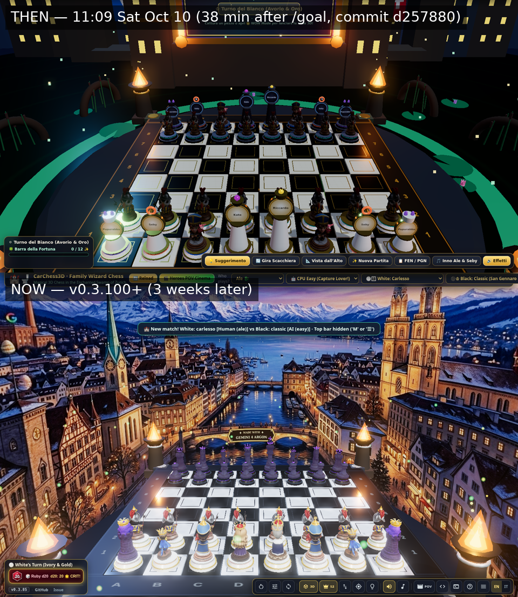

### ⏳ How Long Can Gemini Actually Run Unattended?

The million-dollar question with AI coding agents is always: *"How long can they actually run on their own before hitting a wall or begging a human for help?"*

Looking at the raw Antigravity logs across both machines, here are the longest unattended autonomous runs:

| 🖥️ Machine | Session / Mission | Start (UTC) | 📜 Steps · 🔧 Tool Calls · 🐝 Agents | ⏱️ Span | Autonomous Outcome |
| :---: | :--- | :---: | :---: | :---: | :--- |
| `pupurabbux` | **Kickoff & 3D Factory** (`940b9eac`) | Oct 09, 15:43 | 2,366 · 1,080 · 107 | 110h | Scaffold, multi-view generation, 26-bone Blender rigging, pipeline orchestration. |
| `cpu-box` | **MAIN Merger & Daily UAT Sentinel** (`83ee7dd5`) | Oct 10, 07:37 | 2,399 · 1,120 · — | 5 days | Multi-machine git sync (`cpu-box` ⇄ `pupurabbux`), English UI default, automated Playwright video UAT on GitHub Issues. |
| `cpu-box` | **Autonomous v1 `/goal` + 6×6 Swarm** (`31759f77`) | Oct 10, 08:31 | 2,667 · 1,240 · 15 | 4 days | Complete v1 game in 38m, 5-worker 6×6 Swarm, 36 Veo 3.1 videos, family TTS voices & Lyria 3 strings. |
| `pupurabbux` | **Issue #20: 12 GLB Reconstruction** (`18347678`) | Oct 13, 18:12 | 686 · 375 · — | **12h 12m non-stop** | High-resolution local GPU reconstruction of all 12 Classic and Swamp pieces on the RTX 5080. |

---

## 👑👦👶 3. The Family Cuteness Factor: Who Is on the Board?

Instead of anonymous wooden horses and pawns, every piece in CarChess3D is an affectionate, slightly ridiculous caricature of our family:

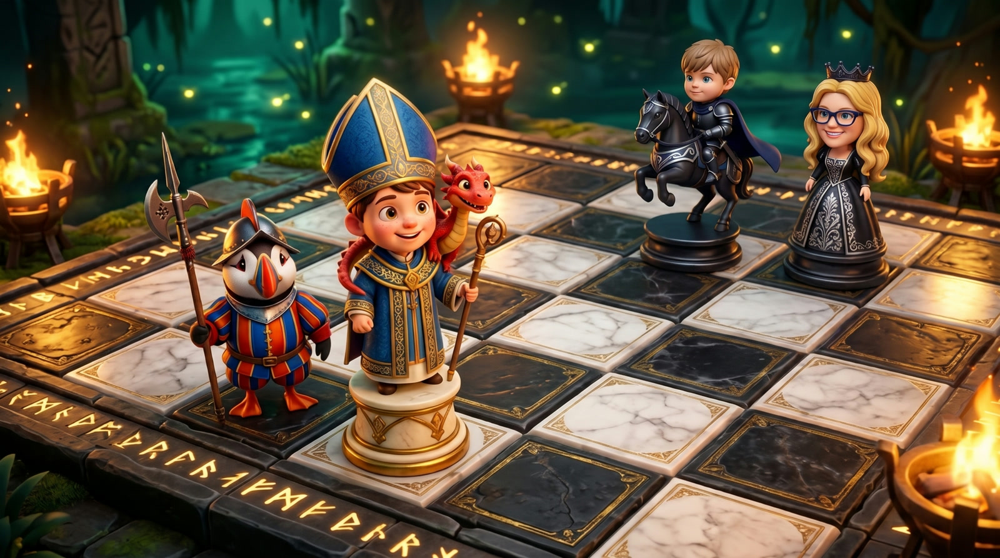

*Early concept art, retouched with Nano Banana: the white Puffin and Bishop Ale face a black-team Seby and Kate — a Carlesso vs. Carlesso mirror match.*

| Piece | Who | Why |
| :--- | :--- | :--- |
| **King 👑** | **Riccardo** (Dad) | Inspired by a fantasy mage: six spells for six different fights — and yes, a golden throne 🚽. |
| **Queen 👸** | **Kate** (my wife) | She works in chocolate, so every one of her attacks is chocolate-based. 🍫 |
| **Bishop 🐉** | **Ale** (Alessandro) | Ale loves wizard stories and dragons, so the bishop is a young wizard with a tiny dragon familiar. |
| **Knight 🏎️** | **Seby** (Sebastian) | He rides horses, so the choice was obvious. |
| **Rook 🏰** | **Pupurabbu** | Seby's imaginary purple fluffy friend, peeking out of a stone tower. 💜 |
| **Pawn 🐧** | **Puffin** (×16) | My wife calls me *Puffin*; the insider joke was irresistible. Swiss Guard uniform included. |

### 🎠 Meet the Kids in 3D

<table style="width:100%;text-align:center;border-collapse:collapse;">
  <tr>
    <td style="width:50%;padding:6px;"><video src="assets/gallery/turntable_knight_seby.mp4" poster="assets/gallery/turntable_knight_seby.gif" autoplay loop muted playsinline style="max-width:100%;border-radius:10px;"></video></td>
    <td style="width:50%;padding:6px;"><video src="assets/gallery/turntable_bishop_ale.mp4" poster="assets/gallery/turntable_bishop_ale.gif" autoplay loop muted playsinline style="max-width:100%;border-radius:10px;"></video></td>
  </tr>
  <tr>
    <td style="padding:4px 6px 14px;"><strong>Seby — Knight 🏎️</strong><br><em>golden armor on his warhorse, 1.92 m</em></td>
    <td style="padding:4px 6px 14px;"><strong>Ale — Bishop 🐉</strong><br><em>wizard's mitre with his little dragon, 1.55 m</em></td>
  </tr>
</table>

*The two reconstructed `.glb` figurines on a 360° turntable (RTX 5080 render, 8 s loop). Full 6-piece lineup below.*

Here they are, all six reconstructed `.glb` figurines (**Riccardo · Kate · Ale · Seby · Pupurabbu · Puffin**, each scored `9.7/10` by the critic) rotating 360° side by side at their true relative heights (`0.80m` → `2.50m`; [`scripts/family_turntable_6up.py`](https://github.com/palladius/carchess3d/blob/main/scripts/family_turntable_6up.py) · [MP4](assets/gallery/family_turntable_6up.mp4)):

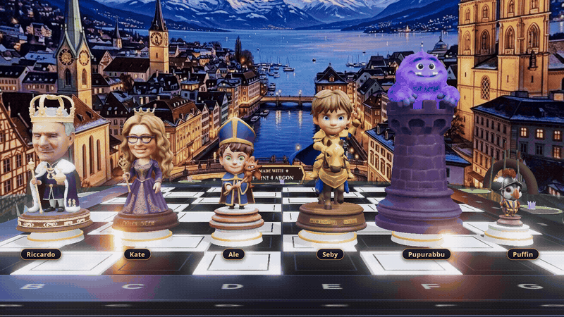

### 💜 The Brotherly Easter Egg: The "Mega Fluffy Cuddle"
Inside the combat rules engine (`src/managers/CombatAnimationManager.js`), one hard-coded law is sacred: **Sebastian and his plushie Pupurabbu can never hurt each other**.
Whenever Knight Seby captures Rook Pupurabbu (or vice versa), there is no explosion and no knock-out: the two rush together into a **SUPER FLUFFY HUG! 💜🤗** while a shower of 3D pink hearts rains down over the board!


*Seby and his imaginary friend cannot fight — they can only hug. (Veo 3.1 clip, [MP4](assets/gallery/seby_pupurabbu_hug.mp4).)*

### 🐸 The Ogre's Swamp Party
Captured pieces don't vanish into a boring sidebar graveyard. They fly along a parabolic arc, splash into the **Enchanted Swamp** — a stylized 3D Zurich, with the Grossmünster towers, the Limmat and the lake as backdrop —, and **bob happily on floating lily pads** amid glowing ripples and swamp fireflies!

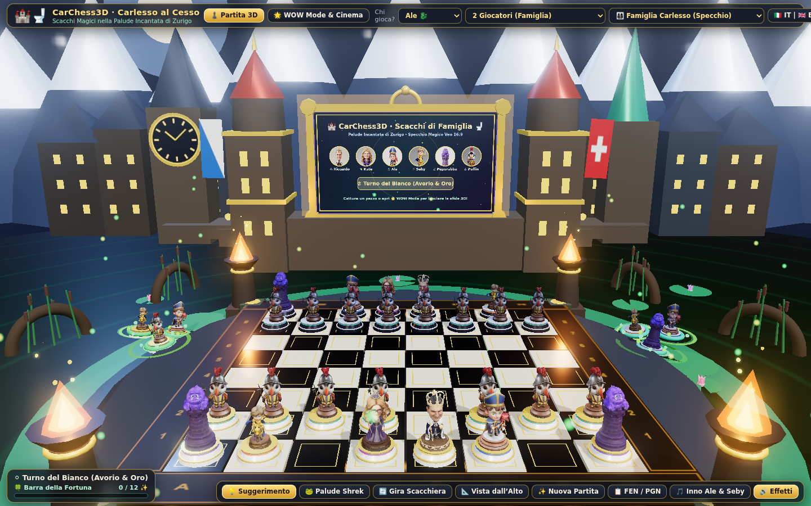

### 👨‍👦‍👦 The Real UAT (*User Acceptance Testing*): Ale & Seby on the Tablet
No automated test suite can beat the final sign-off from the actual customers: here are **Alessandro (🐉)** and **Sebastian (🏎️)** heads-down on the tablet playing CarChess3D, with the 3D pieces on the board and the swamp lily pads glowing in the background!

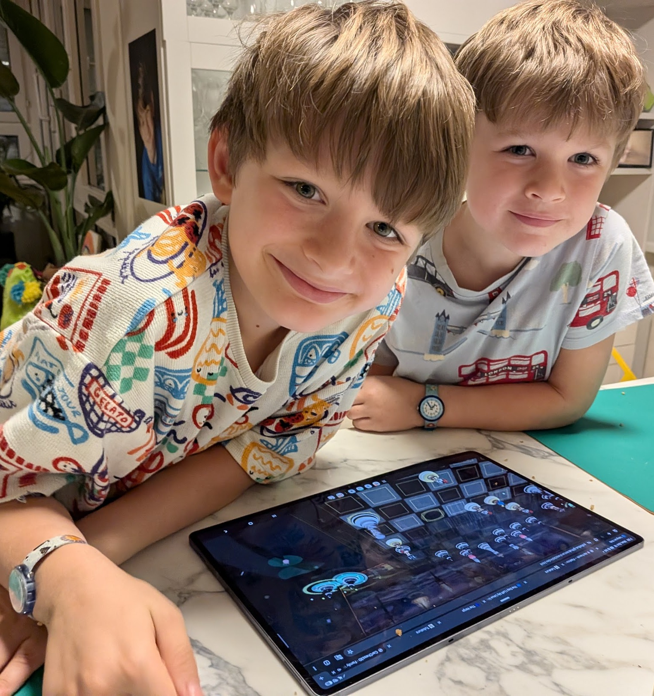

### 👨‍👩‍👦‍👦 The Family Portrait

Advance pawns `b`–`g` two squares, put the camera at board level in front of the white back rank, hide the HUD, and you get the real reason this project exists: Seby, Ale, Dad, Mum, Ale again and Seby again — with Pupurabbu's purple tower on the flank and the Puffin Swiss Guard helmets peeking in from the front row (`scripts/family_portrait_shot.py`):

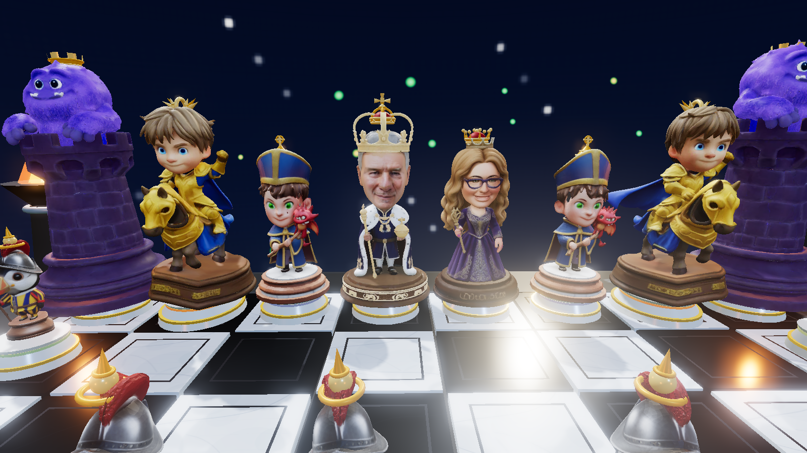

And here is the **12-second cinematic demo sweep** (`scripts/family_orbit_video.py`, rendered on the RTX 5080): starting from a wide aerial establishing view over the Zurich board, swooping down to eye level, holding at the front portrait, and orbiting `-150° → +150°` around the whole family:

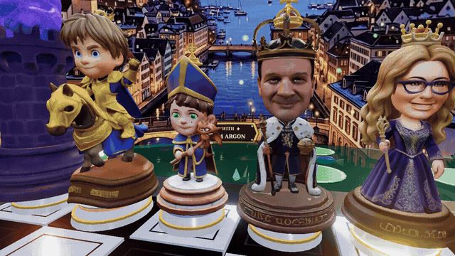

---

## 🎠 4. WOW Gallery: The Carlesso Family Figurines

These are the 2D concept turnarounds (front + 3/4 view) generated with **Nano Banana 2.1** from real family photos. They are the "ground truth" every 3D engine had to chase:

| Dad (King Riccardo 🚽👑) | Mum (Queen Kate 👸💜) |
| :---: | :---: |
| 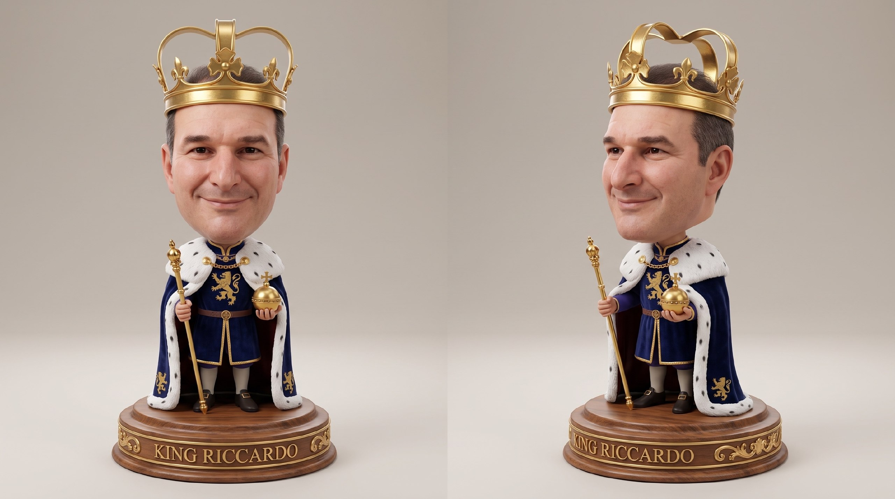 | 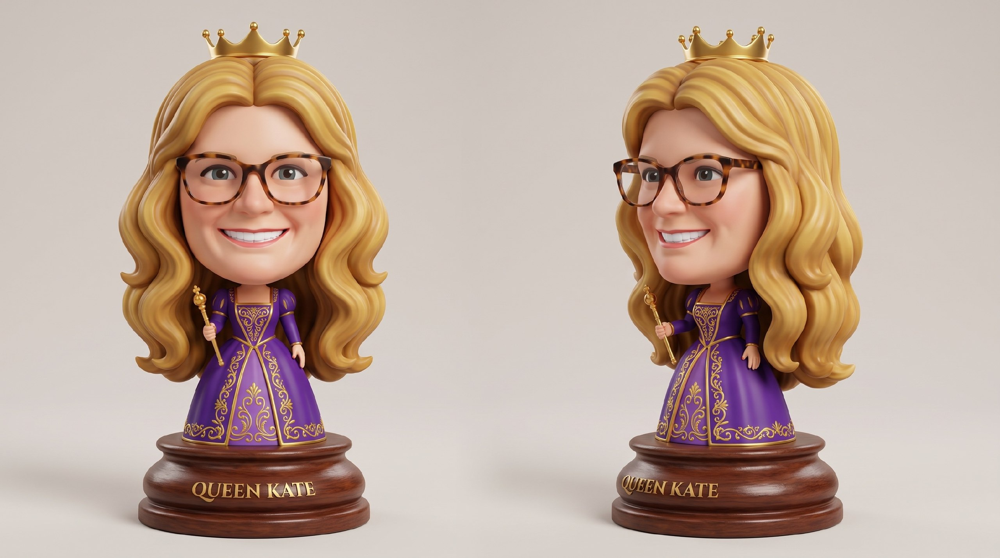 |
| *Royal crown, ermine-trimmed cloak, scepter and golden "Riccardo" plaque* | *Purple damask gown, gold ring, and navy glasses* |

| Bishop Ale & His Dragon (🐉💎) | Knight Seby on His Steed (🏎️✨) |
| :---: | :---: |
| 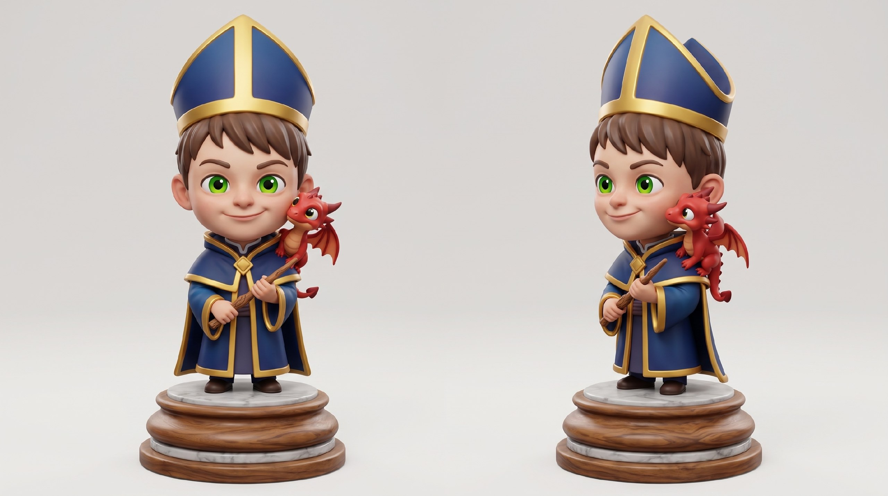 | 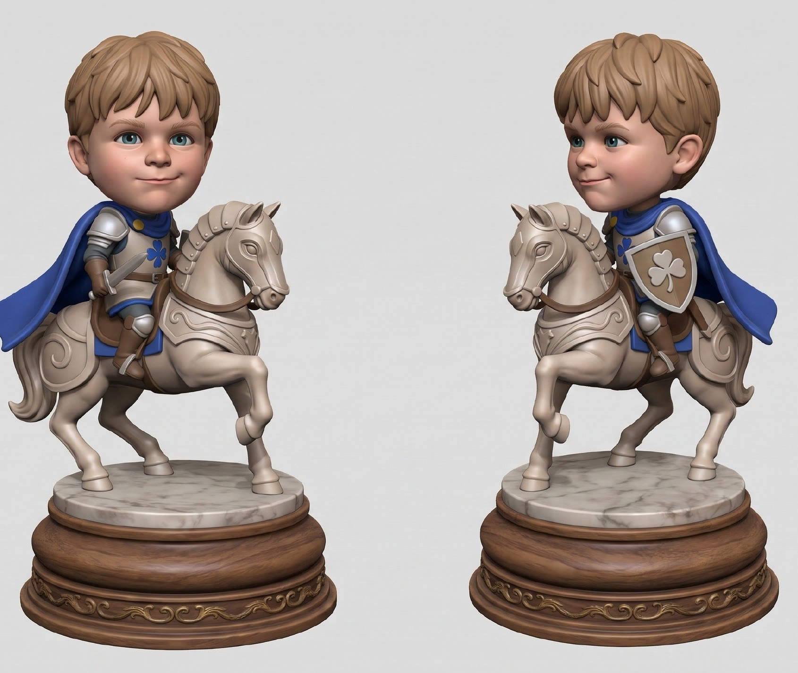 |
| *Episcopal mitre, crozier and shoulder dragon* | *Silver armor, blue cape and wooden lance on his warhorse* |

| Pawn Puffin (Swiss Guard 🐧🛡️) | Rook Pupurabbu (Purple Fluffy Tower 🏰💜) |
| :---: | :---: |
| 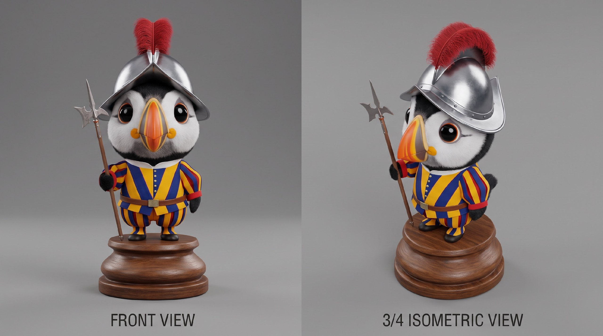 | 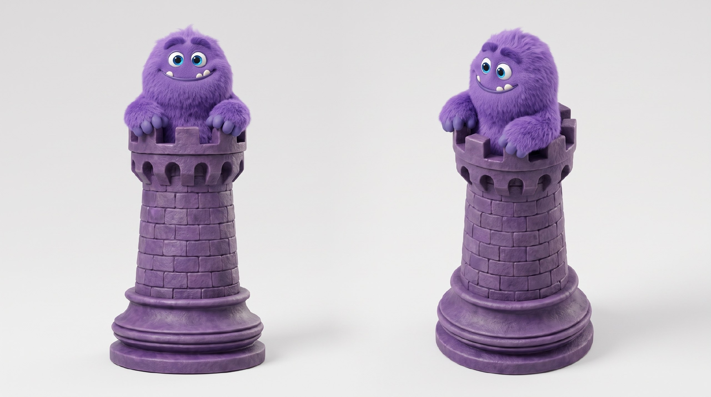 |
| *Morion helmet with red plume and halberd* | *A fluffy purple monster peeking out of a stone keep* |
---

## 🔬 5. Technical Deep Dive: Sculpting 3D Pieces from Family Photos

Turning a casual smartphone photo into a textured, metrically grounded `.glb` that runs at 60 FPS on a tablet boils down to four steps — generate, reconstruct, slim down, judge:

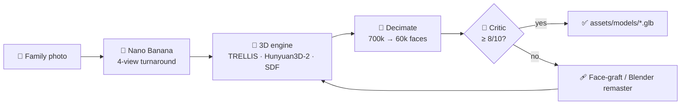

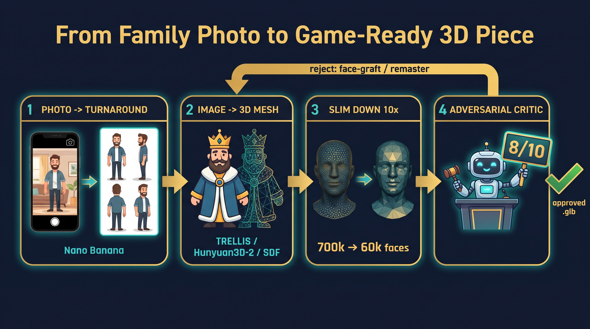

### Step 1: From Smartphone Photo to 4-View Orthographic Turnaround with Nano Banana 2.1
3D diffusion models hate wide-angle perspective distortion. Using **Nano Banana 2.1 (`gemini-nano-banana-2.1`)** and **Nano Banana Pro (`gemini-3-pro-image-preview`)**, we generated strict orthographic sheets:
- **Front (0°)**: symmetrical heroic pose.
- **Side (90°)**: pure lateral profile (essential for King Riccardo's nose/crown profile and the Swamp Donkey's snout).
- **Back (180°)**: full rear view (preventing 3D models from having flat, hallucinated, or unpainted backs).
- **3/4 Isometric**: volumetric depth reference.

### Step 2: The Four 3D Reconstruction Engines

#### Engine 1: Cloud Multi-View Diffusion (TRELLIS) and the Undocumented `/lambda_1` Bug
TRELLIS produces great PBR meshes, but we uncovered a nasty bug in its Gradio backend: calling the API via Python silently ignored every image after the first because the internal `is_multiimage = gr.State(False)` flag was only toggled when a human clicked the "Multiple Images" tab in the browser UI — which fired an undocumented endpoint named **`/lambda_1`**.
Once our script (`gen_mv.py`) explicitly invoked `/lambda_1` right after `/start_session`, TRELLIS finally fused front, side, and back views together!

#### Engine 2: Local GPU Pivot on `pupurabbux` (NVIDIA RTX 5080 + TurboSebux)
When Hugging Face ZeroGPU hit quota limits (*"Exceeded ZeroGPU quota"*), the agent didn't stall waiting for a credit card. It pivoted autonomously to my home PC's local hardware:
- **External Samsung T7 SSD**: mounted a 600 GB ext4 loop volume at `/media/riccardo/TurboSebux` so root `/` wouldn't fill up.
- **Hunyuan3D-2 Shape**: generated complete meshes locally in **32 seconds** using just **5.6 GB of VRAM** on the RTX 5080.
- **Blackwell `sm_120` CUDA PTX JIT Fix**: Because prebuilt PyTorch/rasterizer wheels didn't yet include native binaries for NVIDIA's new Blackwell `sm_120` architecture (`cudaErrorNoKernelImageForDevice`), the agent recompiled `custom_rasterizer_kernel` with `TORCH_CUDA_ARCH_LIST="9.0+PTX"`, leveraging the NVIDIA driver's PTX JIT compiler.

#### Engine 3: Slimming Down 10× with Quadric Edge Collapse 📐
A raw mesh out of Hunyuan3D-2 has **~700,000 triangles (12.5 MB)** per piece: with 32 pieces on the board that is 22 million polygons, and any tablet browser gives up. [Quadric Edge Collapse](https://en.wikipedia.org/wiki/Level_of_detail_(computer_graphics)) (Garland & Heckbert, 1997) merges the edges that matter least first, so we went from **697k to 60k faces (12.5 MB → 1.0 MB) in under 10 seconds** while keeping faces, crowns and noses intact.

#### Engine 4: Mode B Biometric Face-Grafting ($2048 \times 1024$ Dual-Chart WebP Atlas)
My initial King mesh looked like a generic, clean-shaven doll. When I complained (*"Better, but it still doesn't look like me! Build an adversarial likeness critic using my 5 reference photos!"*), the agent built a **Biometric Likeness Critic (`riccardo-likeness-critic`)** scoring **8 facial landmarks** (hooded smiling brown eyes, vertical glabellar crease, white tuft on the left eyebrow, rounded nose tip, wide grin, 2-day salt-and-pepper stubble, silver temples, no glasses) and implemented **Mode B Planar Face-Grafting**:
- Expanded the UV atlas to $2048 \times 1024$: the left half ($u \in [0, 0.5]$) keeps the original 3D robe/crown texture, while the right half ($u \in [0.5, 1.0]$) projects my real South Africa photo onto the 1,483 facial triangles with multi-band Laplacian skin harmonization ($\sigma = 26.0$).

> ⚠️ **`TODO(2026-11-13)` — Add Lesson Learnt from [`article/LESSON_LEARNT_FACE_GRAFTING.md`](LESSON_LEARNT_FACE_GRAFTING.md)**:
> Why Mode B photo face-grafting ultimately failed in-game (causing a blotchy, pockmarked *"faccia butterata"*):
> 1. **Fragmented `xatlas` UV islands ("Frankenstein seams")**: projecting a photo onto a frontal triangle subset (`tri_in_shell`) left saw-toothed borders against surrounding triangles.
> 2. **The `bmesh.ops.remove_doubles` UV seam collapse bug**: welding coincident 3D vertices destroyed distinct `(u, v)` seam coordinates, dragging dark crown/pedestal textures across the cheeks and nose.
> 3. **High-frequency photographic noise vs. stylized 3D lighting**: real skin pores and static baked photo shadows look like craters under dynamic Three.js lighting.
> - **The Fix**: Clean cartoon 2D concept ([`king_riccardo_clean_2d.png`](assets/king_riccardo_clean_2d.png)) + continuous UV unwrap + multi-view Hunyuan3D-2 PBR baking on the 60k-face mesh ([`riccardo_clean_vs_broken_comparison.png`](assets/riccardo_clean_vs_broken_comparison.png), [`riccardo_clean_turntable.gif`](assets/riccardo_clean_turntable.gif)).

### 📸 Three-Stage Visual Evolution: The Classic King (Issue #20)

Here is the actual inspection card comparing the 2D turnaround, the legacy procedural placeholder, and the reconstructed 3D mesh:

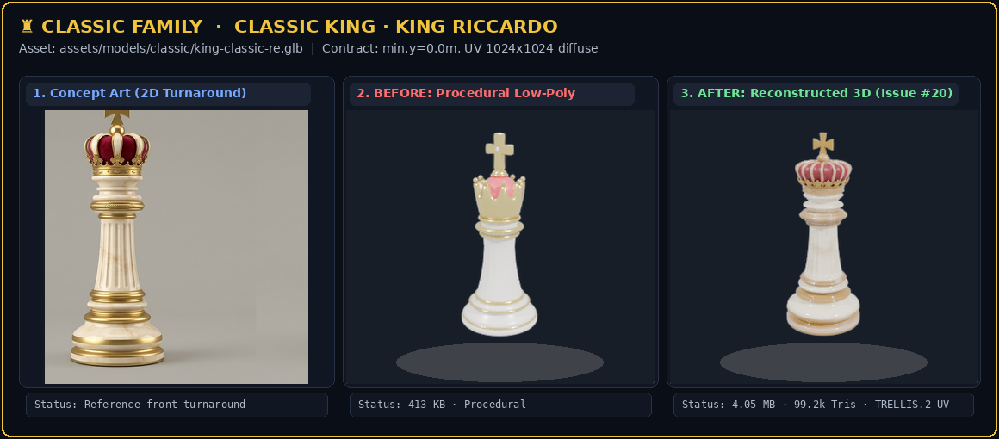

And here are my two favourite reconstructions, the **Classic Rook** (*Matilda's Tower*, Mode A Dual-Orthographic SDF) and the **Classic Bishop** (*Don Spadaccino*, TRELLIS.2 multi-view), each shown as **Concept Art → Procedural placeholder → Reconstructed 3D** (full Before/After lineups of both factions in [`article/SHOWCASE_BEFORE_AFTER.md`](https://github.com/palladius/carchess3d/blob/main/article/SHOWCASE_BEFORE_AFTER.md)):

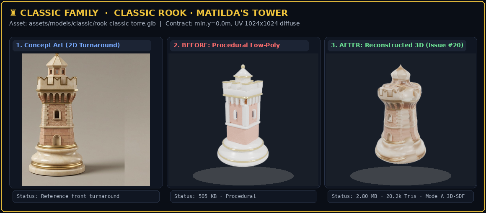

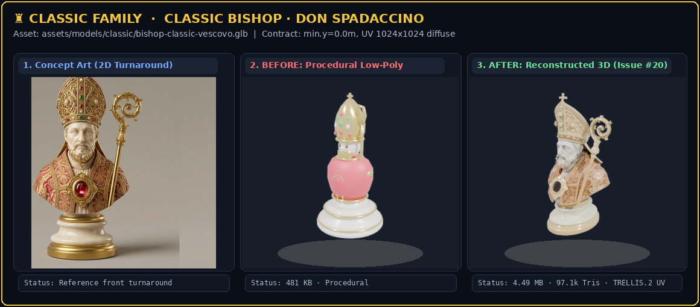

---

## 🤖💩 6. The Adversarial Critic Loop: Separation of Powers

Left to themselves, generative pipelines happily ship deformed meshes or broken shaders. To prevent this, we enforced a strict **separation of powers**:
- **Builder Agents** (write code, sculpt 3D models, render videos).
- **Adversarial Critic Agents** (isolated read-only verifiers armed with Gemini VLM, Claude Fable 5.1 High, and Blender Cycles/EEVEE).

After every 3D build, a headless script shoots a 4-camera contact sheet (`3/4 Overview`, `Close-Up`, `Ground Test y=0.00m`, and `Wireframe`) and updates `docs/qa-scores.yaml`:
- `TOP_QUALITY 🟢` ($\ge 8.0/10$)
- `ACCEPTABLE 🟡` ($6.0 - 7.9/10$)
- **`FA_CAGARE 💩`** ($< 6.0/10$ — literally *"it sucks"* in Italian)

If a model gets stamped `FA_CAGARE 💩`, `just shittest` fails the build and forces a modular rebuild — which is how **Bishop Ale v2** (rejected at `4.0/10` because multi-view fusion produced *"two half-dragons fused into his chest"*) was rebuilt into a clean 26-bone modular rig!

---

## 🐝🎬👁️ 7. Inside the 8 Autonomous Antigravity Loops, Multi-Agent Swarms & Daily UAT

Beyond the 3D asset factory on `pupurabbux`, **Antigravity** on the **`cpu-box`** ran **8 major autonomous loops** (full forensic dossier in [`article/ANTIGRAVITY_FORENSICS.md`](https://github.com/palladius/carchess3d/blob/main/article/ANTIGRAVITY_FORENSICS.md)):

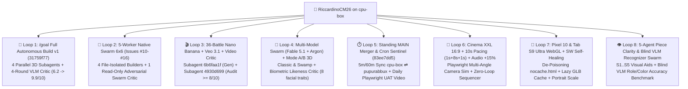

### 1. 🐝 The 5-Worker Native Swarm "Zero-Corner-Cutting" (`Issues #10–#16`)
When I told the agent *"Do NOT cut corners — open an issue for every gap and run an adversarial swarm, even if it takes two days!"*, the orchestrator spawned **5 concurrent Swarm workers** on a shared message board with **strict per-file ownership** so merge conflicts were mathematically impossible:
- **`@matrix36-choreo`**: sole owner of `BattleMatrix36.js` and all **72 video files (`36 .mp4` + `36 .webm`)**.
- **`@brawl3d-vfx`**: owner of `CombatAnimationManager.js` — 3-Act 3D comic brawl (`CHARGE!` → `COUNTERATTACK!` → `K.O.!` into the swamp lily pads).
- **`@skeletons-locomotion`**: owner of `SkeletonRigHelper.js` — **23 articulated 3D joints**, 8-step walk cycle (`2.0s`), and knight gallop (`2.2s`).
- **`@explorer6x6-ux`**: owner of `battles.html` and `HudListener.js`.
- **`@adversarial-critic`**: **Read-Only Verifier** running `scripts/adversarial_swarm_audit.py` to audit the other 4 workers before granting the green light.

### 2. 🎬 The 36 Nano Banana 2.1 + Veo 3.1 Battle Videos & Kate's Adversarial Video Critic (`>= 8.0/10`)
Whenever a piece is captured, the surrounding 3D world dims, the chessboard fades to `90%` transparency (`alpha = 0.10`), the HUD disappears, and a giant **16:9 Cinema XXL screen (`videoBoost = 1.75`)** rises behind the two fighters with a **`10.0s` timeline (`1s pre-roll + 8s Veo video + 1s post-roll`)** and **`+15%` zero-loop combat music**.
When I showed the first batch of 36 Veo videos to my wife Kate, she immediately spotted hallucinations: towers vanishing mid-clip or a second Puffin materializing out of thin air. So we spawned an **Adversarial Video Critic** subagent (`4930d699`) that extracted a **6-frame contact strip (`t = 0.0s..7.5s`)** for all 36 `.mp4` videos, checked for 4 forbidden defects, logged every score in `docs/battles/video_audit.yaml`, and regenerated every rejected clip until all 36 scored `>= 8.0/10`!


### 3. 👁️ The 5-Agent Visual Clarity Swarm (`S1..S5`) & Blind VLM Recognizer (`Issue #32`)
Playing with the kids on the tablet revealed a real UX issue: from overhead (`0°` zenithal and `30°` semi-high), the figurines were so richly detailed that telling White from Black — especially in a *Carlesso vs. Carlesso* mirror match — caused visual fatigue.
To make sure the board is actually *readable* — not just pretty — I had the agents build a **self-testing benchmark**: a *blind* Gemini model is shown 36 renders and asked to name each piece's role and color, with no hints. A 5-agent Swarm then designed **5 combinable clarity modes (`S1..S5`)** — matte obsidian vs. warm ivory pedestals, 3D role crowns baked into the `.glb` files, pedestal wreaths and top-down 2D medallions — and re-ran the benchmark after each one. Recognition climbed from **`5.0/10` (off) to `9.5/10` (`S5`)** (full report in [`article/SHOWCASE_VISUAL_CLARITY.md`](https://github.com/palladius/carchess3d/blob/main/article/SHOWCASE_VISUAL_CLARITY.md)):

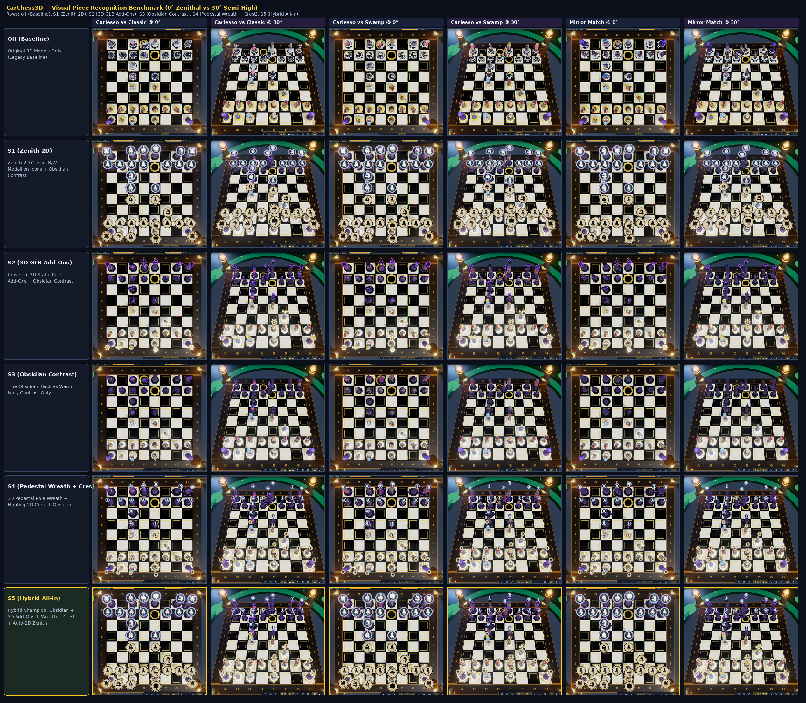

### 4. 🧪🤖 Autonomous "Daily UAT Review" with Antigravity on GitHub Issues ([`label:"gemini-uat"`](https://github.com/palladius/carchess3d/issues?q=state%3Aopen%20label%3A%22gemini-uat%22))
One of my absolute favorite engineering workflows in this project is the **fully autonomous Daily UAT Review** powered by **Antigravity**:
- Every day, a standing scheduled task in Antigravity runs `just daily-uat` (`scripts/daily_uat_playtest.py` + `etc/prompts/daily_uat_prompt.md`).
- The agent launches headless Chromium via Playwright, verifies **9 functional and visual gates** (`engine_boot`, `piece_orientations`, `camera_flip_180`, `camera_top_down`, `skeletons_toggle`, `swamp_party`, `matrix36_modal`, `wow_mode`, `match_gameplay`), plays an actual chess match against CPU Easy through a capture cutscene, performs **monkey-testing** (like rapidly clicking the `🐸 Swamp` button 10 times in a row to verify that exactly 6 pieces swim on lily pads without duplicating or crashing WebGL), and records a **complete `< 60s` gameplay film (MP4 + GIF)**.
- Finally, it uploads the video assets to a dedicated release tag (`uat-media-YYYYMMDD`) and automatically opens or updates a GitHub Issue tagged **`gemini-uat`**!
- You can browse all live daily reports, telemetry tables, and AI-recorded gameplay films directly on GitHub:
  👉 **[GitHub Issues: `state:open label:"gemini-uat"`](https://github.com/palladius/carchess3d/issues?q=state%3Aopen%20label%3A%22gemini-uat%22)** (see [Issue #18 — `Gemini UAT 20261011`](https://github.com/palladius/carchess3d/issues/18) and [Issue #36 — `Gemini UAT 20261015`](https://github.com/palladius/carchess3d/issues/36)).


---

## 💛 8. Niccolò's Game Architecture (`niccolo-game-design`)

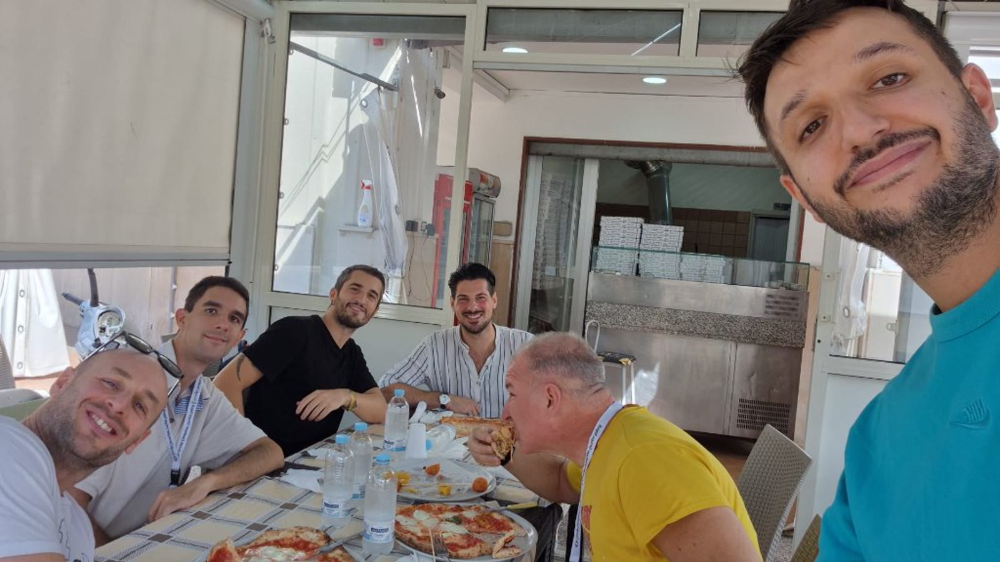

*The pizzeria table where it all started — Niccolò is the one holding the phone; I am the one holding the pizza.*

To avoid the dreaded "AI Spaghetti Monster" (a monolithic 5,000-line `game.js` tangled in `if/else` chains), CarChess3D strictly enforces the rules of the [**Niccolò Game Design** skill](https://github.com/palladius/gemini-cli-palladius-public-goodies/blob/main/skills/niccolo-game-design/SKILL.md) — Managers + Event Bus, a well-known approach Niccolò pointed me to and that is beautifully laid out in Robert Nystrom's [*Game Programming Patterns*](https://gameprogrammingpatterns.com/):

1. **One Manager = One Responsibility ($\le 300$ LOC per file)**:
   - `BoardMapManager.js`: owns all chess rules (check, checkmate, stalemate, castling, en passant, promotion).
   - `DropManager.js`: owns the kid-friendly **🍀 Luck Meter (Pity Timer)** — every capture adds luck points by piece value (`Pawn=1, Knight/Bishop=3, Rook=5, Queen=9`), guaranteeing a 100% *Golden Crit* sticker drop at 12 points!
   - `CombatAnimationManager.js`: looks up `BATTLE_MATRIX[attacker][defender]` declaratively with zero `if/else` ladders.
2. **100% Headless Core**:
   `src/core/`, `src/managers/`, and `src/ai/` contain zero references to `document`, `window`, or `THREE`. They run in pure Node.js in under 1.5 seconds with full test coverage.
3. **Deterministic Queued `GameEventBus`**:
   Events describe past facts (`PIECE_CAPTURED`, `LUCK_CHANGED`), are queued by `emit()`, and are flushed once per fixed tick ($1/30\text{s}$) by `flush()`, eliminating re-entrancy bugs and race conditions.
4. **Listeners, Never Callers**:
   3D views, WebAudio, HUD, and localStorage subscribe to events. Game logic managers never call `sound.play()` or mutate DOM nodes directly.

---

## 🎮 9. Try It Yourself in 10 Seconds

Zero heavy installs, zero bundlers, zero Webpack or Vite:

```bash
# Clone the repo and start the static server
just serve
```

Or play directly online on GitHub Pages:
- 🏰 **CarChess3D Full Game**: [`https://palladius.github.io/carchess3d/`](https://palladius.github.io/carchess3d/)
- 🐸 **Swamp Party with Captured Pieces**: [`https://palladius.github.io/carchess3d/?swamp_party=1`](https://palladius.github.io/carchess3d/?swamp_party=1)
- 🟢 **Legal Move Dots & Capture Reticles**: [`https://palladius.github.io/carchess3d/?demo_moves=1`](https://palladius.github.io/carchess3d/?demo_moves=1)
- 🎬 **Heroes POV Cinema & Family Soundboard**: [`https://palladius.github.io/carchess3d/showcase/?view=pov`](https://palladius.github.io/carchess3d/showcase/?view=pov)
- 📸 **Visual Progress Gallery (Round 1 → Round 4)**: [`https://palladius.github.io/carchess3d/progress.html`](https://palladius.github.io/carchess3d/progress.html)

---

## 🥂 10. Conclusion: Engineering in the Age of Autonomous Swarms

Two years ago, building a custom 3D video game starring your own family — complete with watertight textured meshes, skeletal rigging, event-driven architecture, a Web Worker chess AI, 36 AI battle cutscenes, baroque string music, and bilingual voice acting — would have taken an indie studio four months and tens of thousands of euros.

Today, combining frontier models like [**Gemini 4**](https://deepmind.google/models/gemini/), [**Antigravity**](https://antigravity.google/)'s multi-agent orchestration, solid SRE guardrails, and ruthless adversarial critics, the entire universe came together over **a single anniversary weekend** while the human was clinking Riesling glasses in Colmar.

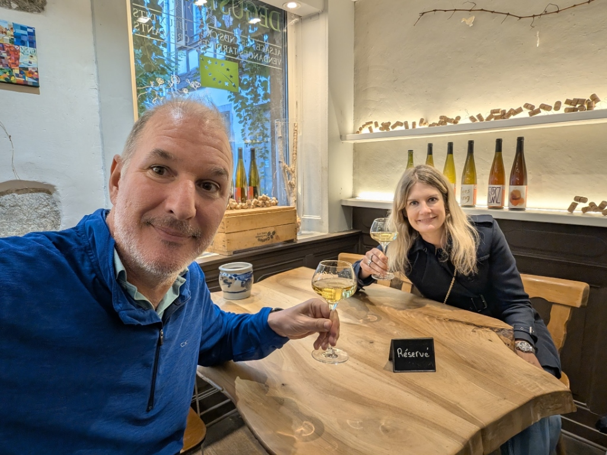

The best technology isn't the one that chains you to a screen — it's the one that works quietly in the background, leaving you free to live your life with the people you love.

*Have a great match, from the Carlesso Family!* 🦖👑👸🐉🏎️💜🐧
