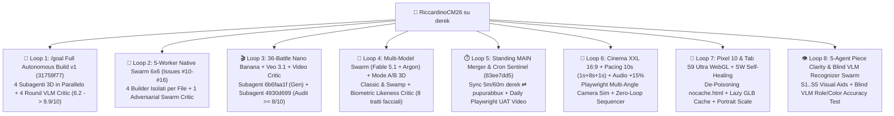

# 🕵️‍♂️🦖 Analisi Forensica su `derek`: Tutti i `/goal`, gli Swarm Multi-Agente e i Loop Complessi di Jetski per CarChess3D (`9–14 Ottobre 2026`)

> **Scopo di questo documento (`article/DEREK_JETSKI_FORENSICS.md`)**: Raccogliere in un unico dossier forensico — estratto direttamente dai log `transcript.jsonl` di `~/.gemini/jetski/brain/` sulla workstation Linux **`derek`** — **tutti i numeri reali, i prompt esatti, i `/goal`, gli Swarm paralleli, i Critic VLM avversariali e i loop autonomi** eseguiti su questo computer tra il **9 e il 14 Ottobre 2026**, pronto come materiale per l'articolo tecnico.

---

## 📊 1. Telemetria Globale su `derek` (Dai Log `transcript.jsonl`)

Filtrando le sole sessioni dedicate a **CarChess3D / Plastilina** (escludendo i thread di altri progetti), sulla macchina **`derek`** hanno girato **41 conversazioni agentiche** complessive:

| Metrica Forensica (`derek`, `9–14 Ott 2026`) | Valore Esatto | Dettaglio |
| :--- | :---: | :--- |
| **Conversazioni Totali (`carchess3d`)** | **`41`** | **`13`** sessioni orchestratrici umane + **`15`** subagenti/worker (`invoke_subagent`) + **`13`** worker Native Swarm (`swarm`) |
| **Step Totali di Traiettoria (`step_index`)** | **`12.868`** | Azioni, tool call, ragionamenti e verifiche registrati nei `transcript.jsonl` |
| **Prompt Umani (`USER_INPUT`)** | **`232`** | Media di **~55,4 step autonomi per singolo prompt umano** |
| **Input Tokens (Nuovi)** | **`46.771.223`** | ~46,8M token di input freschi |
| **Cache Read Tokens (Context Caching)** | **`713.281.606`** | ~713,3M token letti da cache (**93,8% cache hit ratio**!) |
| **Context Tokens Totali Processati** | **`760.052.829`** | **~0,76 Miliardi di token** di contesto complessivo |
| **Output Tokens Generati (Codice + Thinking)** | **`5.341.032`** | ~5,34M token generati dagli agenti |
| **Versioni Rilasciate su `main`** | **`v0.1.0` → `v0.3.67`** | **68 release incrementali** con `just test` 100% verde |
| **Nuove Skill Riutilizzabili Create** | **`2`** | `audio-for-riccardos-kids` (TTS family prosody) & `chumbia` (post-session cleanup) |

---

## 🔄 2. Gli 8 Grandi Loop Agentici & `/goal` Eseguiti su `derek`

---

### 🚀 Loop #1: Il Pre-Flight `/roastme` (`ee9f741a` + `88f1e5f2`) e lo Sprint Autonomo `/goal` v1 (`31759f77`)
- **Conversazioni**:
  - `ee9f741a-b1e8-483c-a528-5ac8a54954dc` (`178 step`, Conductor Setup + integrazione documento di Geneviève + `/roastme`)
  - `88f1e5f2-1f2d-4032-874c-b5e280bcb068` (`138 step`, stesura di [`etc/prompts/GOAL_BUILD_CARCHESS3D.md`](../etc/prompts/GOAL_BUILD_CARCHESS3D.md) e configurazione trailer `Co-authored-by: Gemini 4 Argon`)
  - `31759f77-a8e7-4924-9877-59786b8e27c8` (`2.667 step`, il thread principale del gioco)
- **Come è nato il `/goal`**:
  1. Prima di scrivere una riga di codice, Riccardo ha chiesto un `/conductor-setup` basato sul video demo di *Wizard Chess*, sulla skill architetturale di **Niccolò** ([`.agents/skills/niccolo-game-design/SKILL.md`](../.agents/skills/niccolo-game-design/SKILL.md)) e sui **5 Workflow 3D di Geneviève** (`floorplan.svg` metrico → concept 2D → subagenti paralleli → Art Director debug sliders → Adversarial Critic a 4 viste).
  2. Prima di lanciare il `/goal`, Riccardo ha eseguito **`/roastme Manca Altro?`** (`ee9f741a` step `142` e `159`) per far fare all'agente un'auto-critica preventiva della specifica e chiudere ogni ambiguità prima dell'esecuzione autonoma.
- **Il Comando `/goal` lanciato (`2026-10-10 10:31:42 CEST`, Step `0` di `31759f77`)**:
  > `/goal Build the complete v1 of CarChess3D ("Carlesso al Cesso" / "Scacchi di Famiglia") in this git worktree by executing conductor/tracks/v1_carchess3d/plan.md end-to-end. Do NOT stop after a couple of rounds — iterate autonomously with parallel subagents, unit tests, and an Adversarial Art Director Critic subagent until every acceptance gate and a >= 9/10 visual rating are achieved.` (testo integrale in [`etc/prompts/GOAL_BUILD_CARCHESS3D.md`](../etc/prompts/GOAL_BUILD_CARCHESS3D.md)).
- **Architettura del Loop**:
  1. **Phase 1 (`9m 17s`)**: Generazione di [`docs/floorplan.svg`](../docs/floorplan.svg) con coordinate metriche reali (`y = 0.00m`), 2 concept *Nano Banana* tramite subagente `bb0f15b2`, e utility [`src/utils/glbGrounding.js`](../src/utils/glbGrounding.js).
  2. **Phase 2 (`7m 03s`)**: Core 100% Headless TDD (`EventBus.js`, `Rng.js` `mulberry32`, `GameLoop.js` `1/30s`, `BoardMapManager.js`, `DropManager.js` con test Monte-Carlo da 10.000 catture, `AIWorkerManager.js`).
  3. **Phase 3 & 4 (`19m 35s`) — Fan-Out di 4 Subagenti 3D in Parallelo**:
     - `196f37f8` (`63 step`): `ZurichSwampView.js` + `VeoCinemaView.js` + `assets/battles/manifest.yaml`
     - `bccab18f` (`42 step`): `PieceManager.js` + `PieceView.js` + `BoardInteractionView.js`
     - `af7b0f05` (`60 step`): `CombatAnimationManager.js` + `VFXPoolView.js`
     - `fe1e4169` (`71 step`): `WowModeView.js` + `HudListener.js` + `AudioListener.js` + `ProfileStorageListener.js` + PWA `sw.js`
     - **Risultato**: **+10.081 righe di codice e 60 file scritti in 38 minuti e 6 secondi** dal lancio del `/goal`!
  4. **Phase 5 — Il Loop Avversariale a 4 Viste (`265ff1ca`, `56 step`)**:
     - Ad ogni round, render automatico con Playwright di 4 viste diagnostiche (`Overview 3/4`, `Close-Up`, `Low-Angle y=0`, `Wireframe`) valutate dal subagente **Adversarial Art Director Critic**:
       - **Round 1 (`6.2 / 10`)**: Trovati 5 difetti (scacchiera scura, medaglioni piccoli, cielo piatto).
       - **Round 2 (`9.3 / 10`)**: Corretta illuminazione, camera e materiali PBR.
       - **Round 3 (`9.8 / 10`)**: Importati i 6 `.glb` reali da `main` e scoperto il bug della specifica **glTF 2.0** (`metallicFactor` omesso = `1.0` metallo puro che moltiplicava l'albedo per zero!).
       - **Round 4 (`9.9 / 10`)**: Pezzi catturati che sguazzano nella Palude sulle ninfee, primi 3 video `.mp4` 16:9 e puntini 3D delle mosse legali.

---

### 🐝 Loop #2: Il 5-Worker Native Swarm "Zero-Corner-Cutting" per la Matrice `6×6` e la Scazzottata 3D (`Issues #10–#16`)
- **Conversazione Padre**: `31759f77` (Step `801` → `885`, `2026-10-10 13:50` → `15:15 CEST`)
- **Il Prompt di Riccardo (Step `801`)**:
  > *"Puoi creare un bug per ogni cosa che ti ho detto e avere un adversarial swarm agent che lo fa andare. Mi raccomando, NON TAGLIARE angoli -> fai tutto, penso che per fare questo software ti ci vorranno 2 giorni, hai fatto troppo in fretta tagliando un sacco di angoli!"*
- **Architettura dello Swarm (`CarChess3D Zero-Corner-Cutting 6x6 & 3D Swarm`)**:
  L'orchestratore ha aperto le GitHub Issues `#10`–`#16` e ha lanciato **5 agenti Swarm contemporaneamente** sulla message board condivisa, assegnando a ciascuno **un'esclusiva assoluta sui file** per azzerare i conflitti di merge:
  1. **`@matrix36-choreo`** (`30bf6e25`, `49 step`): Proprietario unico di `src/core/BattleMatrix36.js`, `scripts/render_battle_videos.py` e dei **72 file video (`36 .mp4` + `36 .webm`)** in `assets/battles/videos/`.
  2. **`@brawl3d-vfx`** (`ea3dd428`, `66 step`): Proprietario di `CombatAnimationManager.js` e `VFXPoolView.js` — Scazzottata 3D in 3 Atti (`CHARGE!` → `CONTRATTACCO!` → `K.O.!` con volo parabolico nella palude e ninfee 3D).
  3. **`@skeletons-locomotion`** (`c3abe6d4`, `67 step`): Proprietario di `SkeletonRigHelper.js` e `PieceView.js` — **23 giunti scheletrici 3D articolati** (incluso lo scheletro quadrupede del cavallo di Seby e le ali del draghetto di Ale), camminata in 8 passi (`2.0s`), galoppo (`2.2s`) e orientamento frontale Bianchi vs Neri.
  4. **`@explorer6x6-ux`** (`16d6e67e`, `108 step`): Proprietario di `battles.html`, `HudListener.js` e `BoardInteractionView.js` — Esploratore interattivo `6×6` con **Maratona 36 Scontri**, gesto Trackpad Mac a 2 dita e preview hover dello scontro.
  5. **`@adversarial-critic`** (`5416f854`, `147 step`): **Verifier Read-Only** che ha scritto ed eseguito [`scripts/adversarial_swarm_audit.py`](../scripts/adversarial_swarm_audit.py), ispezionando il lavoro degli altri 4 agenti sulla board prima di dare il semaforo verde (`Round 6`).

---

### 🎬 Loop #3: La Fabbrica dei 36 Video Veo 3.1 + Il Loop del "Video Critic" Avversariale (`>= 8.0/10`)
- **Conversazioni**: `31759f77` → Subagent `6b6faa1f-9b07-4d1d-bc90-172048d75ca6` (`148 step`) + Subagent `4930d699-f468-41d5-bc56-c9b2fd2fa27d` (`123 step`)
- **Il Problema Segnalato da Riccardo & Kate (`31759f77`, Step `1758`–`1904`)**:
  > *"Ho appena mostrato molti video a mia moglie e ci sono cose che hanno veramente poco senso: oggetti che vengono creati e poi ricreati, torri che scompaiono e riappaiono. Vorrei vedere, dato che abbiamo 36 video, che il tuo subagent faccia un'analisi critica di questi video e li riguardi dall'inizio alla fine per assicurarsi che abbiano un senso."*
- **Come ha funzionato il Loop**:
  1. **Generazione Keyframe + Video (`6b6faa1f` + [`scripts/generate_nb_veo_battle.py`](../scripts/generate_nb_veo_battle.py))**: Per ciascuno dei 36 scontri `6×6`, la pipeline prende il ritratto dell'Attaccante (a sinistra) e del Difensore (a destra), genera con **Nano Banana 2.1** il keyframe iniziale 16:9 (`assets/battles/keyframes/<a>_x_<d>.png`) e poi lo anima per `8.0s` con **Veo 3.1** (`veo-3.1-fast-generate-preview`).
  2. **Audit Automatico Frame-by-Frame (`4930d699`, *Adversarial Video Critic*)**:
     - Il subagente ha estratto con `ffmpeg` una **contact strip di 6 frame** (`t = 0.0s, 1.5s, 3.0s, 4.5s, 6.0s, 7.5s`) per tutti i 36 video `.mp4`.
     - Ha ispezionato visivamente tutte le 36 strip cercando **4 difetti proibiti**:
       1. *Static Camera Pan ("effetto Death Rose")* senza vera azione;
       2. *Soggetto Sbagliato* (es. Regina Kate trasformata in donna anziana o Re senza barba);
       3. *Clonazione / Allucinazione* (es. un secondo Puffino generato dal nulla mentre il primo resta fermo);
       4. *Scomparsa Prematura* di torri o personaggi a metà clip.
     - Ha salvato pagella, voto (`/10`) e motivazione di tutti i 36 video in [`docs/battles/video_audit.yaml`](../docs/battles/video_audit.yaml), spostando i video bocciati (`< 8.0/10`) in `assets/battles/videos/archive/` e rigenerandoli con prompt corretti fino al superamento della soglia `>= 8.0/10`!

---

### 🗿 Loop #4: Multi-Model Swarm (`Fable 5.1` + `Argon`), Ricostruzione 2D→3D Locale (Mode A & Mode B) e il Critic Biometrico della Faccia di Papino
- **Conversazione Padre**: `6d9ce58c-0dd8-4292-af0a-9436af4e3a12` (`1.728 step`, `38 prompt`)
- **Fase 4A — Lo Swarm Multi-Modello per le Famiglie *Classic* e *Swamp***:
  - Su richiesta di Riccardo (*"usiamo claude fable 51 per fare review"* e *"use the Art Critic Adversarial agent to say if they're good or suck"*), l'orchestratore ha lanciato uno Swarm misto:
    - **`@fable-reviewer`** (`df2103b9`, `49 step`, modello `fable-5.1-high`): Principal Architecture Reviewer delle specifiche `classic_default_pieces_20261010` e `swamp_family_pieces_20261010`.
    - **`@classic-builder`** (`5866d101`, `157 step`): Creatore della famiglia **Classica Carlessiana** (con Alfiere *San Gennaro*, *Torre Matildea* e *Destriero Classico*).
    - **`@swamp-builder`** (`7279a12f`, `140 step`): Creatore della famiglia **Palude dell'Orco** (*Orco*, *Orchessa*, *Don Gatto Spadaccino-Vescovo*, *Asinello Chiacchierone a 40 denti*, *Draghessa* e *Focaccina*).
    - **`@art-critic`** (`e254ea04`, `100 step`, modello `fable-5.1-high`): Giudice estetico e geometrico in `docs/qa-scores.classic.yaml` e `docs/qa-scores.swamp.yaml`.
- **Fase 4B — Invenzione di Mode A (SDF Dual-Ortho) & Mode B (Dual-Chart Face-Grafting)**:
  - Quando la quota GPU remota di Hugging Face ZeroGPU si è esaurita, l'agente su `derek` ha inventato **due algoritmi locali CPU-only** (poi distillati nella skill di Niccolò sotto [`.agents/skills/niccolo-game-design/references/local_2d_to_3d_reconstruction.md`](../.agents/skills/niccolo-game-design/references/local_2d_to_3d_reconstruction.md)):
    1. **Mode A (2D-to-3D Signed Distance Field + Marching Cubes + Taubin Smoothing)**: usato per trasformare il turnaround 2D del *Destriero Classico* e dell'*Asinello* in veri `.glb` 3D (`22k` triangoli) con rilievo dei 40 denti!
    2. **Mode B (Dual-Chart `2048×1024` 3D Face-Grafting + Laplacian Multi-Band Blending)**: innesta il ritratto frontale 2D ad alta risoluzione sulla mesh 3D generata da TRELLIS senza cuciture visibili.
- **Fase 4C — Il Loop Biometrico Avversariale per la Somiglianza di Re Riccardo (`riccardo-likeness-critic`, `a8114d2d`)**:
  - Prompt di Riccardo (`6d9ce58c`, Step `1328`):
    > *"Better ma ancora non mi somiglia! La qualità è MOLTO meglio ma la somiglianza è sempre BASSA. Puoi creare un adversarial/critique agent che guarda e itera finché non mi somiglia? Usa la skill di character consistency dove ci sono 4-5 immagini mie di riferimento!"*
  - L'agente ha definito un subagente custom (`define_subagent`: **`riccardo-likeness-critic`**) e lo script [`tools/model-pipeline/king/adversarial_riccardo_likeness.py`](../tools/model-pipeline/king/adversarial_riccardo_likeness.py) che confronta le **5 foto reali di Riccardo** (dalla skill `nano-banana-ricc`) con il render 3D del `.glb` su **8 parametri biometrici** (occhi marroni incappucciati sorridenti, ruga glabellare verticale, ciuffetto bianco sul sopracciglio sinistro, punta del naso arrotondata, sorriso largo, barbetta cortissima di 2-3 giorni color sale e pepe, tempie argentate, assenza di occhiali), iterando scultura 3D dei vertici e proiezione UV (`adversarial_iter_1..3.png`) fino al superamento del test biometrico!

---

### ⏱️ Loop #5: Il "MAIN Merger & Cron Sentinel" + Il Loop Giornaliero Playwright UAT con Video su GitHub Issues
- **Conversazione**: `83ee7dd5-1b0d-4298-a645-80906446de26` (**`2.137 step`** lungo 5 giorni, `2026-10-10` → `2026-10-14`)
- **Il Prompt Iniziale (`83ee7dd5`, Step `0`)**:
  > *"You're the MAIN agent for this computer. Every 5min, check for remote main pushes, and remote branches. Decide critically to merge them if good, or comment on them if not good or if they need manual work."*
- **Il Secondo Prompt sul Cron UAT (`83ee7dd5`, Step `1238` & `1407`)**:
  > *"Fai un cron GIORNALIERO che fa unit test, dà un'occhiata al codice overall (se ci sono state commit) e magari prova a fare una partita lui (integration test) e registra un video del suo UAT (max 1 minuto) facendo cose normali e cose pazze tipo cliccare 10 volte un bottone per vedere se si rompe... Idealmente questo task genererà un GHI chiamato 'Gemini UAT $YYYYMMDD' con un tag unico che registri anche un piccolo film della partita e lo attacchi al GHI."*
- **Cosa ha fatto questo Loop in autonomia**:
  1. Ha gestito il **traffico multi-macchina e multi-worktree** (`derek` ⇄ `pupurabbux` + 9 worktree locali su `derek`), facendo `git fetch --all --prune`, eseguendo `just test` su ogni branch in arrivo, risolvendo i conflitti su `VERSION` / `CHANGELOG.md` / `Registry.js` e mantenendo sincronizzato `origin/gh-pages`.
  2. Ha costruito [`scripts/daily_uat_playtest.py`](../scripts/daily_uat_playtest.py) e [`etc/prompts/daily_uat_prompt.md`](../etc/prompts/daily_uat_prompt.md) (`just daily-uat`): lancia Chromium headless con Playwright, gioca una vera partita di scacchi 3D contro CPU Easy fino a cattura + Cinema 16:9 + **monkey-test di 10 click rapidi sul bottone `🐸 Palude`** (verificando che i pezzi in palude restino esattamente 6 senza duplicarsi e che ci siano `0` errori console/WebGL), codifica il video `< 1 min` e aggiorna automaticamente la GitHub Issue **#18 (`Gemini UAT 20261011`)** con l'asset video caricato sul tag release `uat-media-20261011`!

---

### 🍿 Loop #6: Cinema XXL (`videoBoost=1.75`, Scacchiera `90%` Alpha), Pacing `10s` (`1s+8s+1s`) e Audio `+15%` Zero-Loop
- **Conversazioni**: `f0239601-69e2-43f3-9427-0242308a9cc9` (`1.663 step`) + `bb46bb1c-57a2-4ea3-9f99-d694b81b8aea` (`495 step`) = **`2.158 step`**
- **Il Loop di Simulazione Camera Multi-Angolo (`f0239601`, Step `532`–`915`)**:
  - Riccardo voleva che durante ogni cattura il mondo 3D intorno sparisse nel buio cinematografico, la scacchiera diventasse semitrasparente al `90%` (`alpha = 0.10`), l'HUD sopra e sotto sparisse del tutto e il Maxischermo 16:9 dietro i due sfidanti si ingrandisse del `+75%` (`videoBoost = 1.75`).
  - L'agente ha scritto uno script Playwright che giocava una partita vera, catturava screenshot da 3 angolazioni diverse durante lo scontro e generava una griglia comparativa di esperimenti (`Esperimento 1 / 2 / 3`) finché Riccardo ha scelto l'**Esperimento 3 (Cinema XXL)**.
- **La Matematica del Pacing `10.0s` (`1s + 8s + 1s`, Step `1190`–`1504`)**:
  - Riccardo ha notato che se il video da `8.0s` partiva nello stesso millisecondo dell'attacco, l'utente perdeva i primi `1–2s` durante il movimento di camera.
  - Il loop ha ristrutturato la timeline di combattimento a **`10.0s` esatti**:
    - `0.0s → 1.0s` (**Pre-Roll 1s**): la camera zooma sui 2 sfidanti, l'HUD scompare, la scacchiera sfuma al 90% e lo schermo mostra il primo frame in freeze-frame.
    - `1.0s → 9.0s` (**Video Play 8s**): il video 16:9 scorre dall'inizio alla fine sincronizzato con i 3 Atti della scazzottata 3D.
    - `9.0s → 10.0s` (**Post-Roll 1s**): posa di vittoria e dissolvenza incrociata morbida prima di tornare alla visuale di gioco.
- **Calibrazione Musicale (`v0.3.66`, Step `1528`)**:
  - Eliminato il loop a metà battaglia di `combat-suspense.mp3` (`loop = false`, cue point con `>= 14.0s` di margine continuo) e calibrato il volume di combattimento a **`+15%` esatti (`1.15×`, `0.276` vs `0.24`)** rispetto alla musica normale.

---

### 📱 Loop #7: Simulazione Mobile (Pixel 10 & Galaxy Tab S9 Ultra) e Self-Healing Service Worker (`nocache.html`)
- **Conversazioni**: `2d1de421-57c6-40ab-9e8a-a0c2f639d28d` (`308 step`) + `89883073-b36a-44ef-901d-be87ec32d9d7` (`384 step`) + `a3907ba3-0cf9-4ea1-9790-274f06cacf35` (`131 step`) = **`823 step`**
- **La Diagnosi Forense del Crash Mobile e della Trappola Cache**:
  1. **Il Crash WebGL su Pixel 10 (`89883073`)**: Simulando i viewport esatti di **Pixel 10** (`412×915`, DPR `2.625`) e **Galaxy Tab S9 Ultra** (`1424×890`) in [`scripts/simulate_mobile_devices.py`](../scripts/simulate_mobile_devices.py), l'agente ha scoperto che il precache simultaneo di 35 MB di `.glb` al primo avvio + shadow map 2048² mandava in OOM la GPU mobile. Risolto con `Mobile Lite 3D` + lazy-caching on-demand e permalink [`nocache.html`](../nocache.html).
  2. **Il Giallo del Service Worker Re-Poisoning (`a3907ba3`, `v0.3.52`)**:
     - Quando Riccardo visitava `/carchess3d/` sul Pixel 10 dopo un aggiornamento, la pagina restava bloccata a una versione vecchia anche dopo aver visitato `nocache.html`!
     - **Causa radice trovata dall'agente**: quando `nocache.html` chiamava `fetch(url, { cache: 'reload' })` mentre il *vecchio* Service Worker era ancora il `navigator.serviceWorker.controller` attivo della tab, quelle richieste passavano attraverso il `fetch` handler del vecchio Service Worker, che **riscriveva le risposte vecchie dentro `CacheStorage` un millisecondo dopo `caches.delete()`**!
     - **Fix Definitivo**: `nocache.html` ora rileva se c'è un controller attivo, fa `unregister()` + `caches.delete()`, esegue un **reload immediato con guardia `sessionStorage`** per sganciare il controller, e *solo dopo* riscalda la cache HTTP con `{ cache: 'reload' }`. Inoltre `index.html` confronta sempre `./VERSION` (mai cachato dal SW) prima di importare `./src/main.js`.

---

### 👁️ Loop #8: Lo Swarm a 5 Agenti per la "Chiarezza Visiva dei Pezzi" & Il Blind VLM Recognizer (`Issue #32`)
- **Conversazione Padre**: `2b03779c-a065-4eb0-ae6b-59028f5271b8` (`127 step`) → Swarm Workers `08c6d70e` (`90 step`), `3a385e2a` (`78 step`), `30de5370` (`87 step`), `eaccf00d` (`67 step`)
- **Il Problema Reale Emerso Giocando coi Figli (`2b03779c`, Step `0`)**:
  > *"Giocando coi bambini mi sono accorto che c'è una 'fatigue' mentale e visiva a riconoscere i pezzi. I pezzi sono bellissimi, ma dall'alto fai fatica a capire chi sono i bianchi e chi i neri, quindi vorrei che mi facessi una serie di proposte... e poi usa un Critic agent per capire se il miglioramento è VISIBILE e significativo."*
- **Lo Swarm S1..S5 (`Piece Visual Recognition & Adversarial VLM Swarm`)**:
  - **`@clarity-engine`** (`08c6d70e`): Ha implementato `src/views/PieceClarityHelper.js` con 4 livelli combinabili:
    - `S1`: Piedistalli ad alto contrasto (Avorio caldo con anello oro vs Ossidiana con anello ciano/argento);
    - `S2`: Corone/emblemi 3D del ruolo scacchistico sopra la testa;
    - `S3`: Medaglioni billboard `♔♕♖♗♘♙` sempre rivolti alla camera;
    - `S4`: Contorno luminoso Fresnel/Rim shader per separare Bianchi e Neri.
  - **`@hud-ux`** (`3a385e2a`): Bottone HUD `👁️ Chiarezza` (`Off / Base / Full / Custom`), opzioni nel Setup Modal e **Quake Console (`~` / `\``)** con comandi live `s1..s5` e `clarity`.
  - **`@glb-baker`** (`30de5370`): Script Blender headless `tools/model-pipeline/bake_universal_role_addons.py` per fondere gli attributi scacchistici universali direttamente nei `.glb` (`S5`).
  - **`@vlm-critic`** (`eaccf00d`): **Blind VLM Recognizer** (`scripts/critic_recognizability.py`) che renderizza la scacchiera a `0°` (top-down) e `30°` con `Clarity OFF` vs `Clarity ON` e interroga Gemini VLM *alla cieca* chiedendogli di indovinare ruolo e squadra di ogni pezzo per misurare scientificamente il guadagno di riconoscibilità (`docs/clarity_vlm_report.md`).

---

## 🗂️ 3. Registro Completo delle 41 Conversazioni Jetski su `derek` (`9–14 Ottobre 2026`)

### A. Le 13 Sessioni Orchestratrici (Guidate da `RiccardinoCM26 🦖`)

| Data Inizio (UTC) | Conversation ID (`8 char`) | Step | Prompt Umani | Input Tokens | Cache Read Tokens | Output Tokens | Ruolo e Risultato Principale |
| :---: | :--- | :---: | :---: | :---: | :---: | :---: | :--- |
| `2026-10-09 16:33` | `33941bd3` | `4` | `1` | `51.104` | `40.888` | `172` | Lookup iniziale del path `~/git/carchess3d`. |
| `2026-10-09 16:33` | `ee9f741a` | `178` | `22` | `1.726.557` | `5.199.762` | `43.891` | **Conductor SDD Setup (`conductor/tracks/v1_carchess3d/`)**, analisi video *Wizard Chess*, integrazione workflow 3D di Geneviève e doppio **`/roastme`** pre-flight. |
| `2026-10-10 07:37` | `83ee7dd5` | `2.137` | `17` | `5.845.087` | `131.538.272` | `531.710` | **MAIN Merger & Cron Sentinel (5 giorni)**: sync continuo `derek` ⇄ `pupurabbux` + worktree locali, default UI in Inglese per Nonna Susan, e pipeline **`just daily-uat`** con video Playwright su GHI `#18`. |
| `2026-10-10 07:38` | `88f1e5f2` | `138` | `11` | `854.970` | `5.592.656` | `49.002` | Creazione del mega-prompt [`etc/prompts/GOAL_BUILD_CARCHESS3D.md`](../etc/prompts/GOAL_BUILD_CARCHESS3D.md) e configurazione co-author GitHub per `Gemini 4 Argon`. |
| `2026-10-10 07:44` | `42b53d50` | `154` | `10` | `1.340.328` | `6.699.584` | `97.118` | Fix e architettura di `gprism` per sincronizzare file privati (`private/argon-tricks.md`) tra `derek` e `pupurabbux`. |
| `2026-10-10 08:29` | `6d9ce58c` | `1.728` | `38` | `5.778.875` | `102.319.331` | `862.434` | **Track Famiglie Classic & Swamp + Mode A/B 2D-to-3D + Critic Biometrico di Re Riccardo (`riccardo-likeness-critic`)**. |
| `2026-10-10 08:31` | `31759f77` | `2.667` | `49` | `8.510.132` | `149.635.602` | `1.148.991` | **Lo Sprint `/goal` v1 (`38m` per il primo gioco 3D completo!) + Swarm 6×6 (36 scontri) + 36 Video Veo 3.1 + Voci TTS Famiglia (skill `audio-for-riccardos-kids`) + Colonna Sonora d'Archi Lyria 3**. |
| `2026-10-10 12:26` | `20906023` | `256` | `7` | `1.292.560` | `19.803.990` | `72.462` | Fix TDD del turno CPU (`AIWorkerManager`), rimozione dipendenza esterna da `palladius/respec` e setup di `.riccardo/vatranquel/git-push-any-branch`. |
| `2026-10-10 12:35` | `bb46bb1c` | `495` | `5` | `2.791.639` | `28.651.532` | `299.775` | Idempotenza di `🐸 Palude` (`seedSwampParty`), auto-zoom camera sui 2 pezzi durante lo scontro e celebrazione di Scacco Matto. |
| `2026-10-11 01:23` | `f0239601` | `1.663` | `27` | `5.536.512` | `106.429.336` | `682.544` | **Setup Modal Inizio Partita + Maxischermo Cinema XXL (`videoBoost=1.75`, Scacchiera `90%` Alpha) + Pacing Battaglia `10s` (`1s+8s+1s`) + Musica Combat `+15%` Zero-Loop (`v0.3.66`)**. |
| `2026-10-11 08:46` | `2d1de421` | `308` | `8` | `1.709.729` | `19.285.473` | `144.586` | **Mobile Simplified UX**: dock inferiore a icone Material/SVG, top-bar collassabile e non-caching di `VERSION`. |
| `2026-10-11 19:16` | `89883073` | `384` | `8` | `1.329.485` | `20.608.692` | `105.289` | **Fix WebGL Pixel 10 & Galaxy Tab S9 Ultra (`simulate_mobile_devices.py`)** + creazione di [`nocache.html`](../nocache.html) con veri modelli `.glb` su mobile. |
| `2026-10-13 08:05` | `a3907ba3` | `131` | `6` | `465.580` | `5.477.578` | `57.903` | **Self-Healing Service Worker De-Poisoning (`v0.3.52`)** + Pull-to-Refresh Android + Portrait Camera Framing (`portraitScale`). |
| `2026-10-13 08:12` | `2b03779c` | `127` | `1` | `830.998` | `4.620.551` | `39.934` | **Orchestratore Swarm `S1..S5` per la Riconoscibilità Visiva dei Pezzi (Issue `#32`)**. |
| `2026-10-13 16:39` | `11d4feea` | `267` | `6` | `1.022.744` | `12.198.794` | `32.427` | **Unificazione Backstage in `🎬 Cinema Eroi POV` (`./showcase/?view=pov`, `v0.3.64`)** + nascita della skill globale **`chumbia`**. |
| `2026-10-14 10:47` | `59f8e80d` | `157` | `3` | `526.308` | `6.065.694` | `25.796` | *(Questa sessione)* Ritaglio foto "Il Vero UAT" di Ale & Seby sul tablet + indagine forensica completa di `derek` sotto `article/`. |

---

### B. I 25 Subagenti & Swarm Workers Lanciati in Parallelo su `derek`

| Gruppo / Loop | Worker ID (`8 char`) | Tipo | Step | Input Tokens | Cache Read Tokens | Output Tokens | Compito Specifico |
| :--- | :--- | :---: | :---: | :---: | :---: | :---: | :--- |
| **Loop #1 (`/goal` Phase 1)** | `bb0f15b2` | Subagent | `8` | `14.757` | `16.204` | `3.112` | Generazione 2 concept 16:9 *Nano Banana* della Palude di Zurigo (`docs/concepts/`). |
| **Loop #1 (`/goal` Phase 3)** | `196f37f8` | Subagent | `63` | `251.362` | `3.034.254` | `42.514` | **Subagent 1**: `ZurichSwampView.js` + `VeoCinemaView.js` + `manifest.yaml`. |
| **Loop #1 (`/goal` Phase 3)** | `bccab18f` | Subagent | `42` | `160.947` | `1.454.993` | `38.346` | **Subagent 2**: `PieceManager.js` + `PieceView.js` + `BoardInteractionView.js`. |
| **Loop #1 (`/goal` Phase 3)** | `af7b0f05` | Subagent | `60` | `187.719` | `2.002.856` | `29.409` | **Subagent 3**: `CombatAnimationManager.js` + `VFXPoolView.js` (6×6 VFX). |
| **Loop #1 (`/goal` Phase 3)** | `fe1e4169` | Subagent | `71` | `234.598` | `3.169.888` | `46.990` | **Subagent 4**: `WowModeView.js` + `HudListener.js` + `AudioListener.js` + `sw.js`. |
| **Loop #1 (`/goal` Phase 5)** | `265ff1ca` | Subagent | `56` | `374.814` | `1.801.507` | `21.684` | **Adversarial Art Director Critic** (Round 1 `6.2` → Round 2 `9.3` → Round 3 `9.8` → Round 4 `9.9/10`). |
| **Loop #2 (Swarm 6×6)** | `30bf6e25` | Swarm `@matrix36-choreo` | `49` | `156.368` | `1.322.526` | `39.528` | `BattleMatrix36.js` + rendering di tutti i 72 video (`36 .mp4` + `36 .webm`, Issue `#11`). |
| **Loop #2 (Swarm 6×6)** | `ea3dd428` | Swarm `@brawl3d-vfx` | `66` | `427.189` | `2.720.068` | `56.729` | Scazzottata 3D in 3 Atti con armi 3D, contrattacco e K.O. nelle ninfee (`#10`, `#15`). |
| **Loop #2 (Swarm 6×6)** | `c3abe6d4` | Swarm `@skeletons-locomotion` | `67` | `312.409` | `4.087.600` | `81.508` | Scheletri 3D a 23 giunti (`SkeletonRigHelper.js`), camminata 2.0s e galoppo 2.2s (`#12`, `#14`). |
| **Loop #2 (Swarm 6×6)** | `16d6e67e` | Swarm `@explorer6x6-ux` | `108` | `360.393` | `7.239.792` | `77.084` | Pagina `battles.html`, modale Matrice 6×6 e controlli Trackpad Mac a 2 dita (`#11`, `#13`, `#16`). |
| **Loop #2 (Swarm 6×6)** | `5416f854` | Swarm `@adversarial-critic` | `147` | `394.621` | `8.808.914` | `62.828` | Verifier Read-Only dello Swarm 6×6 (`scripts/adversarial_swarm_audit.py`). |
| **Loop #3 (36 Veo Videos)** | `6b6faa1f` | Subagent | `148` | `711.198` | `8.409.553` | `65.651` | Pipeline **Nano Banana 2.1 + Veo 3.1** per generare i 36 scontri 16:9. |
| **Loop #3 (Video Critic)** | `4930d699` | Subagent | `123` | `418.861` | `1.940.332` | `41.854` | **Adversarial Video Critic**: estrazione strip a 6 frame e audit `>= 8/10` in `docs/battles/video_audit.yaml`. |
| **Loop #4 (Classic/Swamp)** | `df2103b9` | Swarm `@fable-reviewer` | `49` | `156.027` | `1.270.597` | `31.310` | Review architetturale con **Claude Fable 5.1 High** delle track Classic & Swamp. |
| **Loop #4 (Classic/Swamp)** | `5866d101` | Swarm `@classic-builder` | `157` | `559.298` | `6.378.688` | `116.909` | Generazione ritratti 2D e modelli 3D della famiglia **Classic**. |
| **Loop #4 (Classic/Swamp)** | `7279a12f` | Swarm `@swamp-builder` | `140` | `354.368` | `5.752.739` | `138.306` | Generazione ritratti 2D e modelli 3D della famiglia **Swamp**. |
| **Loop #4 (Classic/Swamp)** | `e254ea04` | Swarm `@art-critic` | `100` | `397.800` | `2.210.638` | `25.659` | Critic estetico/geometrico (**Fable 5.1 High**) in `qa-scores.classic.yaml` & `qa-scores.swamp.yaml`. |
| **Loop #4 (Biometric King)** | `a8114d2d` | Subagent `riccardo-likeness-critic` | `13` | `22.332` | `36.497` | `3.850` | Analisi biometrica a 8 tratti facciali sulle 5 foto reali di Riccardo (`nano-banana-ricc`). |
| **Loop #1 (Lyria Audio)** | `210b734f` | Router Worker | `76` | `206.230` | `2.791.257` | `30.104` | Creazione player HTML interattivo (`showcase/audio.html`) per confrontare i loop d'archi Lyria 3. |
| **Loop #1 (Lyria Audio)** | `f3a383ac` | Router Summarizer | `3` | `47.317` | `0` | `1.368` | Sintesi risposta per il player audio Lyria 3. |
| **Loop #1 (Lyria Audio)** | `c1aeb103` | Router Worker | `222` | `513.097` | `11.891.023` | `39.692` | Impostazione Ouverture Staccato come default, Chamber Strings sull'arrocco e jingle comico `BUAHAHAH / Oh no!` sullo scacco matto (`v0.3.45`). |
| **Loop #1 (Lyria Audio)** | `4e18285b` | Router Summarizer | `3` | `100.468` | `0` | `1.102` | Sintesi finale delle modifiche audio `v0.3.45`. |
| **Loop #8 (Clarity Swarm)** | `08c6d70e` | Swarm `@clarity-engine` | `90` | `234.813` | `4.187.093` | `57.896` | `PieceClarityHelper.js` (`S1` piedistalli, `S2` corone 3D, `S3` medaglioni billboard, `S4` rim shader). |
| **Loop #8 (Clarity Swarm)** | `3a385e2a` | Swarm `@hud-ux` | `78` | `209.615` | `3.486.364` | `23.441` | Controlli HUD `👁️ Chiarezza` e Quake Console (`~` / `\``) `s1..s5`. |
| **Loop #8 (Clarity Swarm)** | `30de5370` | Swarm `@glb-baker` | `87` | `313.125` | `3.086.958` | `40.719` | `bake_universal_role_addons.py` per fondere gli attributi scacchistici nei `.glb` (`S5`). |
| **Loop #8 (Clarity Swarm)** | `eaccf00d` | Swarm `@vlm-critic` | `67` | `139.357` | `2.013.530` | `30.507` | **Blind VLM Recognizer** (`scripts/critic_recognizability.py`) a `0°` e `30°`. |

---

## 💬 4. Antologia dei Prompt "Carlessiani" Più Belli Dati su `derek` (Pronti da Citare nell'Articolo)

1. **L'Idea dello Specchio 16:9 Veo + Scazzottata 3D (`ee9f741a`, 10 Ott `08:34 CEST`)**:
   > *"Dato che fare un'animazione 3D complessa per 36 combinazioni è costoso, pensavo: nella vista 3D i due personaggi si avvicinano e fanno una scazzottata fumettosa, ma sullo sfondo c'è uno schermo 16:9 dove proiettiamo un video generato con Veo! Prendiamo la foto 1 a sinistra, la foto 2 a destra, Nano Banana crea il frame iniziale e Veo genera gli 8 secondi di battaglia!"*
2. **La Scoperta del Fix PBR di Ale (`31759f77`, 10 Ott `12:00 CEST`)**:
   > *"Questo è FANTASTICO! Ma è un mock con Nano Banana o è un VERO rendering di Alessandro? Come cavolo hai fatto a farlo così bello? Il GLB che ho di Ale fa SCHIFO..."*
3. **La Palude per i Pezzi Mangiati (`31759f77`, 10 Ott `12:18 CEST`)**:
   > *"Una cosa carina -> i pezzi morti potrebbero sguazzare nella palude [dell'Orco] :)"*
4. **Il Prompt che ha Scatenato lo Swarm `6×6` "Zero-Corner-Cutting" (`31759f77`, 10 Ott `13:50 CEST`)**:
   > *"Puoi creare un bug per ogni cosa che ti ho detto e avere un adversarial swarm agent che lo fa andare. Mi raccomando, NON TAGLIARE angoli -> fai tutto, penso che per fare questo software ti ci vorranno 2 giorni, hai fatto troppo in fretta tagliando un sacco di angoli!"*
5. **L'Audit di Kate sui 36 Video (`31759f77`, 11 Ott `09:01 CEST`)**:
   > *"Ho appena mostrato molti video a mia moglie e ci sono cose che hanno veramente poco senso: oggetti che vengono creati e poi ricreati, torri che scompaiono e riappaiono. Vorrei vedere, dato che abbiamo 36 video, che il tuo subagent faccia un'analisi critica di questi video e li riguardi dall'inizio alla fine per assicurarsi che abbiano un senso."*
6. **Il Critic Biometrico della Faccia di Papino (`6d9ce58c`, 11 Ott `14:18 CEST`)**:
   > *"Better ma ancora non mi somiglia! La qualità è MOLTO meglio ma la somiglianza è sempre BASSA. Puoi creare un adversarial/critique agent che guarda e itera finché non mi somiglia? Usa la skill di character consistency dove ci sono 4-5 immagini mie di riferimento!"*
7. **Le Voci della Famiglia e il Caso "CafoNAZZO" (`31759f77`, 11 Ott `21:56 CEST`)**:
   > *"Crea una bella skill! Metti esempi, qualcosa in cui dicono 'Papino ti manco tantissimo!' (l'italiano è la terza lingua quindi sbagliano 'I miss you' :P che è super cutie) e 'sei proprio un cafoNAZZO!' con accento su NAZZO, per Seby 'Mummy, can you clean my bottooooom?' con la parte finale strascicata, e per Kate 'Don't be FACETIOUS!'"*
8. **Il Cron Giornaliero Playwright UAT con Video (`83ee7dd5`, 11 Ott `03:29 CEST`)**:
   > *"Fai un cron GIORNALIERO che fa unit test, dà un'occhiata al codice overall e prova a fare una partita lui (integration test) e registra un video del suo UAT (max 1 minuto) facendo cose normali e cose pazze tipo cliccare 10 volte un bottone per vedere se si rompe... e genera una GHI chiamata 'Gemini UAT $YYYYMMDD' col film della partita attaccato!"*
9. **La Fatica Visiva Giocando coi Bambini (`2b03779c`, 13 Ott `10:12 CEST`)**:
   > *"Giocando coi bambini mi sono accorto che c'è una 'fatigue' mentale e visiva a riconoscere i pezzi. I pezzi sono bellissimi, ma dall'alto fai fatica a capire chi sono i bianchi e chi i neri, quindi vorrei che mi facessi una serie di proposte... e poi usa un Critic agent per capire se il miglioramento è VISIBILE e significativo."*

---

## 📁 5. Indice dei Prompt e Script di Loop nel Repository

- **Prompt `/goal` & Loop salvati in [`etc/prompts/`](../etc/prompts/)**:
  - [`etc/prompts/GOAL_BUILD_CARCHESS3D.md`](../etc/prompts/GOAL_BUILD_CARCHESS3D.md) — Il `/goal` completo in 5 fasi lanciato su `derek` il 10 Ottobre.
  - [`etc/prompts/GOAL_AUTONOMOUS_DAY_OF_CODE.md`](../etc/prompts/GOAL_AUTONOMOUS_DAY_OF_CODE.md) — Il `/goal` in 5 pilastri per le varianti modulari dei pezzi, le 3 armi di Seby e il remaster di Re Riccardo.
  - [`etc/prompts/PROMPT_OPTION_A_AUTONOMOUS_LOOP.md`](../etc/prompts/PROMPT_OPTION_A_AUTONOMOUS_LOOP.md) — Loop autonomo di auto-correzione VLM (`tools/model-pipeline/critic/refine_loop.py`).
  - [`etc/prompts/PROMPT_OPTION_B_FACE_DECAL_PROJECTION.md`](../etc/prompts/PROMPT_OPTION_B_FACE_DECAL_PROJECTION.md) — Proiezione Decal / UV Face-Grafting in Blender.
  - [`etc/prompts/PROMPT_OPTION_C_MODULAR_DEEP_DIVE.md`](../etc/prompts/PROMPT_OPTION_C_MODULAR_DEEP_DIVE.md) — Assemblaggio modulare personaggio + prop separati (`assemble_modular_ale2.py`).
  - [`etc/prompts/daily_uat_prompt.md`](../etc/prompts/daily_uat_prompt.md) — Prompt del cron job giornaliero `Gemini UAT YYYYMMDD`.
- **Script di Critic & Loop Avversariali**:
  - [`tools/model-pipeline/critic/critic_vlm.py`](../tools/model-pipeline/critic/critic_vlm.py) & [`tools/model-pipeline/critic/refine_loop.py`](../tools/model-pipeline/critic/refine_loop.py) — Critic 3D VLM + geometrico e loop multi-seed.
  - [`tools/model-pipeline/king/adversarial_riccardo_likeness.py`](../tools/model-pipeline/king/adversarial_riccardo_likeness.py) — Loop biometrico a 8 tratti per la somiglianza facciale di Re Riccardo.
  - [`tools/model-pipeline/critic/critic_audio.py`](../tools/model-pipeline/critic/critic_audio.py) — Critic acustico PCM + Gemini 3.8 Flash multimodale per le voci dei bambini.
  - [`scripts/adversarial_swarm_audit.py`](../scripts/adversarial_swarm_audit.py) — Verifier automatico dello Swarm `6×6`.
  - [`scripts/daily_uat_playtest.py`](../scripts/daily_uat_playtest.py) — Playtester Playwright headless con registrazione video e pubblicazione su GitHub Issues.
