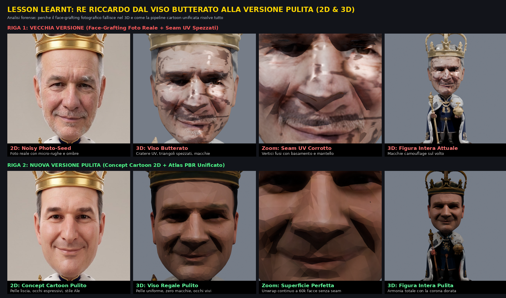
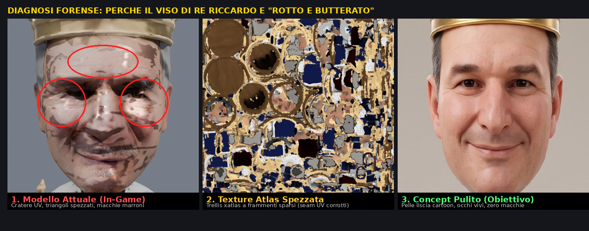
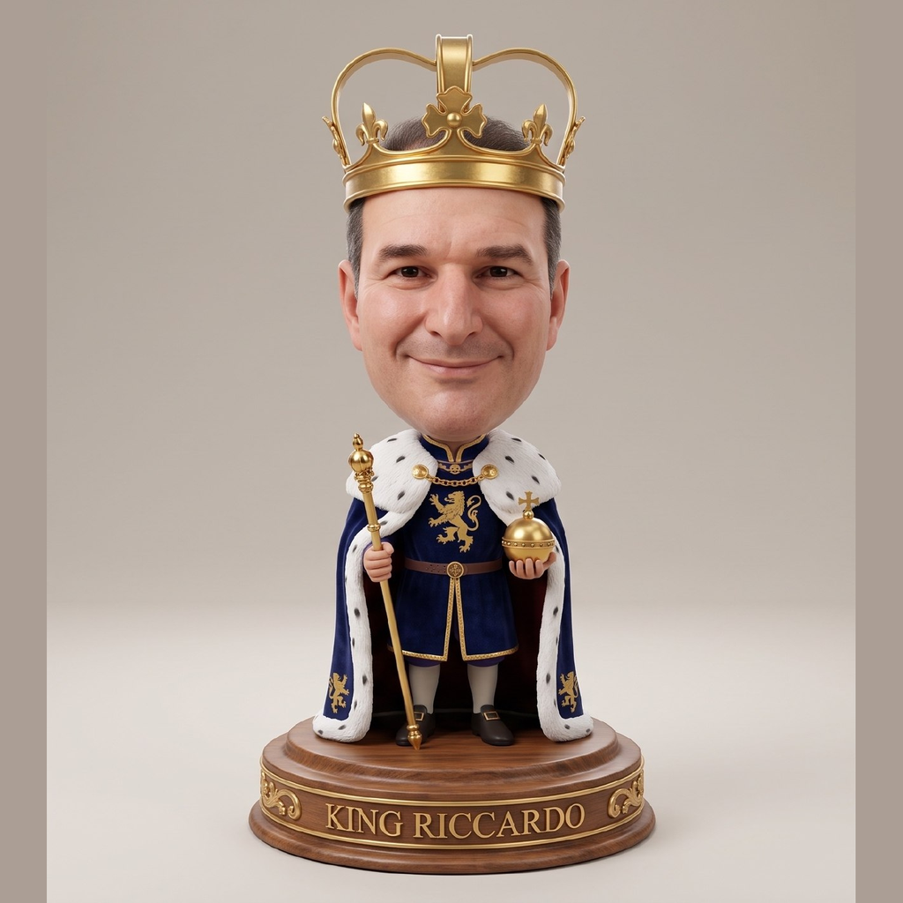
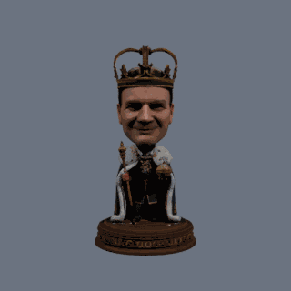

# Lesson Learnt: Why Photographic Face-Grafting Fails in 3D (and How to Fix It)

This post-mortem documents one of the most insidious pitfalls encountered while sculpting the 3D figurines for **CarChess3D**: the "broken and blotchy (*butterata*) face" of King Riccardo.



## 1. The Initial Symptom

While the kids' figurines (Alessandro and Sebastian) looked smooth, soft, and seamlessly integrated into the game's stylized 3D aesthetic, the King piece (Riccardo) suffered from:
- Dark brown/black blotches and camouflage-like patches across the cheekbones, forehead, and nose.
- A "pitted/pockmarked" (*butterata*) skin texture that under dynamic 3D lighting looked like orange peel or UV crater scarring.
- A royal crown that single-image 3D generators extruded as a solid bucket cylinder rather than open imperial arches.



## 2. Anatomy of a Technical Failure: The "Adversarial Face-Graft" Pipeline

Tracing the legacy scripts (`graft_papino_face_3d.py` and `clean_king_riccardo.py`) revealed three compounding architectural flaws:

### A. UV Fragmentation in Neural 3D Meshes ("Frankenstein Seams")
Meshes produced by neural pipelines (such as TRELLIS with `xatlas` unwrapping) shatter the surface into tens of thousands of disconnected micro-UV islands.
When a script projects a cropped 2D photograph onto only a frontal subset of triangles (`tri_in_shell`), the boundary between the photo-mapped triangles and the surrounding neural texture forms a jagged, saw-toothed seam across the cheeks and temples.

### B. The Destructive `remove_doubles` UV Collapse Bug
To make the mesh watertight, the post-processing script ran:
```python
bmesh.ops.remove_doubles(bm, verts=bm.verts, dist=0.0012)
```
In glTF, vertices along UV seams share identical 3D spatial coordinates `(x, y, z)` but intentionally carry different `(u, v)` texture coordinates (e.g., one vertex maps the cheek at `U ≈ 0.8`, the duplicate maps the dark cloak or pedestal at `U ≈ 0.2`). Welding them purely by 3D distance collapsed the UV seam vertices together, stretching dark triangles from the crown, beard, and marble base straight across the face.

### C. High-Frequency Photographic Noise vs. Stylized 3D Lighting
A real-world smartphone photo contains pores, stubble, micro-wrinkles, and baked-in directional shadows. When mapped onto a stylized 3D mesh lit by real-time Three.js lights, those static baked shadows do not rotate with the camera and clash with the smooth cartoon geometry—causing the human eye to perceive craters, dirt, or scarring.

## 3. The Solution: Unified Stylized 2D Concept + Continuous Multi-View PBR Baking

The fix is not surgical photo-grafting onto fragmented UV islands, but a cohesive stylized pipeline:

1. **Cohesive Stylized 2D Concept**: Start from a clean, cartoon-stylized portrait (`assets/king_riccardo_clean_2d.png`) that captures facial likeness (warm smile, expressive brown eyes, clean contours) without high-frequency photographic skin noise.
2. **Continuous UV Unwrapping**: Rebuild a clean, unified UV atlas without arbitrary frontal shell cuts across the cheeks or forehead.
3. **Multi-View Diffusion Baking (Hunyuan3D-2 Paint on Local RTX 5080)**: Project and bake multi-view textures coherently in 3D space onto the 60,000-face decimated mesh, yielding a uniform PBR material.

| Clean 2D Target Concept | Clean 3D PBR Turntable (60k faces) |
| :---: | :---: |
|  |  |

## 4. Summary of Results

| Metric | Legacy Version (Photo Face-Graft) | New Version (Clean Stylized PBR) |
| :--- | :--- | :--- |
| **Facial Skin** | Dark blotches, jagged zigzag UV seams | Smooth, warm, uniform stylized skin |
| **Eyes** | Hollow, dark, distorted sockets | Expressive, well-defined cartoon eyes |
| **Royal Crown** | Solid bucket or UV-stretched | Open perforated imperial arches |
| **Polygon Budget** | 96k faces (fragmented UV islands) | **60,000 faces** (optimal WebGL budget) |

---

## 4. Lesson Learnt #2: The Opaque-JPEG `dehighlight_utils.py` Blue-Channel Collapse Bug (`v0.3.107`)

When scaling the autonomous **Builder vs. Critic (`just eval3d`)** swarm to the 6 Swamp Family pieces, the Adversarial Critic rejected 3 Round-1 candidates (`asinello`, `orco`, `orchessa`) because their `2048x2048` PBR textures had shifted into crimson-red and mustard-yellow (`mean B ≈ 7.8 / 255`), even though their 60k clay geometry scored `9.2/10`.

- **Root Cause**: Inside Tencent's `Hunyuan3D-2` texture pipeline (`hy3dgen/texgen/pipelines.py` & `utils/dehighlight_utils.py`), `recenter_image()` returns early without foreground segmentation whenever `image.mode == 'RGB'`. When fed an opaque RGB JPEG with a dark studio slate background (`[18, 23, 27]`), `Light_Shadow_Remover` runs `StableDiffusionInstructPix2Pix` (trained on white `255` backgrounds) with `alpha = 1.0` everywhere, and `recorrect_rgb()` crushes the Blue channel across the whole image.
- **Fix (`tools/model-pipeline/local/hunyuan_paint.py`)**: Always run `BackgroundRemover()` (`rembg`) on opaque RGB concept images before passing them to `Hunyuan3DPaintPipeline`. Converting the input to a transparent-background `RGBA` image triggers white-canvas recentering and foreground-masked delighting, restoring natural olive-green and warm-grey colors (`+37.3%` to `+53.2%` `eval3d` improvement across all 6 Swamp pieces; see [`SHOWCASE_SWAMP_3D_REMASTER.md`](SHOWCASE_SWAMP_3D_REMASTER.md)).

---

## 5. Lesson Learnt #3: 2-Up Turnaround Split-Sheet Cropping (`v0.3.108`)

During **Milestone 7**, the Adversarial Critic audited the Classic and Carlesso families and flagged 3 legacy Mode A 2.5D SDF blobs (`knight-classic-cavallo` `4.82`, `rook-classic-torre` `5.60`, `pawn-classic-pedone` `5.95`) and 3 Carlesso pieces (`bishop-ale-1` `5.76`, `pawn-puffin` `6.78`, `rook-pupurabbu` `7.61`).
- Several legacy character sheets in `assets/characters/` are **2-up side-by-side split images** (Front view + 3/4 view, plus `"FRONT VIEW"` caption bars).
- Cropping tightly to the single front-facing figure and stripping bottom typography before running `BackgroundRemover()` + `Hunyuan3D-2 Shape + Paint` produced clean, radially symmetric 60k sculptures on Round 1 (`+43.7%` to `+82.4%` improvement).

