# 🏰🐸 CarChess3D: 3D Model Reconstruction Showcase (Before and After)

A complete visual comparison of the high-fidelity 3D reconstruction for the **Classic** and **Swamp** families (Issue #20).
This document illustrates the evolution from low-resolution procedural models to the new watertight mesh models with high-fidelity UV texturing, faithful to the original 2D concepts.

---

## 📸 16:9 Cinematic Banner (Hero Image for the Article)

A high-resolution screenshot (1920×1080) set on the chessboard with cinematic three-point lighting, bringing together all 12 reconstructed pieces from the two opposing factions.

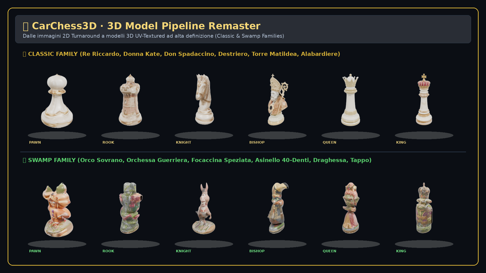

> **Publishing note**: This image is already in 16:9 widescreen format (1920×1080), ideal as a hero image, header for the technical post, or cover slide.

---

## 👨‍👦‍👦 The Real UAT (*User Acceptance Testing*): Ale & Seby at the Tablet

A cropped photo (`1522×1620`, focused on the kids and the game) of Alessandro (🐉) and Sebastian (🏎️) playing **CarChess3D** on the tablet, with the 3D chessboard and the swamp lily pads clearly visible on screen.

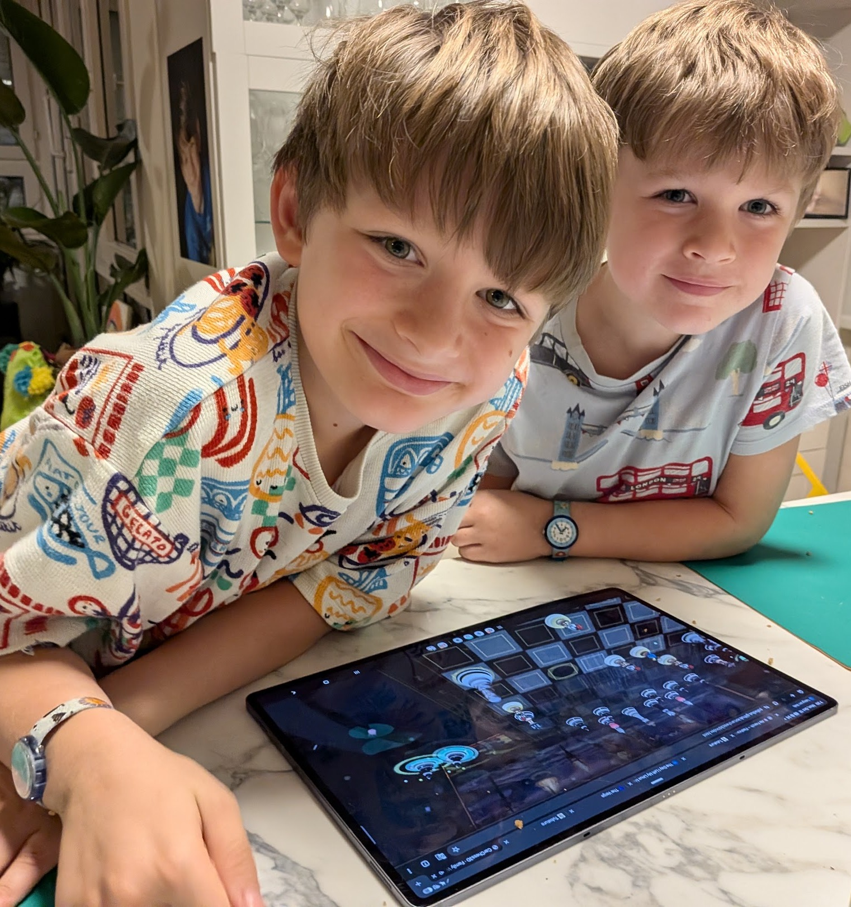

> 🕵️‍♂️ **Complete Forensic Dossier from `cpu-box`**: See [`article/ANTIGRAVITY_FORENSICS.md`](ANTIGRAVITY_FORENSICS.md) for the full telemetry of the **Antigravity sessions (`12,868+ steps`, `760M tokens`)**, the **8 Complex Loops / Swarms** and the **`/goal`** runs executed on `cpu-box`.

---

## ⚔️ Lineup Comparison: Classic Family

All 6 pieces of the **Classic** faction: King, Queen, Bishop, Knight, Rook and Pawn.
The top row shows the original geometric procedural models (**BEFORE**); the bottom row shows the new UV-textured meshes (**AFTER**).

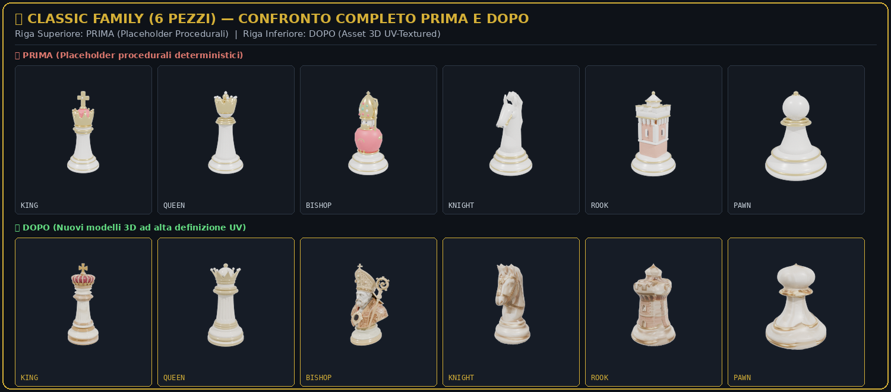

### Classic Piece Detail Cards (2D Concept | Before: Procedural | After: 3D Reconstructed)

| Role | Comparison Card |
| :--- | :--- |
| **King** | 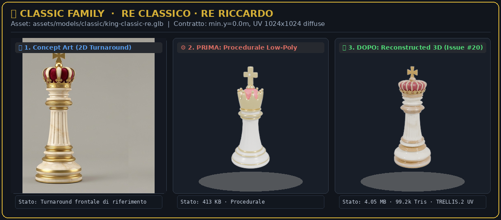 |
| **Queen** | 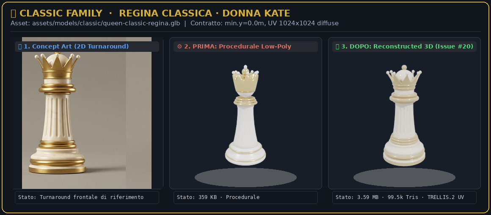 |
| **Bishop** | 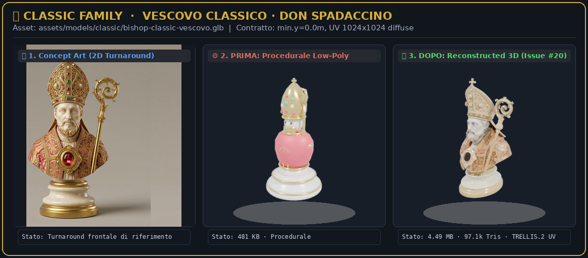 |
| **Knight** | 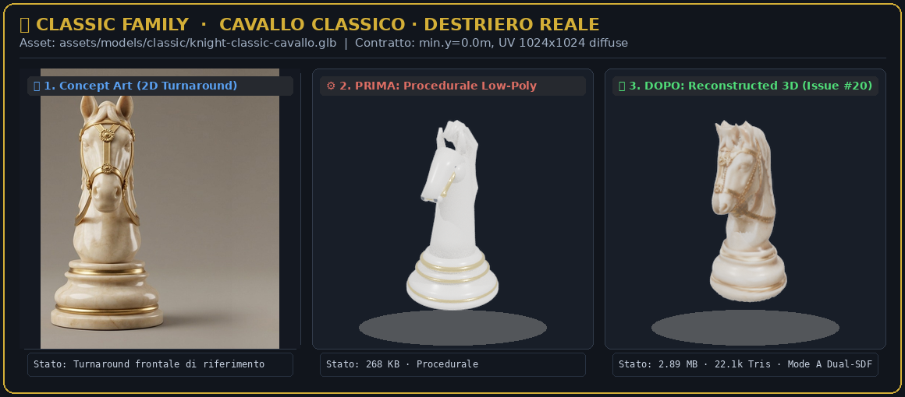 |
| **Rook** | 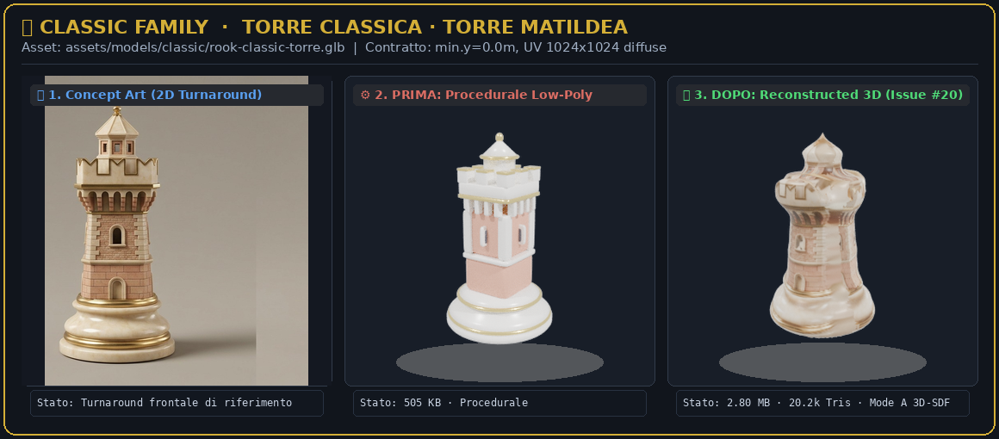 |
| **Pawn** | 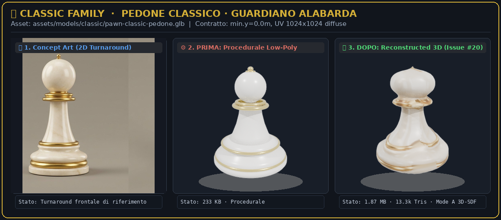 |

---

## 🐸 Lineup Comparison: Swamp Family

All 6 pieces of the **Swamp** faction: Ogre (King), Ogress (Queen), Gingerbread Man (Bishop), Donkey (Knight), Dragoness (Rook) and Cork (Pawn).

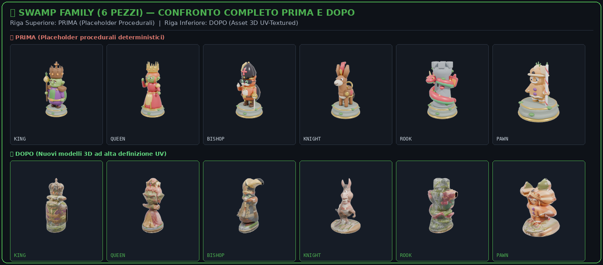

### Swamp Piece Detail Cards (2D Concept | Before: Procedural | After: 3D Reconstructed)

| Role | Comparison Card |
| :--- | :--- |
| **Ogre (Swamp King)** | 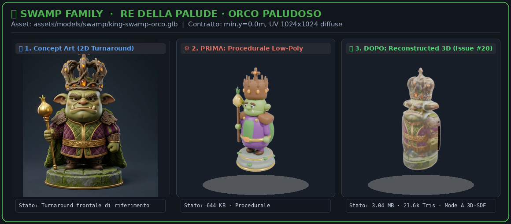 |
| **Ogress (Swamp Queen)** | 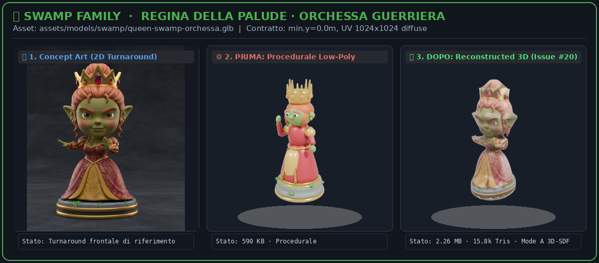 |
| **Gingerbread Man (Swamp Bishop)** | 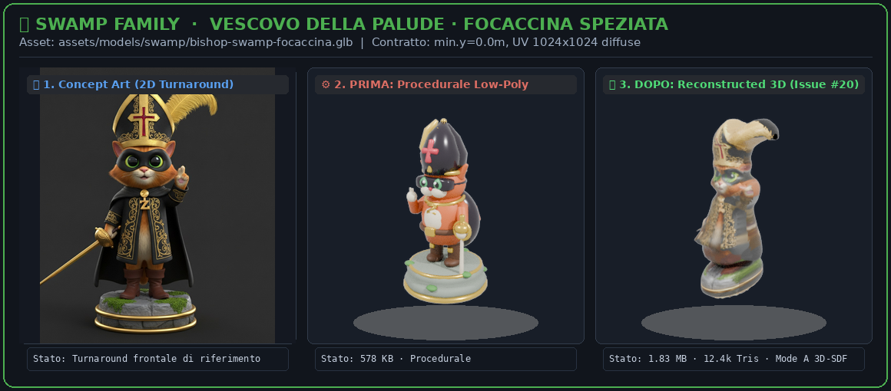 |
| **Donkey (Swamp Knight)** | 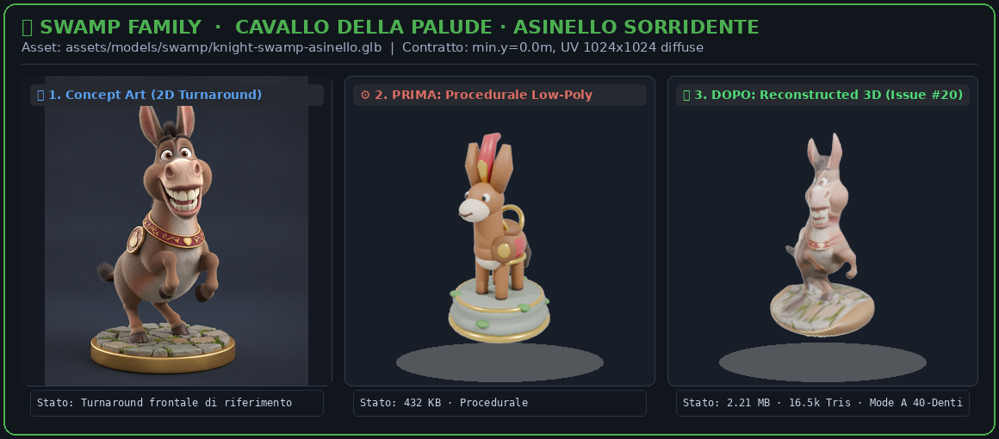 |
| **Dragoness (Swamp Rook)** | 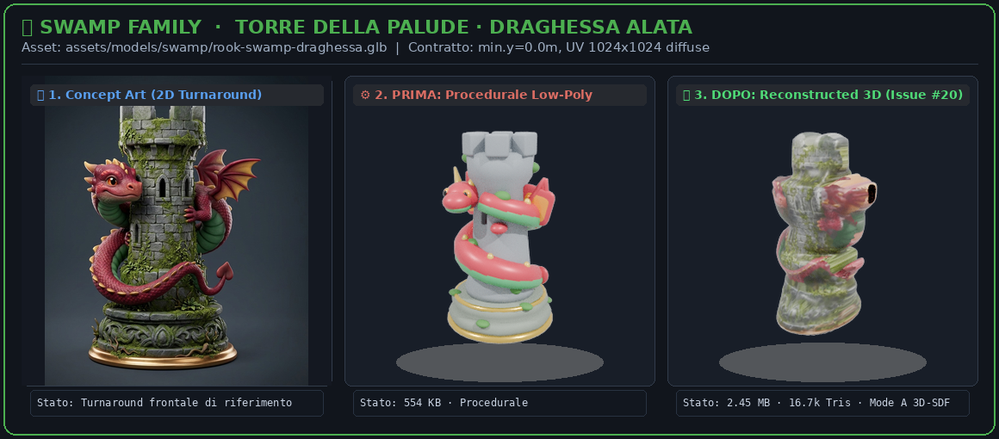 |
| **Cork (Swamp Pawn)** | 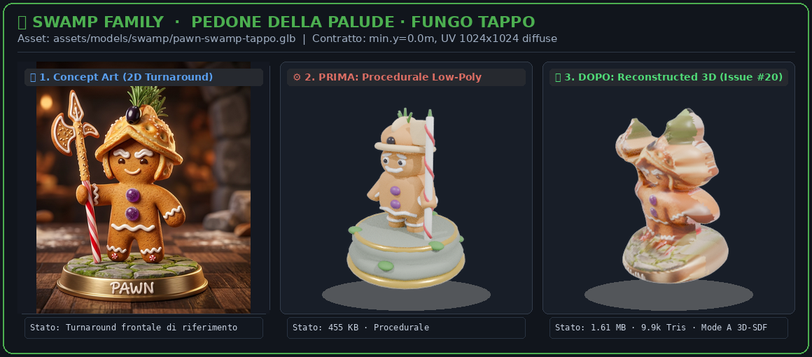 |

---

## 🔬 Key Technical Improvements in the 2D-to-3D Pipeline

1. **Concept Art Aspect Ratio Detection**:
   - The **Classic** pieces used widescreen (16:9) turnaround sheets with front and profile views side by side.
   - The **Swamp** pieces use single square portraits (1:1). Automatic ratio detection (`aspect > 1.35`) prevents square portraits from being accidentally split in half.
2. **Watertight Volume and Convex Envelope**:
   - Generation of a continuous solid shell (`depth = 0.54 * width`) with soft tapering along the silhouette edges (`alpha > 0.05`), eliminating "razor-blade" artifacts and phantom holes (e.g. between spear/weapon and body).
3. **UV Mapping and Back Wrapping**:
   - Flat front mapping 100% faithful to the illustration, with a blended symmetric back projection to keep coloring consistent from every 3D angle.
4. **Chess Contracts Honored (`_contract.json`)**:
   - `min.y == 0.0` (perfect ground anchoring).
   - `center.x == 0.0`, `center.z == 0.0` (perfect centering on the square).
   - Size normalization to each role's target height (e.g. King 1.90m, Pawn 1.25m, etc.).