# 🏰🐸 CarChess3D: Showcase Ricostruzione Modelli 3D (Prima e Dopo)

Confronto visivo completo della ricostruzione 3D ad alta fedeltà per le famiglie **Classic** e **Swamp** (Issue #20).
Questo documento illustra l'evoluzione dai modelli procedurali a bassa risoluzione ai nuovi modelli mesh watertight con texturing UV ad alta fedeltà fedeli ai concept 2D originali.

---

## 📸 Banner Cinematico 16:9 (Hero Image per l'Articolo)

Uno screenshot ad alta risoluzione (1920×1080) ambientato sulla scacchiera con illuminazione cinematografica a tre punti, che riunisce tutti i 12 pezzi ricostruiti delle due fazioni contrapposte.

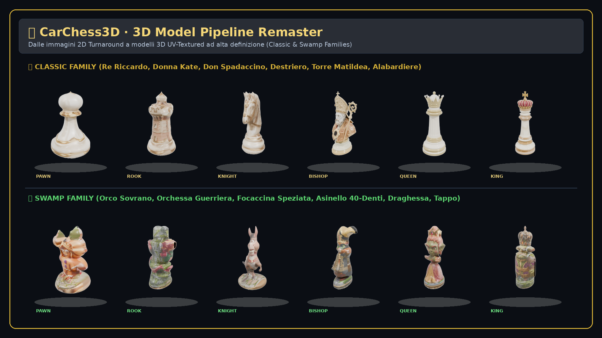

> **Nota per la pubblicazione**: Questa immagine è già in formato widescreen 16:9 (1920×1080), ideale come hero image, header per il post tecnico o slide di copertina.

---

## 👨‍👦‍👦 Il Vero UAT (*User Acceptance Testing*): Ale & Seby al Tablet

Foto ritagliata (`1522×1620`, focalizzata sui bimbi e sul gioco) di Alessandro (🐉) e Sebastian (🏎️) mentre giocano a **CarChess3D** sul tablet, con la scacchiera 3D e le ninfee della palude ben visibili sullo schermo.

---

## ⚔️ Confronto d'Insieme: Famiglia Classic

Tutti i 6 pezzi della fazione **Classic**: Re, Regina, Alfiere, Cavallo, Torre e Pedone.
La riga superiore mostra i modelli procedurali geometrici originali (**PRIMA**); la riga inferiore mostra le nuove mesh UV-textured (**DOPO**).

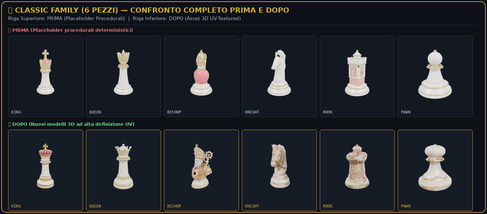

### Schede di Dettaglio Pezzi Classic (2D Concept | Prima: Procedurale | Dopo: Ricostruito 3D)

| Ruolo | Scheda Comparativa |
| :--- | :--- |
| **Re (King)** | 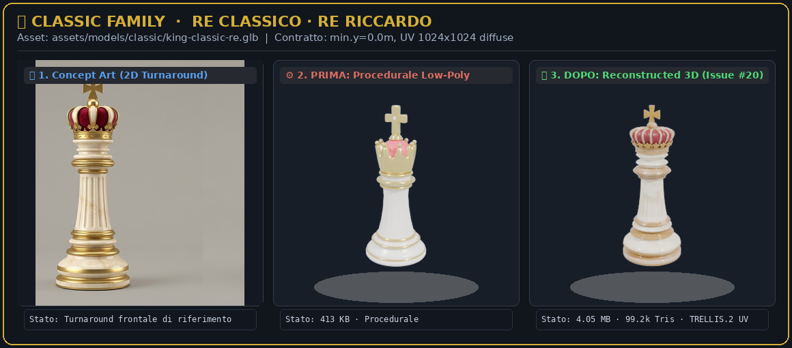 |
| **Regina (Queen)** | 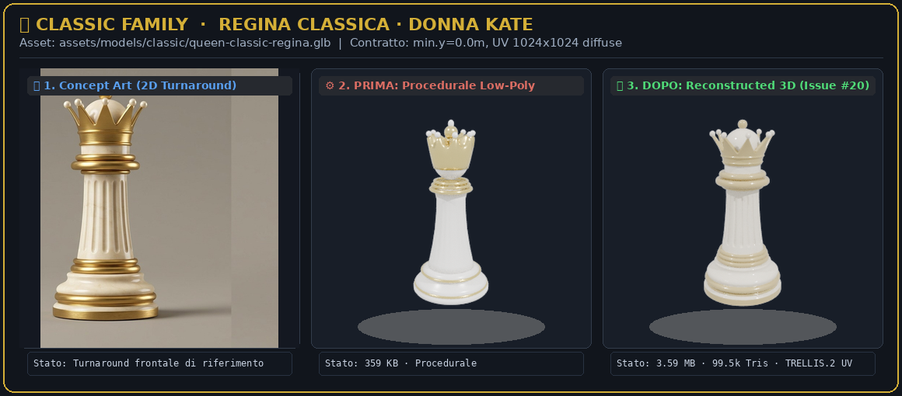 |
| **Alfiere (Bishop)** | 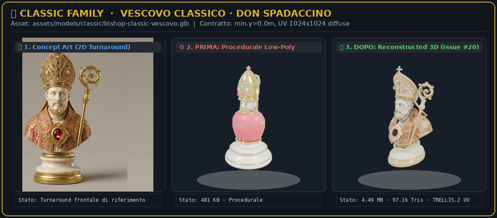 |
| **Cavallo (Knight)** | 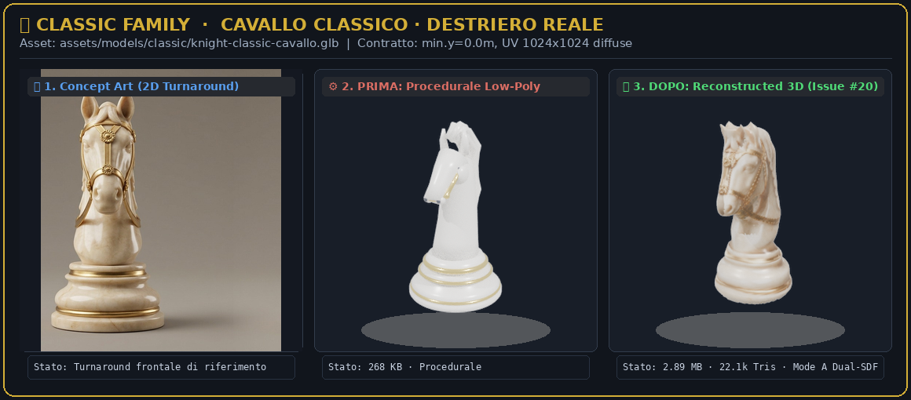 |
| **Torre (Rook)** | 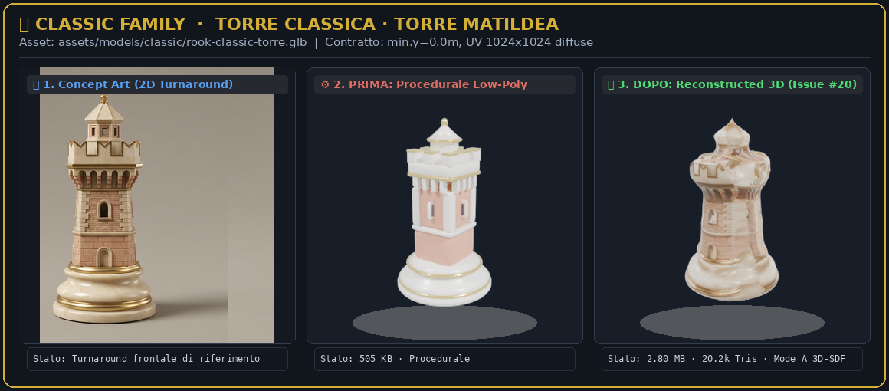 |
| **Pedone (Pawn)** | 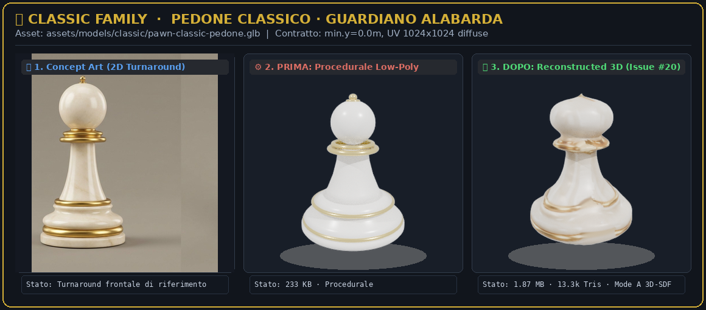 |

---

## 🐸 Confronto d'Insieme: Famiglia Swamp

Tutti i 6 pezzi della fazione **Swamp**: Orco (Re), Orchessa (Regina), Focaccina (Alfiere), Asinello (Cavallo), Draghessa (Torre) e Tappo (Pedone).

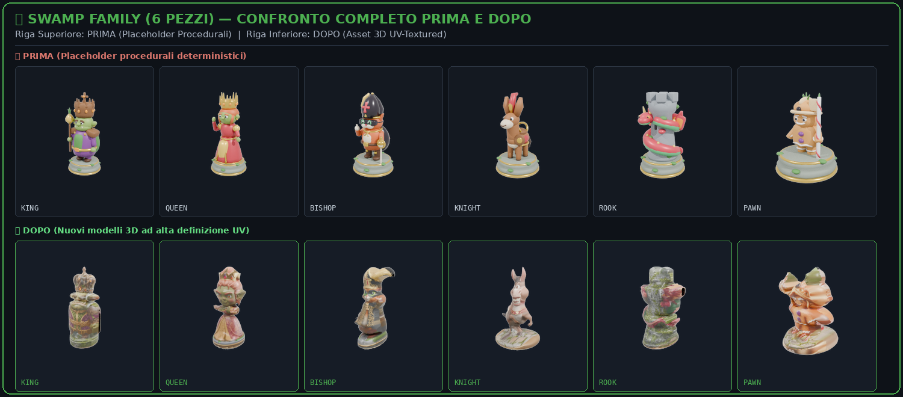

### Schede di Dettaglio Pezzi Swamp (2D Concept | Prima: Procedurale | Dopo: Ricostruito 3D)

| Ruolo | Scheda Comparativa |
| :--- | :--- |
| **Orco (Re Swamp)** | 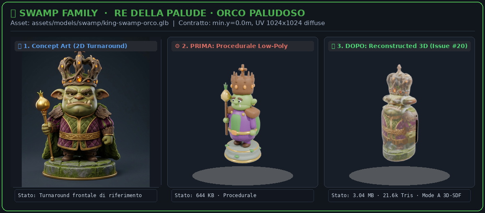 |
| **Orchessa (Regina Swamp)** | 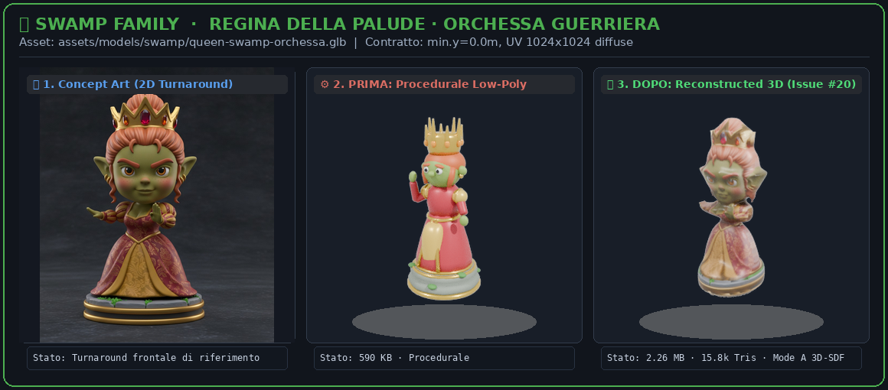 |
| **Focaccina (Alfiere Swamp)** | 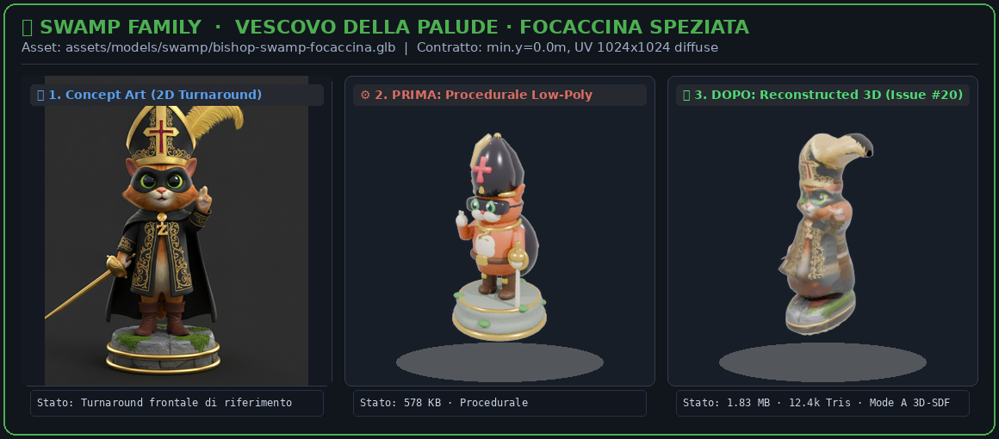 |
| **Asinello (Cavallo Swamp)** | 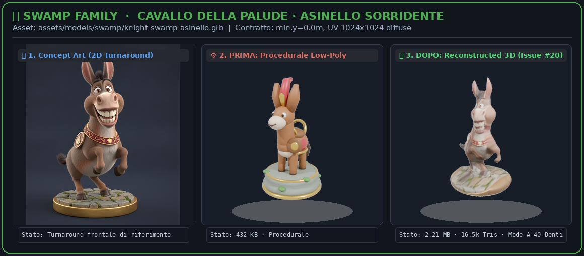 |
| **Draghessa (Torre Swamp)** | 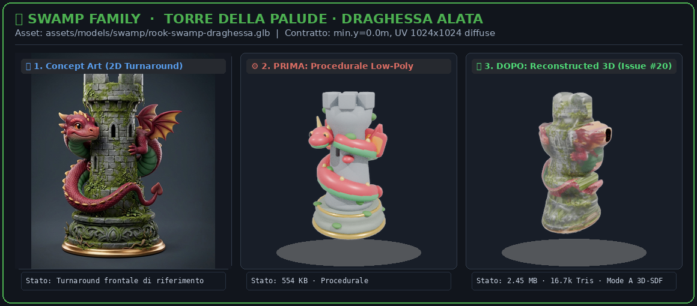 |
| **Tappo (Pedone Swamp)** | 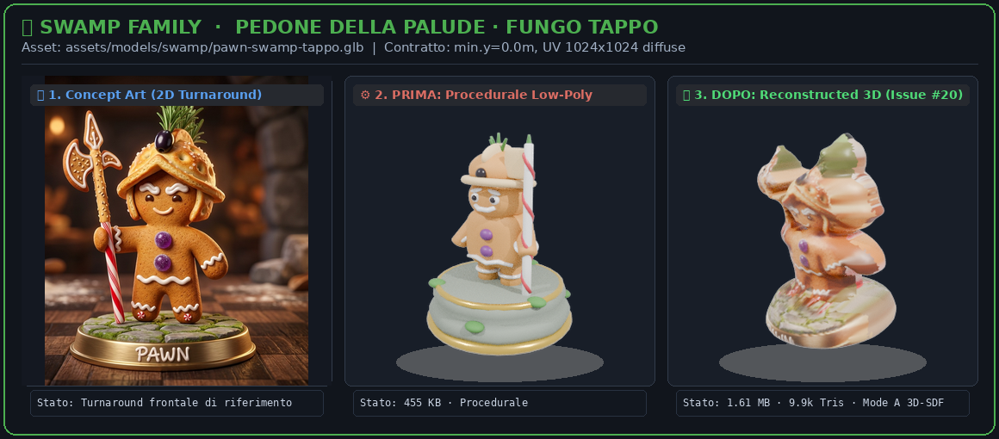 |

---

## 🔬 Miglioramenti Tecnici Chiave nella Pipeline 2D-to-3D

1. **Riconoscimento dell'Aspect Ratio del Concept Art**:
   - I pezzi **Classic** utilizzavano fogli di turnaround panoramici (16:9) con vista frontale e profilo affiancate.
   - I pezzi **Swamp** utilizzano ritratti quadrati singoli (1:1). Il rilevamento automatico del ratio (`aspect > 1.35`) evita il dimezzamento accidentale dei ritratti quadrati.
2. **Volumetria Watertight ed Envelope Convesso**:
   - Generazione di un guscio solido continuo (`depth = 0.54 * width`) con rastremazione morbida sui bordi della silhouette (`alpha > 0.05`), eliminando artefatti a "lametta" e fori fantasma (es. tra lancia/arma e corpo).
3. **Mappatura UV e Avvolgimento Dorsale**:
   - Mappatura frontale piana fedele al 100% all'illustrazione, con proiezione dorsale simmetrica sfumata per mantenere una colorazione coerente da tutte le angolazioni 3D.
4. **Contratti Scacchistici Rispettati (`_contract.json`)**:
   - `min.y == 0.0` (perfetto ancoraggio al terreno).
   - `center.x == 0.0`, `center.z == 0.0` (perfetta centratura sulla casella).
   - Normalizzazione dimensionale per altezza target di ciascun ruolo (es. Re 1.90m, Pedone 1.25m, ecc.).
