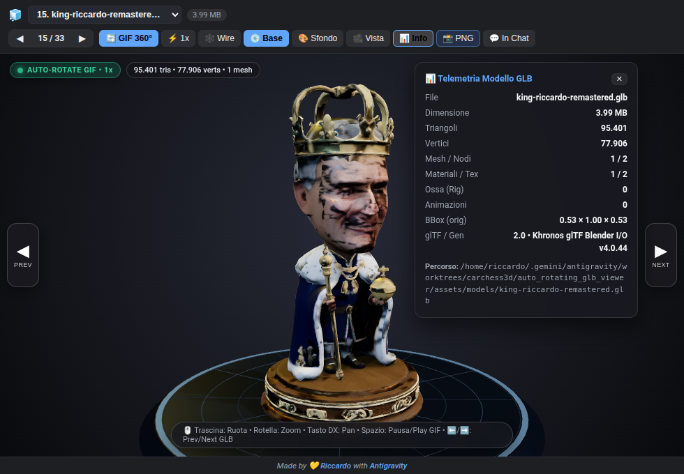
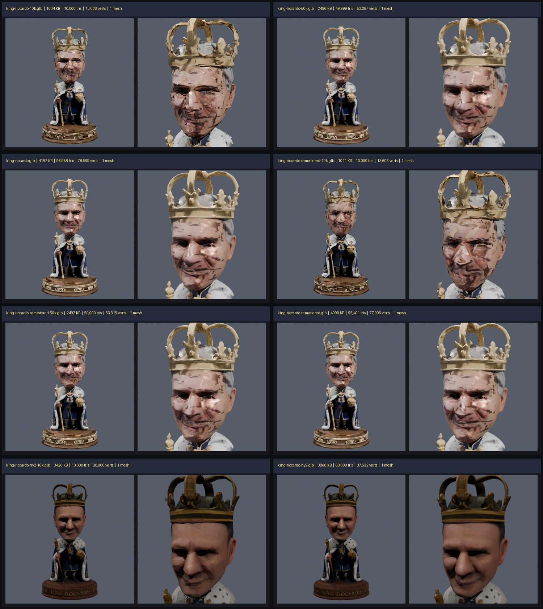
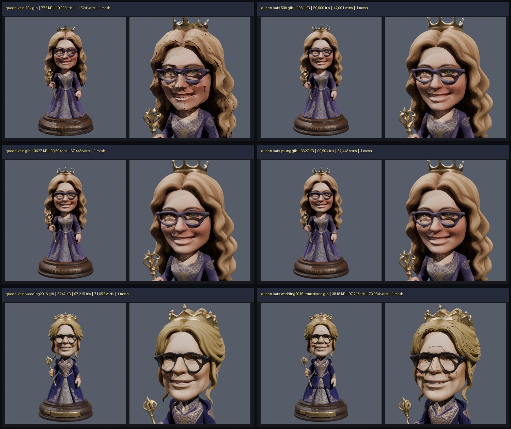
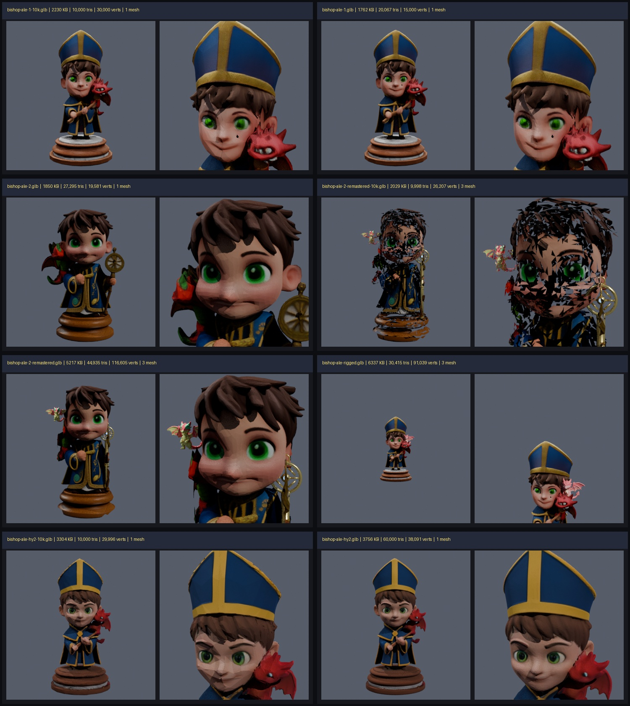
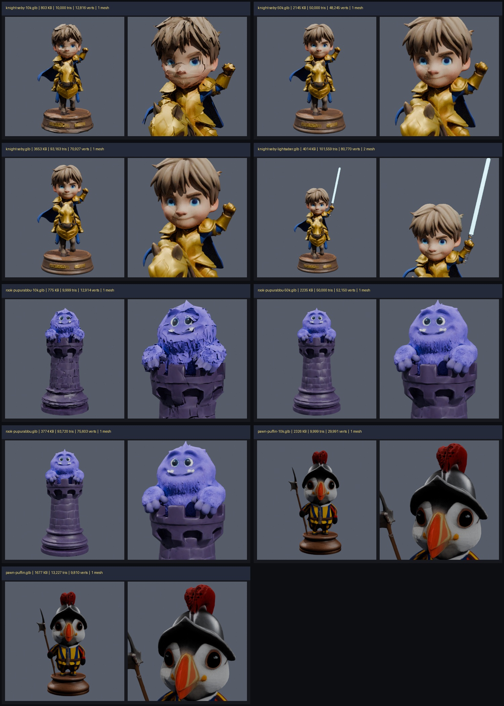

# Showcase: Antigravity GLB 3D Turntable Sidecar & Full Roster Visual Audit

Thanks to the new **Antigravity GLB 3D Viewer Sidecar** (`glb-viewer`), inspecting every `.glb` in `assets/models/` at 360° immediately exposed critical UV-decimation and face-grafting defects that had been hidden by static thumbnails and optimistic VLM scores (`docs/qa-scores.yaml`).

---

## 1. King Riccardo (`audit_king_riccardo.jpg`) — ❌ Broken Across All Grafted / Decimated Variants

- **Root Cause #1 (Mode B Planar Face Graft + Mismatched Metallic/Roughness Map)**:
  - `king-riccardo.glb` (96,958 tris, 4.1 MB) and `king-riccardo-remastered.glb` (95,401 tris, 4.0 MB) were modified by `tools/model-pipeline/king/graft_papino_face_3d.py` (`2048x1024` dual-chart UV splice), which left `Image 1` (`metallicRoughnessTexture`) on the original `1024x1024` `xatlas` layout and tore UV island boundaries across the cheeks, nose, and mouth.
- **Root Cause #2 (Unconstrained 10k QEC Decimation)**:
  - `king-riccardo-10k.glb` and `king-riccardo-remastered-10k.glb` collapsed 90% of triangles across UV seams (`mod.decimate_type = 'COLLAPSE'` without `delimit={'UV'}`), pulling black background texels across the entire face.
- **Local Hunyuan3D-2 Variant (`king-riccardo-hy2.glb`, 60k tris, 3.8 MB)**:
  - Free of black UV tears, but lacks Riccardo's salt-and-pepper beard (`brizzolati`) and glasses, and has dark/flat facial shading. **Action**: Delete broken `-10k`/`-50k`/`grafted` variants and regenerate a clean, high-fidelity King Riccardo 3D model.

---

## 2. Queen Kate (`audit_queen_kate.jpg`) — ✅ Full-Res & 50k Are Clean; ❌ `10k` & `wedding2016-remastered` Are Broken

- **Clean Production Models (Keep!)**:
  - `queen-kate.glb` (99,504 tris, 3.6 MB) and `queen-kate-young.glb` (99,504 tris, 3.6 MB): **100% clean face, glasses, and hair**.
  - `queen-kate-50k.glb` (50,000 tris, 1.9 MB): **Clean** — 50% size reduction with zero facial UV tearing.
  - `queen-kate-wedding2016.glb` (97,215 tris, 3.7 MB): **100% clean** original TRELLIS.2 wedding updo model.
- **Broken Models (Delete / Regenerate with `delimit={'UV'}`)**:
  - `queen-kate-10k.glb` (10,000 tris, 772 KB): Severe black UV-seam tears across cheeks, glasses, mouth, and hair caused by `generate_lod_tiers.py` collapsing across `xatlas` UV seams.
  - `queen-kate-wedding2016-remastered.glb` (97,215 tris, 3.8 MB): Black seam lines across forehead, nose bridge, and cheeks caused by `clean_queen_kate.py` welding vertices across UV seams (`remove_doubles`). Replace with clean `queen-kate-wedding2016.glb`.

---

## 3. Bishop Ale (`audit_bishop_ale.jpg`) — ✅ `bishop-ale-hy2.glb` Is Clean; ⚠️ 2 Bugs in Legacy / Modular Variants

- **Gold Standard Winner (`bishop-ale-hy2.glb`, 60,000 tris, 3.75 MB)**:
  - Generated locally on RTX 5080 via Hunyuan3D-2: **clean face skin**, bright green eyes, single well-sculpted red dragon on shoulder, clean mitre hat.
- **The 2 Bugs in `bishop-ale-rigged.glb` & `bishop-ale-2-remastered.glb`**:
  1. **Bug #1 — Duplicate / Ghost Pink Dragon**: `assemble_modular_bishop.py` and `assemble_modular_ale2.py` mounted the secondary `dragon_clean.glb` mesh (which renders pale pink due to unlinked vertex colors) **without removing the original red dragon already baked into the base shoulder mesh**, resulting in **two overlapping dragons** (or a floating pink dragon hovering mid-air next to Ale's ear in `bishop-ale-2-remastered.glb`).
  2. **Bug #2 — Cheek UV Scar / Black Dot & Exploded 10k Mesh**:
     - `bishop-ale-1.glb` / `bishop-ale-rigged.glb` have a dark mole/artifact under the left eye and a diagonal UV seam line across the right cheek.
     - `bishop-ale-2-remastered-10k.glb` is completely shattered into black holes across the entire head and torso.

---

## 4. Knight Seby, Rook Pupurabbu & Pawn Puffin (`audit_seby_rook_pawn.jpg`)

- **Clean Production Models (Keep!)**:
  - `knight-seby.glb` (93k tris), `knight-seby-lightsaber.glb` (101k tris), `knight-seby-halberd.glb`, `knight-seby-aurora.glb`, and `knight-seby-50k.glb` (50k tris) are **flawless**.
  - `rook-pupurabbu.glb` (93k tris), `rook-pupurabbu-50k.glb` (50k tris), and `pawn-puffin.glb` (13k tris) are **clean**.
- **Broken `-10k` Models (Delete / Fix Decimator)**:
  - `knight-seby-10k.glb` and `rook-pupurabbu-10k.glb` suffer from the same `generate_lod_tiers.py` UV-seam collapse scars on the face/fur.
  - `pawn-puffin-10k.glb` (2,326 KB) is actually **larger** in file size than the un-decimated `pawn-puffin.glb` (1,677 KB, 13,227 tris)!
