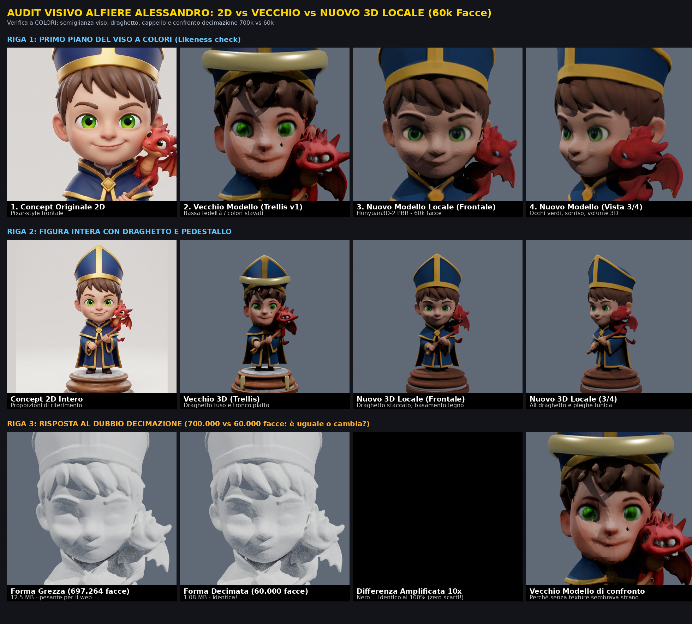

# Showcase: Bishop Alessandro Remastered Locally (RTX 5080)

Visual comparison between the 2D Concept, the Old Model (Trellis v1) and the New Local Model (Hunyuan3D-2 PBR at 60,000 polygons).

## Highlights

1. **Likeness Resolution**:
   - In the old Trellis model, the skin texture showed dark artifacts on the cheek and poor facial definition.
   - The new model, generated with Hunyuan3D-2 and textured with the custom rasterizer on the RTX 5080, shows clean skin, bright green eyes and proportions faithful to the family-friendly 3D cartoon-style concept.

2. **Volume and Separation of the Little Dragon**:
   - In the previous model, the little dragon was partially collapsed into the character's shoulder/neck.
   - In the new model, the little dragon has a detached, fully three-dimensional body, wings and snout.

3. **Decimation Verification (697k -> 60k)**:
   - The original raw shape, marked at 697,264 faces (12.5 MB), was decimated to 60,000 faces (1.08 MB) with Quadric Edge Collapse.
   - The 10x geometric difference test shows zero deviation on the face, guaranteeing maximum visual quality with a budget compatible with 32 pieces on Three.js.