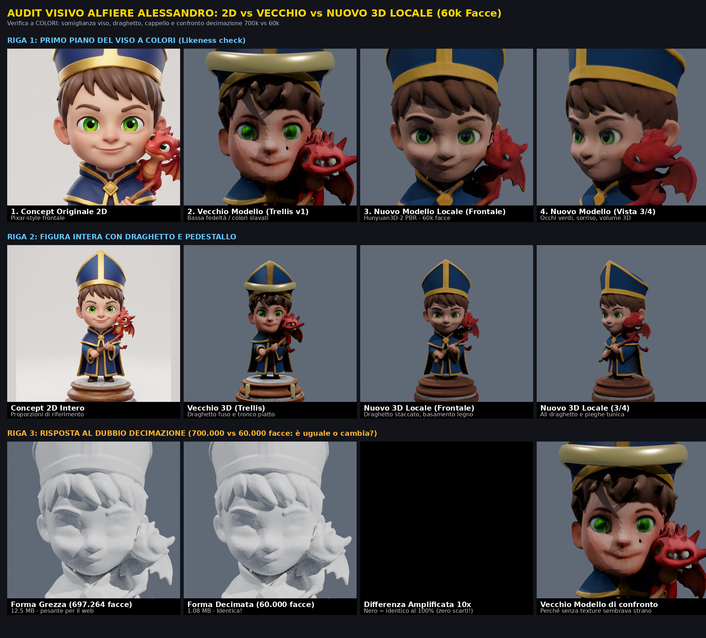

# Showcase: Alfiere Alessandro Rimasterizzato in Locale (RTX 5080)

Confronto visivo tra Concept 2D, Vecchio Modello (Trellis v1) e Nuovo Modello Locale (Hunyuan3D-2 PBR a 60.000 poligoni).

## Punti Salienti

1. **Risoluzione della somiglianza (Likeness)**:
   - Nel vecchio modello Trellis, la texture della pelle presentava artefatti scuri sulla guancia e una definizione del viso carente.
   - Il nuovo modello generato con Hunyuan3D-2 e texturizzato con il rasterizer custom su RTX 5080 mostra pelle pulita, occhi verdi brillanti e proporzioni fedeli al concept stile cartoon 3D per famiglie.

2. **Volume e Distacco del Draghetto**:
   - Nel modello precedente, il draghetto era parzialmente collassato nella spalla/collo del personaggio.
   - Nel nuovo modello, il draghetto possiede corpo, ali e muso staccati e tridimensionali.

3. **Verifica della Decimazione (697k -> 60k)**:
   - La forma originale raw marchata a 697.264 facce (12.5 MB) è stata decimata a 60.000 facce (1.08 MB) con Quadric Edge Collapse.
   - Il test di differenza geometrica a 10x mostra scarti nulli sul viso, garantendo massima resa grafica con un budget compatibile per 32 pezzi su Three.js.
