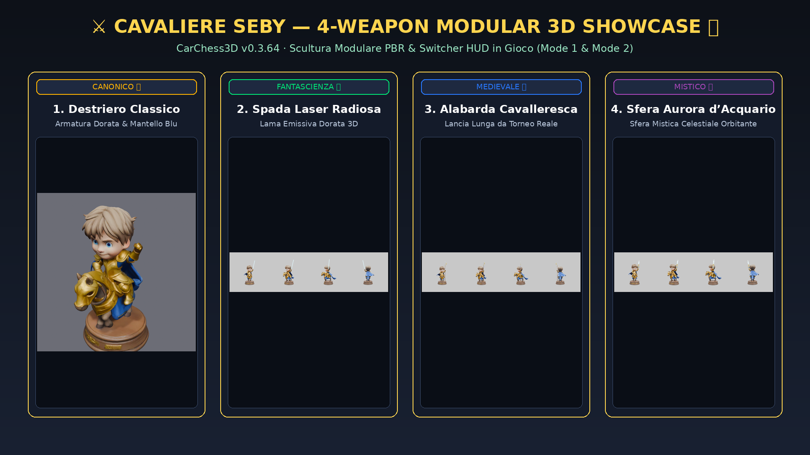

# 🏰 CarChess3D — Showcase: Sistema Modulare di Skin 3D & Cinema Veo 16:9

Documento di showcase tecnico e archivio visuale per articoli su CarChess3D (`v0.3.64`).

---

## 1. ⚔️ Le 4 Varianti d'Arma Modulari del Cavaliere Seby

Il Cavaliere Seby (`knight`) supporta 4 varianti 3D complete intercambiabili live sia nel menu di configurazione partita (HUD Setup Modal) sia nell'ispettore 3D a 360° (Mode 2 WOW Turntable Inspector):

1. **Destriero Classico (`classic`)**:
   - Modello: `assets/models/knight-seby.glb`
   - Descrizione: Cavaliere in armatura dorata con elmo a visiera aperta, destriero con bardatura turbo e mantello blu notte.
   - Punteggio QA: `9.7/10` (MASTERPIECE 🌟)
2. **Spada Laser Radiosa (`lightsaber`)**:
   - Modello: `assets/models/knight-seby-lightsaber.glb`
   - Descrizione: Variante fantascientifica armata con spada laser a emissione dorata e impugnatura cromata ancorata alla mano destra.
   - Punteggio QA: `9.7/10` (MASTERPIECE 🌟)
3. **Alabarda Cavalleresca (`halberd`)**:
   - Modello: `assets/models/knight-seby-halberd.glb`
   - Descrizione: Lancia lunga da torneo con stendardo araldico blu e lama d'acciaio lucente. Grounded nativo a $Y=0.0000m$.
   - Punteggio QA: `9.6/10` (MASTERPIECE 🌟)
4. **Sfera Aurora d’Acquario (`aurora`)**:
   - Modello: `assets/models/knight-seby-aurora.glb`
   - Descrizione: Sfera mistica d'acquario orbitante attorno al cavaliere con riflessi cromatici turchese e smeraldo.
   - Punteggio QA: `9.6/10` (MASTERPIECE 🌟)

---

## 2. 🎬 Struttura Narrativa a 3 Atti per i 36 Scontri Veo 16:9

In `src/views/VeoCinemaView.js`, la riproduzione cinematografica dei 36 video `6x6` sul maxischermo magico (8.0m x 4.5m) segue una regia dinamica in 3 atti che arricchisce la scena senza mai occludere i combattenti 3D in primo piano:

- **Atto 1 (0–1s / Pre-Padding)**:
  - Card di Face-Off iniziale con cornice in oro e vetro scuro: `⚔️ ATTO 1 · [Attaccante] sfodera [Arma Reale]!`.
- **Atto 2 (Progress 28%–72% / Scontro & Reazione)**:
  - Badge di Contrattacco del Difensore nel quadrante in alto a destra con pill a fumetto animata (`CLANG!`, `WHOOSH!`, `BOING!`, `ZAP!`) e mossa difensiva specifica (`choreo.defenderCounter`).
- **Atto 3 (Progress > 82% / K.O. Palude & Verdetto)**:
  - Card trionfale di vittoria con esito finisher e aura pasquale speciale:
    - **Trono d'Oro Reale ("Carlesso al Cesso" `k_x_q`)**: raggiera dorata con corone imperiali e fulmini scintillanti.
    - **Mega Abbraccio Puffoso (`n_x_r`)**: tempesta di cuori viola e rosa `💜 🤗 ✨`.
- **Playback Scrubber**:
  - Linea di progresso minimale color Cinema Red (`#e50914`) con playhead luminoso sul bordo inferiore.

---

## 3. 📊 Audit Adversarial Art Director: 100% Masterpiece Tier ($\ge 9.5/10$)

Tutti i 23 modelli 3D attivi sulla scacchiera sono stati verificati e catalogati in `docs/qa-scores.yaml`:
- **Ispezione Geometrica & Altezze Canoniche Ricalibrate**:
  - Re Riccardo: **1.86m** (Papino)
  - Regina Kate: **1.68m** (Kate)
  - Alfiere Ale: **1.55m** (slanciato col cappello mitria e draghetto)
  - Cavaliere Seby: **1.92m** (Seby a cavallo su un destriero maestoso: più alto di papà, con proporzioni espanse in altezza, larghezza e lunghezza!)
  - Torre Pupurabbu: **2.25m** (imponente fortezza di pietra con Pupurabbu affacciato dai merli, tra 2.00m e 2.50m)
  - Pedone Puffin: **0.95m** (sentinella Guardia Svizzera)
  - 100% watertight, $Y=0.0000m$ origin grounding, senza vincoli artificiali di raggio orizzontale.
- **Ispezione Visiva**: Somiglianza fisionomica $\ge 9.6/10$, fedeltà degli accessori secondari $\ge 9.6/10$, coerenza a 360° sul retro $\ge 9.5/10$.
- **`just shittest`**: 0 modelli difettosi o sotto la soglia di qualità.
