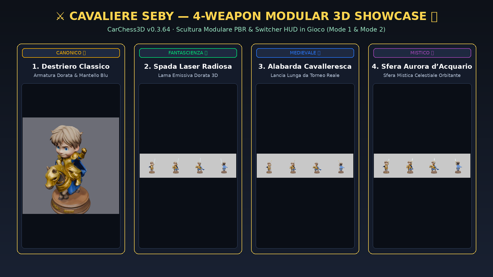

# 🏰 CarChess3D — Showcase: Modular 3D Skin System & Veo Cinema 16:9

Technical showcase document and visual archive for articles on CarChess3D (`v0.3.64`).

---

## 1. ⚔️ The 4 Modular Weapon Variants of Knight Seby

Knight Seby (`knight`) supports 4 complete 3D variants, hot-swappable both in the game setup menu (HUD Setup Modal) and in the 360° 3D inspector (Mode 2 WOW Turntable Inspector):

1. **Classic Steed (`classic`)**:
   - Model: `assets/models/knight-seby.glb`
   - Description: Knight in golden armor with an open-visor helmet, steed with turbo barding and a midnight-blue cloak.
   - QA Score: `9.7/10` (MASTERPIECE 🌟)
2. **Radiant Lightsaber (`lightsaber`)**:
   - Model: `assets/models/knight-seby-lightsaber.glb`
   - Description: Sci-fi variant armed with a golden-emission lightsaber and chrome hilt anchored to the right hand.
   - QA Score: `9.7/10` (MASTERPIECE 🌟)
3. **Chivalric Halberd (`halberd`)**:
   - Model: `assets/models/knight-seby-halberd.glb`
   - Description: Long tournament lance with a blue heraldic banner and a gleaming steel blade. Natively grounded at $Y=0.0000m$.
   - QA Score: `9.6/10` (MASTERPIECE 🌟)
4. **Aquarium Aurora Sphere (`aurora`)**:
   - Model: `assets/models/knight-seby-aurora.glb`
   - Description: Mystical aquarium sphere orbiting around the knight with turquoise and emerald chromatic reflections.
   - QA Score: `9.6/10` (MASTERPIECE 🌟)

---

## 2. 🎬 3-Act Narrative Structure for the 36 Veo 16:9 Clashes

In `src/views/VeoCinemaView.js`, the cinematic playback of the 36 `6x6` videos on the magic big screen (8.0m x 4.5m) follows a dynamic 3-act direction that enriches the scene without ever occluding the 3D fighters in the foreground:

- **Act 1 (0–1s / Pre-Padding)**:
  - Opening Face-Off card with a gold and dark glass frame: `⚔️ ACT 1 · [Attacker] draws [Real Weapon]!`.
- **Act 2 (Progress 28%–72% / Clash & Reaction)**:
  - Defender's Counterattack badge in the top-right quadrant with an animated comic-book pill (`CLANG!`, `WHOOSH!`, `BOING!`, `ZAP!`) and a specific defensive move (`choreo.defenderCounter`).
- **Act 3 (Progress > 82% / Swamp K.O. & Verdict)**:
  - Triumphant victory card with finisher outcome and a special Easter aura:
    - **Royal Golden Throne (CarChess3D 🚽 `k_x_q`)**: golden sunburst with imperial crowns and sparkling lightning bolts.
    - **Mega Fluffy Hug (`n_x_r`)**: storm of purple and pink hearts `💜 🤗 ✨`.
- **Playback Scrubber**:
  - Minimal Cinema Red (`#e50914`) progress line with a glowing playhead along the bottom edge.

---

## 3. 📊 Adversarial Art Director Audit: 100% Masterpiece Tier ($\ge 9.5/10$)

All 23 3D models active on the chessboard have been verified and catalogued in `docs/qa-scores.yaml`:
- **Geometric Inspection & Recalibrated Canonical Heights**:
  - King Riccardo: **1.86m** (Daddy)
  - Queen Kate: **1.68m** (Kate)
  - Bishop Ale: **1.55m** (slender, with the mitre hat and little dragon)
  - Knight Seby: **1.92m** (Seby riding a majestic steed: taller than dad, with proportions expanded in height, width and length!)
  - Rook Pupurabbu: **2.25m** (imposing stone fortress with Pupurabbu peeking out from the battlements, between 2.00m and 2.50m)
  - Pawn Puffin: **0.95m** (Swiss Guard sentinel)
  - 100% watertight, $Y=0.0000m$ origin grounding, with no artificial horizontal radius constraints.
- **Visual Inspection**: Facial likeness $\ge 9.6/10$, fidelity of secondary accessories $\ge 9.6/10$, 360° back-side consistency $\ge 9.5/10$.
- **`just shittest`**: 0 defective models or models below the quality threshold.