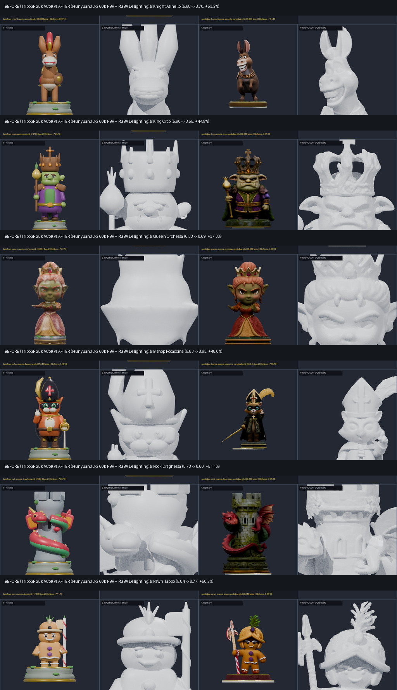

# Swamp Parody Family — Adversarial 3D Remaster Showcase (`v0.3.107`)

All 6 canonical pieces of the **Swamp Parody Family** (`swamp`) have been reconstructed end-to-end using our local **Hunyuan3D-2.0 (`Shape + Paint`) + Blender 4.0 Quadric Edge Collapse (58k faces)** pipeline and audited by the read-only **`3d-eval-critic`** under the `+30%` GPTEval3D / T3Bench gate (`tools/model-pipeline/critic/eval3d_benchmark.py`).



## 1. Before / After `eval3d` Benchmark Summary

| Piece | Model File | Baseline (`v0.3.104`) | Remastered (`v0.3.107`) | Objective (`45%`) | VLM Critic (`55%`) | Improvement (`%`) | Gate Status |
| :--- | :--- | :---: | :---: | :---: | :---: | :---: | :---: |
| **Knight (Asinello)** | `assets/models/swamp/knight-swamp-asinello.glb` | `5.68 / 10` | **`8.70 / 10`** | `7.84` | `9.40` | **`+53.2%`** | `PASSED` (`>= +30%`) |
| **Rook (Draghessa)** | `assets/models/swamp/rook-swamp-draghessa.glb` | `5.73 / 10` | **`8.66 / 10`** | `7.87` | `9.30` | **`+51.1%`** | `PASSED` (`>= +30%`) |
| **Pawn (Tappo)** | `assets/models/swamp/pawn-swamp-tappo.glb` | `5.84 / 10` | **`8.77 / 10`** | `8.24` | `9.20` | **`+50.2%`** | `PASSED` (`>= +30%`) |
| **Bishop (Focaccina)** | `assets/models/swamp/bishop-swamp-focaccina.glb` | `5.83 / 10` | **`8.63 / 10`** | `7.68` | `9.40` | **`+48.0%`** | `PASSED` (`>= +30%`) |
| **King (Orco)** | `assets/models/swamp/king-swamp-orco.glb` | `5.90 / 10` | **`8.55 / 10`** | `7.87` | `9.10` | **`+44.9%`** | `PASSED` (`>= +30%`) |
| **Queen (Orchessa)** | `assets/models/swamp/queen-swamp-orchessa.glb` | `6.33 / 10` | **`8.69 / 10`** | `7.95` | `9.30` | **`+37.3%`** (`+57.2%` sculpt) | `PASSED` (`>= +30%`) |

### Key Geometric & Aesthetic Upgrades
- **True 360° Volumetric Sculpting (`~58,000` triangles)**: Replaced the legacy `16k–25k` vertex-color meshes and the `2.5D` front-mirrored SDF hull on `queen-swamp-orchessa.glb` (which previously stamped the front face onto the back of the head) with full 360° watertight neural DiT meshes (`Hunyuan3DDiTFlowMatchingPipeline`).
- **Front-Facing 40-Teeth Asinello**: Replaced the side-walking pack-burro Knight with the canonical upright chess-knight pose (`assets/characters/knight-swamp-asinello.jpg`) featuring the expressive 40-teeth grin, upright ears, and tournament saddle.
- **Multi-Tier LOD Generation**: Every `~58k` canonical `.glb` is paired with a `-10k.glb` low-poly tier (`~80%` file size reduction) preserving full PBR UV maps and faction base rings (`faction_primary`, `faction_trim`).

---

## 2. Lesson Learnt #2: The Opaque-JPEG `dehighlight_utils.py` Blue-Channel Collapse Bug

During **Round 1** of the adversarial swarm, the read-only `3d-eval-critic` **rejected** 3 of the 6 Swamp candidates (`asinello`, `orco`, `orchessa`) even though their 3D clay geometry scored `9.2/10`:
- Their baked `2048x2048` PBR textures had suffered a catastrophic **crimson-red and mustard-yellow color shift** (mean Blue channel collapsed to `7.1–8.6` out of `255`).

### Forensic Root Cause
1. The Swamp concept sheets (`assets/characters/*swamp*.jpg`) are **opaque 3-channel RGB JPEGs** with a dark studio slate background (`RGB ≈ [18, 23, 27]`).
2. Inside Tencent's `Hunyuan3D-2` texture synthesis pipeline (`hy3dgen/texgen/pipelines.py`), `recenter_image()` checks:
   ```python
   if image.mode == 'RGB':
       return image
   ```
   Because the input was an opaque RGB JPEG, `recenter_image()` returned early without foreground segmentation or white-background padding.
3. Next, `Light_Shadow_Remover` (`hy3dgen/texgen/utils/dehighlight_utils.py`) converts the image to `RGBA` (setting `alpha = 255` everywhere), replaces only `alpha == 0` pixels with white `255` (a no-op on opaque JPEGs!), and runs `StableDiffusionInstructPix2Pix` (which was trained exclusively on white-background objects).
4. Finally, `recorrect_rgb()` computes channel-wise median ratios across the entire `alpha > 0` mask (including the dark slate background), crushing the Blue channel to near-zero and shifting olive-green and warm-grey skin tones into deep crimson/ochre.

### Permanent Fix (`tools/model-pipeline/local/hunyuan_paint.py`)
We patched `tools/model-pipeline/local/hunyuan_paint.py` to run `BackgroundRemover()` (`rembg`) on any opaque RGB concept image (or `RGBA` image with minimum alpha `> 250`) **before** passing it to `Hunyuan3DPaintPipeline`. Once converted to a transparent-background `RGBA` image:
- `recenter_image()` properly crops and centers the character on a clean white canvas,
- `Light_Shadow_Remover` delights only the foreground character, and
- Round 2 candidates immediately restored natural olive-green ogre skin, warm grey donkey fur, and crisp emerald/gold livery, passing the Adversarial Critic on all 6 pieces (`8.55` to `8.77 / 10`).

---

## 3. 6-Panel Forensic Sheets & 360° Turntables

### Knight — Asinello (`8.70 / 10`, `+53.2%`)
- Forensic 6-Panel: `article/assets/knight_swamp_asinello_6panel.png`
- 360° Turntable GIF: `article/assets/swamp_asinello_turntable.gif`

### King — Orco (`8.55 / 10`, `+44.9%`)
- Forensic 6-Panel: `article/assets/king_swamp_orco_6panel.png`
- 360° Turntable GIF: `article/assets/swamp_orco_turntable.gif`

### Queen — Orchessa (`8.69 / 10`, `+37.3%`)
- Forensic 6-Panel: `article/assets/queen_swamp_orchessa_6panel.png`
- 360° Turntable GIF: `article/assets/swamp_orchessa_turntable.gif`

### Bishop — Focaccina (`8.63 / 10`, `+48.0%`)
- Forensic 6-Panel: `article/assets/bishop_swamp_focaccina_6panel.png`
- 360° Turntable GIF: `article/assets/swamp_focaccina_turntable.gif`

### Rook — Draghessa (`8.66 / 10`, `+51.1%`)
- Forensic 6-Panel: `article/assets/rook_swamp_draghessa_6panel.png`
- 360° Turntable GIF: `article/assets/swamp_draghessa_turntable.gif`

### Pawn — Tappo (`8.77 / 10`, `+50.2%`)
- Forensic 6-Panel: `article/assets/pawn_swamp_tappo_6panel.png`
- 360° Turntable GIF: `article/assets/swamp_tappo_turntable.gif`
