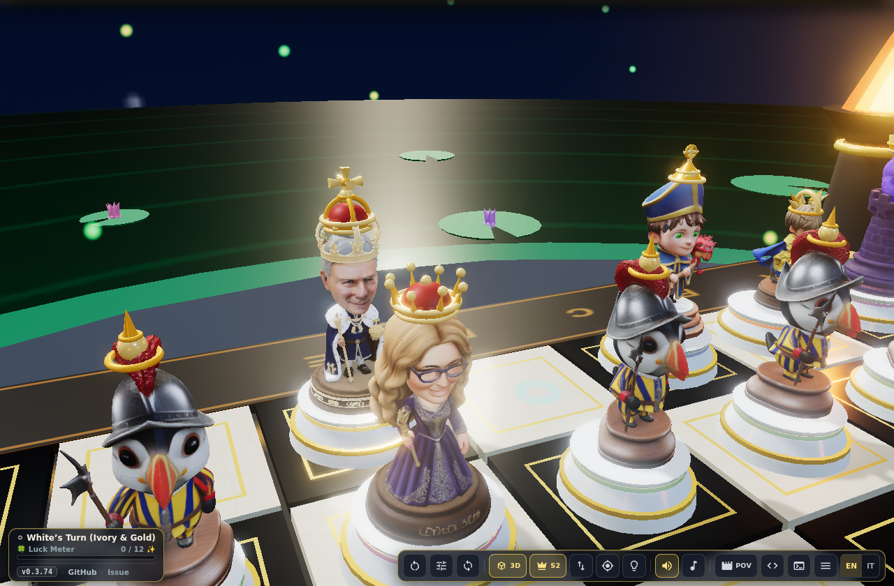
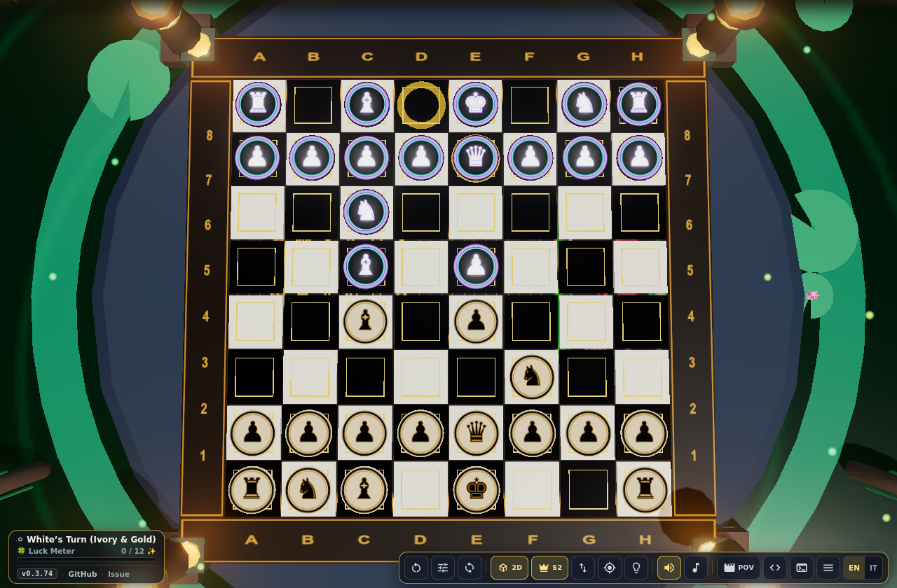
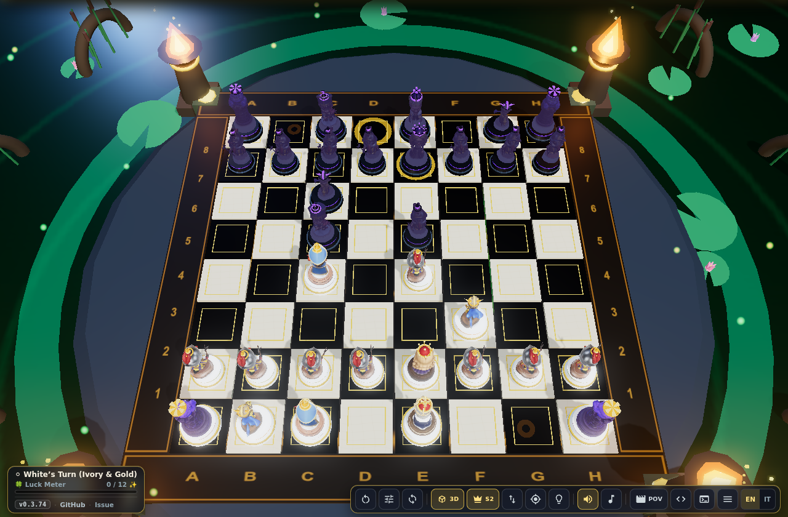

# 🔍 CarChess3D — Visual Piece Recognition Benchmark & Blind VLM Audit (`0°` vs `30°`)

- **Benchmark Angles**:
  1. **`0°` Vertical Zenithal (`0deg`)**: Camera at `(0, 12.8, 0.01)` looking at `(0, 0, 0)`.
  2. **`30°` Semi-High (`30deg`)**: Camera at `(0, 11.08, 6.40)` looking at `(0, 0, 0)` ($\arctan(6.40 / 11.08) = 30.0^\circ$).
- **Opening Position Tested**: `1. e4 e5 2. Nf3 Nc6 3. Bc4 Bc5 4. Qe2 Qe7` (all 6 roles `K, Q, R, B, N, P` spread across center & back ranks).
- **Matchups Evaluated**: `carlesso` vs `classic`, `carlesso` vs `swamp`, and `carlesso` vs `carlesso` (Mirror Match).
- **Composite Contact Sheet**: [`docs/clarity_comparison_0deg_30deg.png`](clarity_comparison_0deg_30deg.png)

## 🏆 Leaderboard (Pixel Contrast Telemetry + Gemini VLM `gemini-flash-latest` Blind Recognizer)

| Rank | Mode | Composite (`/10`) | B/W Contrast | 0° Roles (`/10`) | 30° Roles (`/10`) | Kid Low-Fatigue | White Luma | Black Luma | Δ Luma (`W - B`) | Contrast Ratio |
| :---: | :--- | :---: | :---: | :---: | :---: | :---: | :---: | :---: | :---: | :---: |
| 🥇 | **`s5`** — S5 (Hybrid All-In) | **9.50** | 10/10 | 10/10 | 9/10 | 9/10 | `153.98` | `73.11` | **`+80.88`** | `1.95x` |
| 🥈 | **`s1`** — S1 (Zenith 2D) | **8.50** | 9/10 | 10/10 | 7/10 | 8/10 | `157.54` | `71.98` | **`+85.56`** | `2.01x` |
| 🥉 | **`s2`** — S2 (3D GLB Add-Ons) | **8.50** | 9/10 | 8/10 | 9/10 | 8/10 | `146.07` | `61.77` | **`+84.3`** | `2.16x` |
| #4 | **`s4`** — S4 (Pedestal Wreath + Crest) | **8.50** | 9/10 | 8/10 | 9/10 | 8/10 | `139.2` | `72.41` | **`+66.79`** | `1.81x` |
| #5 | **`s3`** — S3 (Obsidian Contrast) | **5.25** | 6/10 | 4/10 | 6/10 | 5/10 | `137.26` | `64.8` | **`+72.46`** | `1.98x` |
| #6 | **`off`** — Off (Baseline) | **5.00** | 5/10 | 4/10 | 7/10 | 4/10 | `115.31` | `96.61` | **`+18.71`** | `1.22x` |

## 🧐 Adversarial Critiques per Solution (`off`, `S1..S5`)

### 1. `s5` — S5 (Hybrid All-In) (Score: **9.50/10**)
- **Description**: Hybrid Champion: Obsidian + 3D Add-Ons + Wreath + Crest + Auto-2D Zenith
- **Roles recognized at 0° (Zenithal)**: `King, Queen, Rook, Bishop, Knight, Pawn`
- **Roles recognized at 30° (Semi-High)**: `King, Queen, Rook, Bishop, Knight, Pawn`
- **Mirror Match Telemetry (`carlesso` vs `carlesso`)**:
  - `0°`: White Luma `160.74` vs Black Luma `68.63` (Δ `92.11`, Ratio `2.13x`, 2D Discs `32`)
  - `30°`: White Luma `147.37` vs Black Luma `63.61` (Δ `83.75`, Ratio `2.1x`, 3D Add-Ons `32`, Baked GLB Add-Ons `32`, Wreaths `32`, Billboards `32`)
- **VLM Critique (`gemini-flash-latest`)**: _The 0° view with 2D medallions carrying glyphs and letter abbreviations removes every ambiguity, even in the most complex mirror matches. At 30° the combination of 3D add-ons, pedestal wreaths and floating crests maintains exceptional legibility, although a slight visual saturation can be perceived in the dense central sectors. The color contrast between golden ivory white and violet obsidian black is sharp, eliminating any cognitive fatigue for children._

### 2. `s1` — S1 (Zenith 2D) (Score: **8.50/10**)
- **Description**: Zenith 2D Classic B/W Medallion Icons + Obsidian Contrast
- **Roles recognized at 0° (Zenithal)**: `King, Queen, Rook, Bishop, Knight, Pawn`
- **Roles recognized at 30° (Semi-High)**: `King, Queen, Rook, Bishop, Knight, Pawn`
- **Mirror Match Telemetry (`carlesso` vs `carlesso`)**:
  - `0°`: White Luma `161.36` vs Black Luma `68.55` (Δ `92.81`, Ratio `2.14x`, 2D Discs `32`)
  - `30°`: White Luma `153.59` vs Black Luma `65.26` (Δ `88.33`, Ratio `2.13x`, 3D Add-Ons `0`, Baked GLB Add-Ons `0`, Wreaths `0`, Billboards `0`)
- **VLM Critique (`gemini-flash-latest`)**: _At 0° legibility is unbeatable thanks to the standardized 2D medallions with clear letters and icons. At 30°, however, the horizontal discs suffer from perspective flattening and partial overlaps in the back ranks, reducing the three-dimensional impact. The excellent color contrast between White and Black nonetheless guarantees zero ambiguity, even in mirror games._

### 3. `s2` — S2 (3D GLB Add-Ons) (Score: **8.50/10**)
- **Description**: Universal 3D Static Role Add-Ons + Obsidian Contrast
- **Roles recognized at 0° (Zenithal)**: `King, Queen, Rook, Knight, Bishop, Pawn`
- **Roles recognized at 30° (Semi-High)**: `King, Queen, Rook, Knight, Bishop, Pawn`
- **Mirror Match Telemetry (`carlesso` vs `carlesso`)**:
  - `0°`: White Luma `142.96` vs Black Luma `48.34` (Δ `94.62`, Ratio `2.55x`, 2D Discs `0`)
  - `30°`: White Luma `149.03` vs Black Luma `57.22` (Δ `91.8`, Ratio `2.31x`, 3D Add-Ons `32`, Baked GLB Add-Ons `32`, Wreaths `0`, Billboards `0`)
- **VLM Critique (`gemini-flash-latest`)**: _The excellent color contrast between golden ivory and violet obsidian makes telling the factions apart immediate, even in mirror matches. At 0° the volumetric top symbols (crosses, crowns and horse heads) clearly guide role reading without straining the eyes. At 30° the overall silhouette gains further three-dimensionality, offering playful legibility ideal for a young audience._

### 4. `s4` — S4 (Pedestal Wreath + Crest) (Score: **8.50/10**)
- **Description**: 3D Pedestal Role Wreath + Floating 2D Crest + Obsidian
- **Roles recognized at 0° (Zenithal)**: `King, Queen, Rook, Bishop, Knight, Pawn`
- **Roles recognized at 30° (Semi-High)**: `King, Queen, Rook, Bishop, Knight, Pawn`
- **Mirror Match Telemetry (`carlesso` vs `carlesso`)**:
  - `0°`: White Luma `132.9` vs Black Luma `57.83` (Δ `75.07`, Ratio `2.06x`, 2D Discs `0`)
  - `30°`: White Luma `145.8` vs Black Luma `63.29` (Δ `82.51`, Ratio `2.08x`, 3D Add-Ons `0`, Baked GLB Add-Ons `0`, Wreaths `32`, Billboards `32`)
- **VLM Critique (`gemini-flash-latest`)**: _The integration of floating badges with standardized 2D icons brilliantly resolves the geometric ambiguity at both 0° and 30°, guaranteeing immediate recognition even in mirror matches. The color contrast between the deep obsidian of Black and the golden ivory of White is sharp and unmistakable. The only limitation lies in the slight visual crowding of the billboards in central melees, which can tire spatial reading of the board during long games._

### 5. `s3` — S3 (Obsidian Contrast) (Score: **5.25/10**)
- **Description**: True Obsidian Black vs Warm Ivory Contrast Only
- **Roles recognized at 0° (Zenithal)**: `Pawn, Rook`
- **Roles recognized at 30° (Semi-High)**: `Pawn, Knight, Bishop, Rook, King`
- **Mirror Match Telemetry (`carlesso` vs `carlesso`)**:
  - `0°`: White Luma `129.34` vs Black Luma `46.46` (Δ `82.88`, Ratio `2.4x`, 2D Discs `0`)
  - `30°`: White Luma `145.02` vs Black Luma `56.4` (Δ `88.62`, Ratio `2.28x`, 3D Add-Ons `0`, Baked GLB Add-Ons `0`, Wreaths `0`, Billboards `0`)
- **VLM Critique (`gemini-flash-latest`)**: _The color contrast between the two sides is sufficient, but the 0-degree view suffers from the lack of clear graphic indicators on the pieces' heads. The 30-degree view improves the reading of the main silhouettes, while still retaining some ambiguity among the major pieces._

### 6. `off` — Off (Baseline) (Score: **5.00/10**)
- **Description**: Original 3D Models Only (Legacy Baseline)
- **Roles recognized at 0° (Zenithal)**: `Rook, Knight, Pawn`
- **Roles recognized at 30° (Semi-High)**: `King, Queen, Rook, Bishop, Knight, Pawn`
- **Mirror Match Telemetry (`carlesso` vs `carlesso`)**:
  - `0°`: White Luma `108.78` vs Black Luma `70.29` (Δ `38.49`, Ratio `1.46x`, 2D Discs `0`)
  - `30°`: White Luma `123.66` vs Black Luma `71.5` (Δ `52.16`, Ratio `1.62x`, 3D Add-Ons `0`, Baked GLB Add-Ons `0`, Wreaths `0`, Billboards `0`)
- **VLM Critique (`gemini-flash-latest`)**: _The 0° zenithal view suffers heavily from the absence of 2D indicators on the discs, making King and Queen hard to distinguish from the top of the headgear alone. At 30° the three-dimensional silhouette improves the legibility of individual pieces, but in the Mirror Match the low luminance contrast (only 1.3x-1.5x) and the similar bases considerably strain a child's eyes._

---

## 👑 v0.3.74 — Human-in-the-Loop Polish: `S2` Default (Single Grounded 3D Crowns) + `📐 2D` Auto-Toggled Square-Aligned Medallions

After live-testing all modes (`S1..S5`), we refined the design by combining the best of clean 3D and tactical 2D:

1. **Default 3D Mode = `👑 S2` (Single 3D Crowns Seated on the Head + Obsidian vs Ivory Contrast)**:
   - Removed all duplicate `UniversalRoleAddon_*` nodes pre-baked into the `.glb` files that created a second crown floating in mid-air.
   - Replaced the cubic primitives (`BoxGeometry`) with **high-resolution sculpted 3D crowns** (Imperial Diadem + Cross Pattée for the King `♚`, 8-Point Tiara with 8 Pearls for the Queen `♛`, Sculpted Liturgical Mitre for the Bishop `♝`, Corinthian Crest + Equine Wings for the Knight `♞`, Curved 6-Merlon Mural Crown for the Rook `♜`, Braided Circlet + Staunton Finial for the Pawn `♟`) anchored directly on the top of the character's head (`computeGroundedHeadAnchor`).
   - No floating 2D badges in 3D by default, to keep the cinematic scene clean.
2. **`📐 2D` Auto-Toggle Button + 100% Square-Centered Alignment (`ZENITH_DISC_BOARD_Y = 0.04m`)**:
   - Pressing `📐 2D` automatically activates the 2D medallions at board level (`y = 0.04m`), hiding the 3D body underneath: **zero perspective parallax**, every medallion lands 100% in the geometric center of its own square (`a1..h8`).
   - **Simplified Single-Icon Design**: by default the medallion shows only **one large classic chess icon (`♚ ♛ ♜ ♝ ♞ ♟`) perfectly centered and oriented North (`0°`)**, with no `K, Q, R, B, N, P` letters and no overlapping double drawings (letters + Braille `K ⠇..P ⠏` can still be enabled in the accessibility settings `#hud-setup-letters-toggle` or via `?letters=1`).

| View | Screenshot |
| :--- | :--- |
| **King & Queen Close-up (`👑 S2`)** — Single sculpted 3D crown seated on the head |  |
| **`📐 2D` Zenithal View** — Medallions 100% aligned to the squares with a single centered icon |  |
| **`👑 S2` 3D View at `30°` (Default)** — Obsidian vs Ivory contrast + 3D crowns on the head |  |

