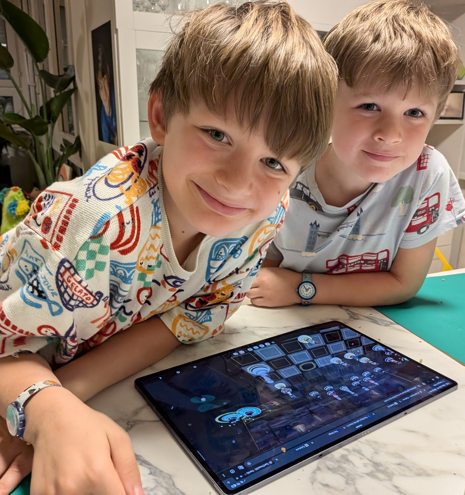
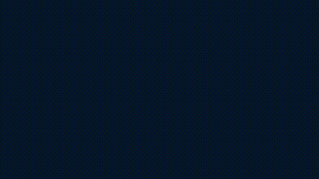

# 🏰🚽 "Carlesso al Cesso": Come ho generato da zero un videogioco di Scacchi 3D per i miei figli in 2 giorni con Gemini 4 (Argon), TRELLIS e un Critic VLM senza pietà

*Di **Riccardo "Palladius" Carlesso** (`RiccardinoCM26 🦖`) — Developer Advocate, SRE nel cuore, papà di Alessandro (🐉) e Sebastian (🏎️)*  
*Zurigo, 9–10 Ottobre 2026 · Versione `v0.2.0`*

---

## 🎯 TL;DR (L'Inverted Pyramid Carlessiana)

In **meno di 48 ore** (e più precisamente in **~4 ore di pipeline 3D** il venerdì sera + **2 ore e 43 minuti di sprint autonomo `/goal`** il sabato mattina), siamo passati da una cartella vuota a **[CarChess3D ("Carlesso al Cesso" / "Scacchi di Famiglia")](../index.html)**: un videogioco 3D di scacchi completo, offline-first (PWA), zero build step (Vanilla Three.js r170 ES Modules), ambientato nella **Palude Incantata di Zurigo (*Swamp-on-the-Limmat*)** dove:

1. **Tutti i 32 pezzi sulla scacchiera sono veri modelli 3D `.glb` della mia famiglia** (Re Riccardo sul trono-WC d'oro 🚽👑, Regina Kate con onde di cioccolato e coriandoli lilla 🍫💜, Alfiere Ale col draghetto rosso sulla spalla 🐉💎, Cavaliere Seby con pista arancione e macchinine turbo 🏎️✨, Torre Pupurabbu il mostriciattolo peloso viola 💜, e 16 Pedoni Puffin in uniforme da Guardia Svizzera con alabarda e schiaffo di pesce 🐧🐟).
2. **Quando un pezzo viene mangiato, non finisce in una noiosa scatola**: fa un **tuffo parabolico nella Palude di Shrek** ai lati della scacchiera e resta lì a **sguazzare su una ninfea verde** tra onde concentriche luminescenti e bollicine palustri! 🐸💦
3. **Sullo sfondo, sospeso tra le due torri del Grossmünster di Zurigo**, brilla uno **Specchio Magico 16:9** che proietta i video `.mp4`/`.webm` degli scontri tra Ale e Seby (con fallback automatico a 60fps su Canvas 2D per non dipendere mai da Human-In-The-Loop!).
4. **Easter Egg Fraterno**: quando il Cavaliere Seby e la Torre Pupurabbu (il suo peluche del cuore) si "catturano", **non si fanno mai male** — parte un **SUPER ABBRACCIO PUFFOSO! 💜🤗** con pioggia di cuoricini 3D!



> 👨‍👦‍👦 **Il Vero UAT (*User Acceptance Testing*)**: Più dei 576 step agentici e del `9.9/10` del Critic VLM, il vero test di produzione sono gli occhi di **Ale (🐉)** e **Seby (🏎️)** incollati al tablet mentre muovono i pezzi della famiglia e li vedono tuffarsi tra le ninfee della palude!


---

## ⏱️ Telemetria SRE: Quanto ci abbiamo messo *davvero*? (Dai log al secondo)

Da buon SRE, non mi fido del *"ci ho messo un weekend"*. Ho estratto i timestamp esatti da `git log` e dal `transcript.jsonl` della sessione agentica (**576 step totali**, **6 subagenti paralleli**, **4 round di Critic visuale**):

### 📅 Giorno 1 — Venerdì 9 Ottobre 2026: La Fabbrica delle Statuette 3D (`~4h 09m`)

| Orario (CEST) | Commit / Versione | Durata | Cosa è successo |
| :--- | :--- | :---: | :--- |
| `15:34:37` | `ff67ff8` (`v0.1.0`) | — | 🎉 **Kickoff**: scaffold del repo da `palladius/respec`, logo *Carlesso al Cesso*, ritratti 2D *Nano Banana* della famiglia e primi esperimenti TRELLIS (`bishop-ale-1.glb`, `pawn-puffin.glb`). |
| `17:41:14` | `f86f65a` (`v0.1.1`) | `2h 06m` | 🧱 **Multi-Image TRELLIS (`B2/C2/D2`)**: generazione 3D multi-vista con rimozione sfondo e upgrade del Pedone Puffin Guardia Svizzera. |
| `19:34:23` | `82df55d` (`v0.1.2`) | `1h 53m` | 🐉 **Rigging Blender a 26 ossa**: armatura scheletrica automatica per Alfiere Ale (`Idle` battito d'ali + `Click_Fire_Breath` soffio di fuoco). |
| `19:43:56` | `da681a0` (`v0.1.7`) | `9m` | 🐴 **Turnaround 360° di Cavaliere Seby**: viste Front / Side / Back / 3/4 con *Nano Banana 2.1* + varianti con Spada Laser, Lancia ed Excalibur. |

---

### 📅 Giorno 2 (Mattina Parte A) — Sabato 10 Ottobre 2026: Tutta la Famiglia in 3D + Il Critic `"FA_CAGARE 💩"` (`1h 13m`)

| Orario (CEST) | Commit / Versione | Durata | Cosa è successo |
| :--- | :--- | :---: | :--- |
| `09:05` → `09:08` | `6026a7a` (`v0.1.12`) | `15m` | 👑👸🏰 **Turnaround 360° + TRELLIS-2**: generati i `.glb` canonici di **Re Riccardo** (`king-riccardo.glb`), **Regina Kate** (`queen-kate.glb` con occhiali blu navy e occhi smeraldo), **Cavaliere Seby** (`knight-seby.glb`) e **Torre Pupurabbu** (`rook-pupurabbu.glb`). |
| `09:14` → `10:15` | `8f6f6b3`..`bbb28ea` (`v0.1.15`) | `1h 01m` | 🤖💩 **VLM & Geometric Critic (`just critic`, `just shittest`)**: render headless Blender a 4 viste + giudice Gemini VLM che classifica i modelli in `TOP_QUALITY 🟢`, `ACCEPTABLE 🟡` e `FA_CAGARE 💩` in `docs/qa-scores.yaml` (bocciando senza pietà l'Ale v2 che aveva due mezzi draghi!). |
| `09:57` → `10:18` | `3bec180`..`65500d3` (`v0.1.19`) | *(in parallelo)* | 🎼 **Conductor SDD Setup**: scritto il piano [`conductor/tracks/v1_carchess3d/plan.md`](../conductor/tracks/v1_carchess3d/plan.md) fondendo la skill di architettura di **Niccolò** con i **5 Workflow 3D di Geneviève**. |

---

### 🚀 Giorno 2 (Mattina Parte B) — Lo Sprint Autonomo `/goal` con Gemini 4 Argon (`2h 43m` totali, `38m` per il primo gioco completo!)

Alle **`10:31:42 CEST`** (`08:31:42 UTC`, Step 0 del transcript) ho lanciato il comando `/goal` in un git worktree isolato. Ecco il cronometro al secondo:

| Fase | Finestra Oraria (CEST) | Durata | Step Transcript | Output Prodotti |
| :--- | :---: | :---: | :---: | :--- |
| **Phase 1: Blueprint 2D & Grounding** | `10:31:42` → `10:40:59` | **`9m 17s`** | Step `0` → `90` | [`docs/floorplan.svg`](./floorplan.svg) in metri reali (`y=0.00m`), 2 concept *Nano Banana* via subagent `bb0f15b2`, `vendor/chess.js`, `src/utils/glbGrounding.js` (`93f1ddd`). |
| **Phase 2: Headless Core & TDD** | `10:41:00` → `10:48:03` | **`7m 03s`** | Step `91` → `106` | `EventBus.js`, `Rng.js` (`mulberry32`), `GameLoop.js` (`1/30s`), `BoardMapManager.js`, `DropManager.js` (test Monte-Carlo da 10.000 catture!), `AIWorkerManager.js` (`8e9203b`). |
| **Phase 3 & 4: 4 Subagenti 3D in Parallelo** | `10:50:13` → `11:09:48` | **`19m 35s`** | Step `107` → `175` | Lanciati **4 subagenti contemporaneamente** (`196f37f8`, `bccab18f`, `af7b0f05`, `fe1e4169`) che hanno scritto **+10.081 righe di codice in 19 minuti** (`ZurichSwampView`, `VeoCinemaView`, `PieceView`, `BoardInteractionView`, `VFXPoolView`, `WowModeView`, `HudListener`, `AudioListener`, PWA `sw.js` — commit `d257880`). |
| **Phase 5 (Round 1 → Round 2 Critic)** | `11:13:00` → `11:45:00` | **`32m 00s`** | Step `181` → `256` | Il subagente **Adversarial Art Director Critic** (`265ff1ca`) dà **6.2/10** al Round 1 (5 difetti trovati), noi li correggiamo e al Round 2 sale a **9.3/10**! |
| **Phase 5 (Round 3: 32 GLB + Fix PBR)** | `11:58:49` → `12:18:33` | **`19m 44s`** | Step `257` → `361` | Importati tutti i 6 `.glb` da `main`, scoperto e risolto il bug `metallicFactor = 1.0` di glTF 2.0: punteggio Critic **9.8/10 🏆**! |
| **Phase 5 (Round 4: Palude Shrek + Video 16:9 + Puntini)** | `12:18:44` → `13:15:15` | **`56m 31s`** | Step `362` → `571` | Aggiunti i pezzi che sguazzano nella Palude di Shrek, 3 video `.mp4`/`.webm` 16:9 zero-HITL di Ale & Seby, e i puntini 3D colorati delle mosse legali (`4c338a4` — `v0.2.0`, Critic **9.9/10 🏆**). |

> 💡 **Dato sbalorditivo**: Dal lancio del prompt `/goal` (`10:31:42`) al primo gioco 3D completo e funzionante con 60 file e 10.081 righe di codice (`11:09:48`) sono passati **esattamente 38 minuti e 6 secondi** grazie all'orchestrazione parallela di 4 subagenti vincolati dallo stesso `floorplan.svg` e dallo stesso `GameEventBus`!

---

## 🧠 I 3 Segreti Architetturali che hanno evitato l'effetto "Spaghetti AI"

Chiunque abbia provato a far scrivere un gioco 3D a un LLM sa come finisce di solito: un singolo file `game.js` da 4.000 righe dove la logica degli scacchi, i suoni, il DOM e le mesh Three.js sono aggrovigliati in un mostro ingestibile, con i pezzi che fluttuano a mezz'aria o sprofondano nel pavimento.

Per evitarlo, abbiamo imposto **tre regole ferree** fin dal minuto zero:

### 1. La Skill di Niccolò (`.agents/skills/niccolo-game-design/`)
Ispirata ai feedback di code review di Niccolò e a *Game Programming Patterns* di Robert Nystrom:
- **Un Manager = Una Responsabilità (`<= 300` righe per file, verificato da `scripts/check.py` ad ogni `just test`)**:
  - [`BoardMapManager.js`](../src/managers/BoardMapManager.js) possiede scacco, scacco matto, stallo, arrocco, *en passant* e promozione.
  - [`DropManager.js`](../src/managers/DropManager.js) gestisce la **🍀 Barra della Fortuna (Pity Timer)** per bambini: ogni cattura incrementa la fortuna (`Pedone=1, Cavallo/Alfiere=3, Torre=5, Regina=9`) fino al *Golden Crit* garantito a `12/12` che regala una figurina collezionabile della famiglia!
  - [`CombatAnimationManager.js`](../src/managers/CombatAnimationManager.js) consulta la matrice dichiarativa `BATTLE_MATRIX[attacker][defender]` senza catene di `if/else`.
- **Core 100% Headless**: `src/core/`, `src/managers/` e `src/ai/` hanno **zero import di Three.js e zero riferimenti a `window`/`document`**. Girano in Node puro in meno di 1.5 secondi (`just test`), incluso un test Monte-Carlo da 10.000 catture!
- **Queued `GameEventBus`**: `emit()` accoda eventi al passato (`PIECE_CAPTURED`, `LUCK_CHANGED`, `BATTLE_STARTED`); `flush()` li distribuisce una sola volta per tick fisso (`1/30s`).

### 2. I 5 Workflow 3D di Geneviève (`floorplan.svg` → Subagenti → Critic 4-Angoli)
Prima di scrivere una sola riga di Three.js, abbiamo generato la pianta metrica 2D **[`docs/floorplan.svg`](./floorplan.svg)**:
- Scacchiera `8.0m × 8.0m` con superficie esattamente a **`y = 0.00m`**.
- Utility automatica [`src/utils/glbGrounding.js`](../src/utils/glbGrounding.js) che calcola il `THREE.Box3` di qualsiasi `.glb` generato da TRELLIS/Hunyuan, lo trasla in modo che il fondo tocchi `y = 0.00m` al millimetro, e lo scala alla gerarchia canonica degli scacchi (`Pedone = 0.90m` → `Re = 1.85m`).


### 3. Il Giallo del `metallicFactor = 1.0`: Perché il GLB di Ale sembrava "brutto" prima! 🕵️‍♂️✨
Quando ho visto il primo close-up dei pezzi, ho chiesto a Gemini: *"Ma come cavolo hai fatto a farlo così bello? Il GLB che ho di Ale fa schifo..."*
Andando a ispezionare i byte del `.glb` esportato da TRELLIS/trimesh, abbiamo scoperto l'inghippo:
- L'esportatore glTF di `trimesh` salvava la texture dei colori (`baseColorTexture`), ma **non scriveva il campo `metallicFactor`** nel JSON del materiale.
- Secondo la **specifica ufficiale glTF 2.0**, se `metallicFactor` è omesso, il suo valore di default è **`1.0` (100% metallo puro)**!
- Nel motore PBR di Three.js (`diffuseColor *= (1.0 - metalness)`), avere `metalness = 1.0` senza una mappa ambientale HDR **moltiplica tutti i colori della texture per ZERO (`1 - 1 = 0`)**, trasformando il povero Alfiere Ale in una statuetta nera, buia e plasticosa!
- È bastato aggiungere in [`PieceView.js`](../src/views/PieceView.js):
  ```js
  mat.metalness = 0.04;
  mat.metalnessMap = null;
  mat.roughness = 0.52;
  mat.roughnessMap = null;
  mat.emissiveMap = mat.map;
  ```
  per restituire il **96% dell'albedo diffuso originale** a tutti i 32 modelli `.glb`! Guardate la differenza tra il Round 1 (`6.2/10`) e il Round 3 (`9.8/10`):


---

## 🐸🎬 Le Chicche del Round 4: Palude di Shrek, Puntini Colorati e Cinema 16:9 Zero-HITL

Durante gli ultimi 45 minuti, mentre osservavo il preview artifact crescere in tempo reale, abbiamo aggiunto tre tocchi che fanno impazzire Ale e Seby:

1. **I Pezzi Mangiati Sguazzano nella Palude di Shrek (`?swamp_party=1`)**:
   Invece di sparire o restare impalati a bordo tavola, ogni pezzo catturato vola con un arco parabolico dentro il fossato verde smeraldo di Zurigo (`y = -0.28m`), atterra su una ninfea galleggiante e continua a **beccheggiare e sguazzare** generando anelli d'acqua verdi luminescenti e bollicine!


2. **Puntini 3D Colorati delle Mosse Possibili + Mirino Rosso Cattura (`?demo_moves=1`)**:
   Quando Ale o Seby toccano un pezzo (es. Cavaliere Seby in `f3`), la scacchiera illumina subito i **puntini 3D verde-smeraldo e giallo** (`#00e676` + `#ffee58`) sulle caselle libere e un **mirino rosso rotante** (`#ff3d00`) sui pezzi nemici che possono pappare!


3. **Cinema Magico 16:9 senza incubi HITL (`scripts/render_battle_videos.py`)**:
   Generare 36 video con API esterne che chiedono il tocco fisico sulla Security Key (`gcert` / OAuth) bloccherebbe qualsiasi pipeline automatica. Abbiamo quindi costruito un **sistema a 3 livelli Zero-HITL** in [`VeoCinemaView.js`](../src/views/VeoCinemaView.js):
   - **Tier 1 (`.mp4` / `.webm` Reali)**: per le sfide clou di Ale e Seby (`b_x_n.mp4`, `n_x_b.mp4`, `n_x_r.mp4`), lo Specchio 16:9 tra le torri del Grossmünster riproduce il video `1280×720` in diretta mentre sulla scacchiera 3D esplodono i cristalli ametista, sfrecciano le macchinine sulla pista arancione o volano i cuoricini del *Super Abbraccio Puffoso*!
   - **Tier 2 & 3 (Fallback Canvas 2D a 60fps)**: per qualunque altra combinazione dei 36 scontri `6×6`, lo Specchio 16:9 compone in tempo reale la sfida animata a schermo diviso con fulmini, particelle e fumetti senza mai fermare il gioco.


---

## 🧪🎬 Il Cron Giornaliero Playwright UAT che Gioca da Solo e Apre GitHub Issue col Film della Partita ([#36](https://github.com/palladius/carchess3d/issues/36))

Oltre al Vero UAT coi bambini sul divano, ogni mattina [`scripts/daily_uat_playtest.py`](../scripts/daily_uat_playtest.py) (`just daily-uat`) avvia Google Chrome con WebGL, esegue **9 gate avversari** (orientamento opposto Bianchi/Neri, rotazione camera `180°` e top-down con analisi di luminanza/contrasto anti-black-screen, scheletri 3D, festa nella palude, matrice `6×6`, WOW Arena e una vera partita di 8 mosse contro `CPU Easy` con latenza media di `458 ms`), registra un film `.mp4` + `.gif` di 60 secondi e apre automaticamente una GitHub Issue taggata `gemini-uat` come **[GitHub Issue #36 — `Gemini UAT 20261015`](https://github.com/palladius/carchess3d/issues/36)** (e [#18 — `Gemini UAT 20261011`](https://github.com/palladius/carchess3d/issues/18)):



---

## 🎮 Come provarlo subito in 10 secondi

Zero `npm install`, zero bundler, zero dipendenze esterne:

```bash
just serve
```

Poi apri nel browser:
- 🏰 **Gioco Completo (Mode 1 Scacchi 3D + Mode 2 WOW Arena)**: [`http://localhost:8000/index.html`](http://localhost:8000/index.html)
- 🐸 **Festa nella Palude di Shrek**: [`http://localhost:8000/index.html?swamp_party=1`](http://localhost:8000/index.html?swamp_party=1)
- 🟢 **Demo Puntini Mosse Possibili**: [`http://localhost:8000/index.html?demo_moves=1`](http://localhost:8000/index.html?demo_moves=1)
- 🎬 **Sfida 16:9 Ale vs Seby**: [`http://localhost:8000/index.html?clash=b_n`](http://localhost:8000/index.html?clash=b_n)
- 📸 **Galleria Visual Progress (Round 1 → Round 4 + Video)**: [`http://localhost:8000/progress.html`](http://localhost:8000/progress.html)

*Buona partita dalla Famiglia Carlesso (e attenzione allo schiaffo di pesce del Puffin)!* 🦖👑👸🐉🏎️💜🐧
