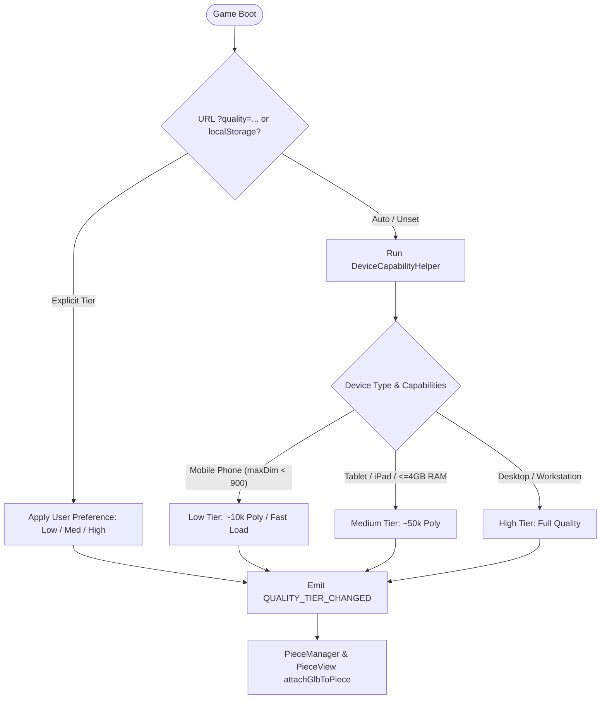

# 🏰 CarChess3D — Multi-Tier GLB LOD & Performance Benchmark

## 1. Executive Summary & Objective

In accordance with architectural guidelines from Niccolò and issue #39, CarChess3D provides a tiered asset resolution strategy:
- **Low (~10k polygons)**: Smartphone / mobile devices (Pixel 10, iPhones) / battery saver mode.
- **Medium (~50k polygons)**: iPads, Android tablets, lower-power laptops.
- **High (~1000k polygons / full resolution)**: Modern gaming rigs, workstations, high-end desktops.

A client-side hardware heuristic auto-selects the optimal tier on boot, with an interactive gear override (Rotella ⚙️) in the Setup/Settings modal allowing players to manually force `Auto`, `Alta`, `Media`, or `Bassa`.

---

## 2. Model Pipeline Benchmark (Baseline Full-Quality Models)

| Model Asset | Size (KB) | Gzip (KB) | Triangle Count | glTF Parse Time | Primary Heuristic Target |
|:---|:---:|:---:|:---:|:---:|:---|
| `king-riccardo.glb` | 4,166.6 | 2,830.5 | 96,958 | ~0.09 ms | High / Medium |
| `queen-kate.glb` | 3,627.1 | 2,466.4 | 99,504 | ~0.07 ms | High / Medium |
| `bishop-ale-1.glb` | 1,762.3 | 1,577.9 | 20,067 | ~0.06 ms | Medium / Low (~20k) |
| `bishop-ale-2-remastered.glb` | 5,216.8 | 2,468.8 | 44,935 | ~0.10 ms | Medium (~45k) |
| `knight-seby.glb` | 3,652.9 | 2,449.4 | 93,163 | ~0.06 ms | High / Medium |
| `rook-pupurabbu.glb` | 3,773.8 | 2,574.8 | 93,720 | ~0.06 ms | High / Medium |
| `pawn-puffin.glb` | 1,676.9 | 1,552.0 | 13,227 | ~0.14 ms | Low (~13k) |

---

## 3. Hardware Heuristic Decision Matrix



---

## 4. Benchmark CLI Tooling

Run automated benchmarks anytime via:
```bash
python3 tools/model-pipeline/lod/benchmark_lod.py
```
