# 🎨📸 CarChess3D — Growing Visual Progress Log (`docs/VISUAL_PROGRESS.md`)

> **Live HTML Gallery:** Open [`progress.html`](../progress.html) (or `http://localhost:8000/progress.html` via `just serve`) to inspect every visual milestone and play the 16:9 `.mp4` battle videos side-by-side in the browser!
> **Growing Asset Folder:** [`docs/visual-progress/`](./visual-progress/)

---

## 🐝🎬🦴 Round 6 (v0.3.0) — Adversarial Swarm Complete: Tutte le 36 (`6×6`) Scazzottate 3D & Video 16:9 + Esploratore `battles.html` + Scheletri 3D Articolati (Issues `#10`–`#16` ✅)

### 6.1 Tutte le 36 (`6 vs 6`) Coreografie e 72 Video 16:9 (`.mp4` + `.webm`) + Matrice Interattiva `6×6` (`#11`)
- **`src/core/BattleMatrix36.js`** + **72 file video (`36 .mp4` + `36 .webm`)** in `assets/battles/videos/`: ogni singola combinazione `Attaccante (6) × Difensore (6)` (`k_x_k` .. `p_x_p`) ha ora il proprio titolo bilingue, arma d'attacco, **contrattacco specifico del difensore nell'Atto 2**, banner fumetto e video 16:9 dedicato!
- **Modale In-Game `🎬 Matrice 6×6 (36 Scontri)`** (`HudListener.js`) + **Pagina Standalone [`battles.html`](../battles.html)**: griglia `6×6` interattiva per riprodurre qualsiasi video 16:9 o lanciare con 1 click la Scazzottata 3D sulla scacchiera (inclusa la **Maratona 36 Scontri**)!

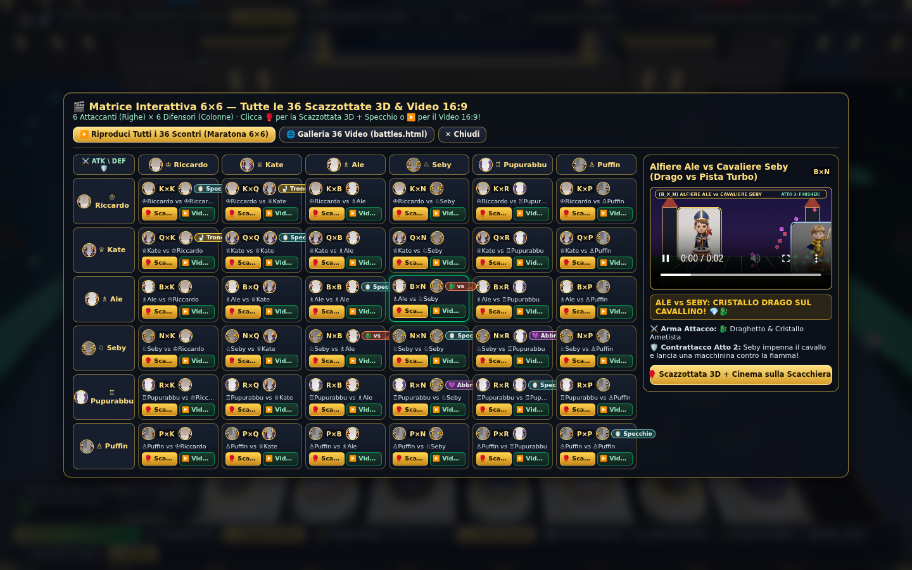

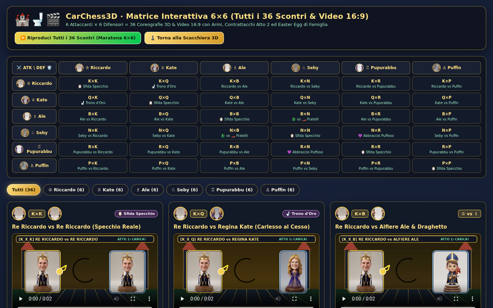

### 6.2 Scheletri 3D Articolati Visibili (`SkeletonRigHelper.js`) + Impronte Passi/Zoccoli (`#12`)
- **23 Giunti Scheletrici 3D (`🦴 Scheletri 3D`)**: bacino, colonna, testa, gambe/ginocchia sx/dx, braccia/gomiti sx/dx, più lo **scheletro quadrupede del cavallo di Seby** (`frontLeftLeg`, `frontRightLeg`, `hindLeftLeg`, `hindRightLeg`, `horseHead`) e le **ali del draghetto di Ale** (`leftWing`, `rightWing`), accompagnati da impronte luminose dei passi (`c2 → c4` in `2.0s`) e ferri di cavallo (`g1 → f3` in `2.2s`)!

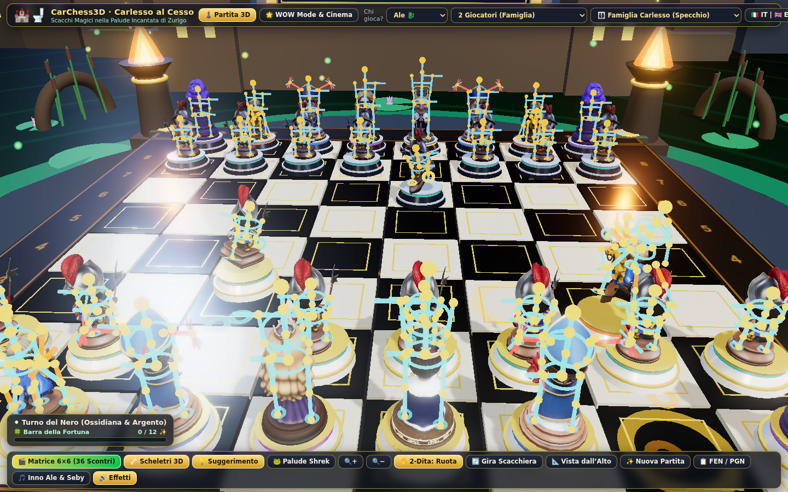

### 6.3 Scazzottata 3D in 3 Atti con Armi 3D, Contrattacco del Difensore e Fumetti 3D (`#10`, `#15`, `#16`)
- **Atto 1 (`CHARGE!`)**: Carica con armi 3D impugnate (Alabarda + Pesce 3D di Puffin, Scettro Ametista + Fiammata Drago di Ale, Doppio Turbo + Macchinina di Seby, Guantoni Puffosi di Pupurabbu, Bacchetta Ciocco-Lilla di Kate, Scettro Fulmine + Corona-Sturalavandini di Riccardo).
- **Atto 2 (`CLANG! ⚔️` → `CONTRATTACCO! 💥` → `KAPOW! 🌪️`)**: Il difensore risponde con la sua contromossa 3D specifica prima del colpo finale!
- **Atto 3 (`K.O.! 🐸💦`)**: Volo parabolico nella Palude di Shrek con spruzzo 3D di gocce smeraldo, ninfea 3D intagliata e fiore di loto rosa!

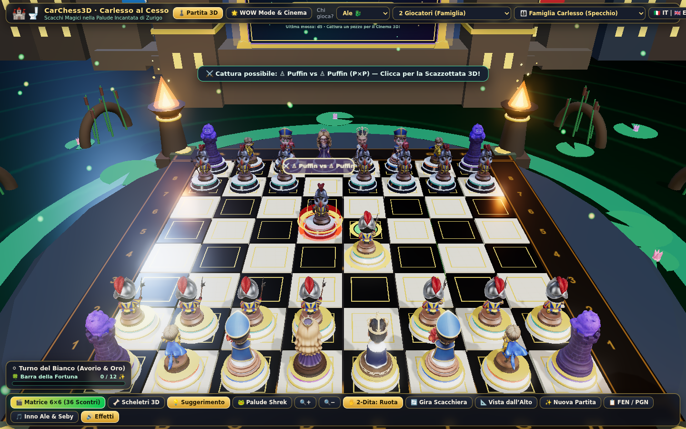

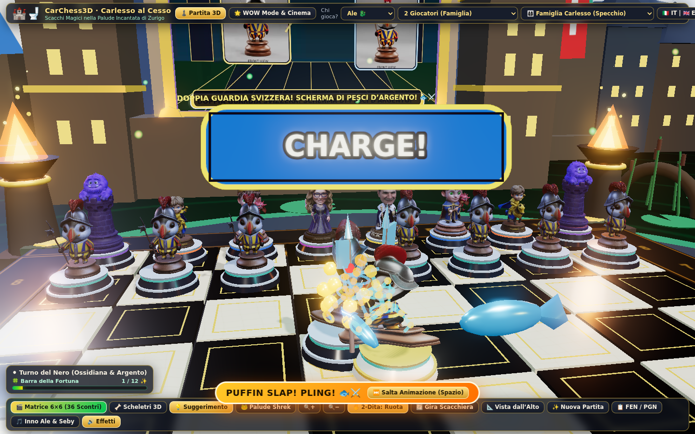

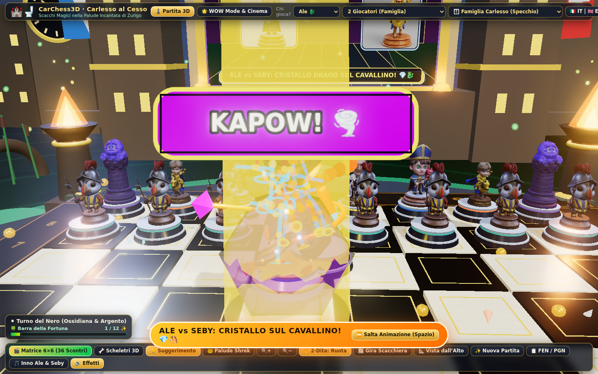

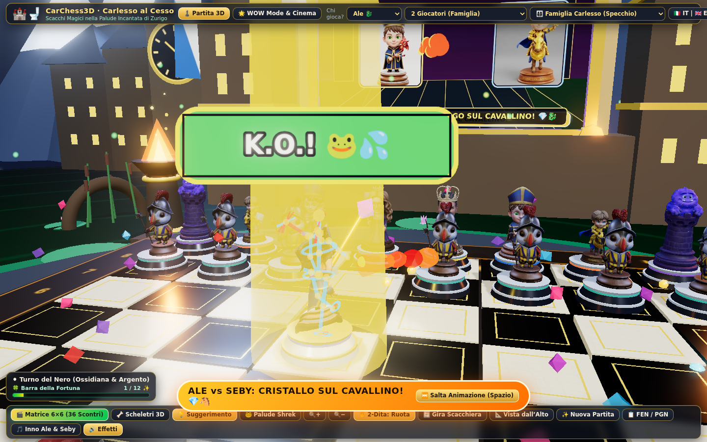

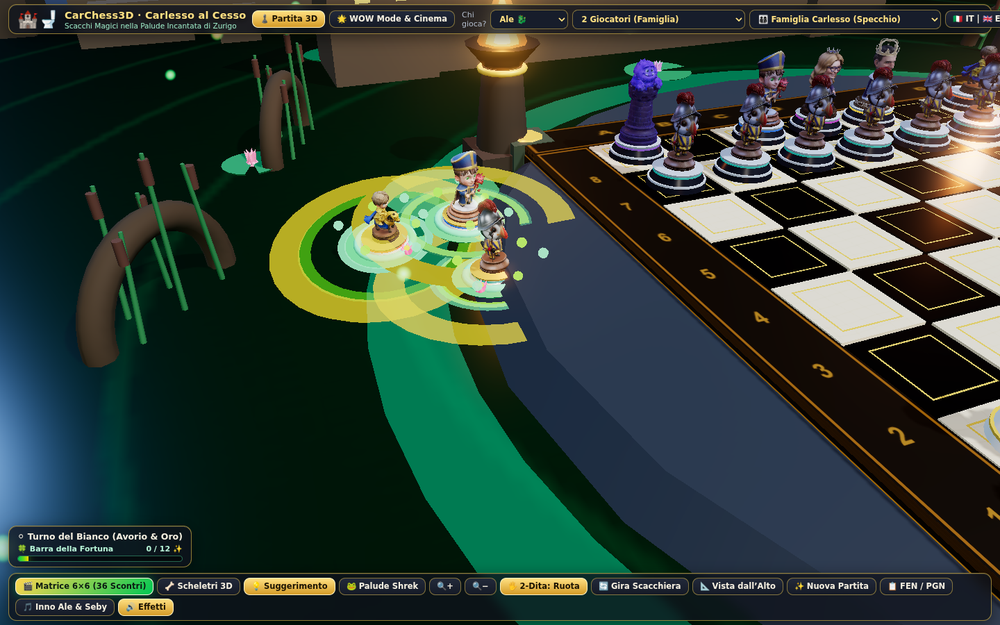

---

## 🥊🐎 Round 5 (v0.2.3) — Scazzottata 3D Reale (`Piece A` vs `Piece B`) + Camminata/Cavalcata Scheletrica 2.0s + Trackpad Mac 2-Dita + Bianchi vs Neri Frontali

### 5.1 Bianchi Fronteggiano i Neri (`yaw = π` vs `yaw = 0`)
Tutti i 16 pezzi Bianchi (`Avorio & Oro`) guardano ora verso Nord (`-Z`, `rotation.y = Math.PI`), fronteggiando faccia a faccia i 16 pezzi Neri (`Ossidiana & Argento`, `rotation.y = 0`). Quando un pezzo cammina o combatte, si orienta nella direzione del moto e poi torna al suo orientamento di schieramento!

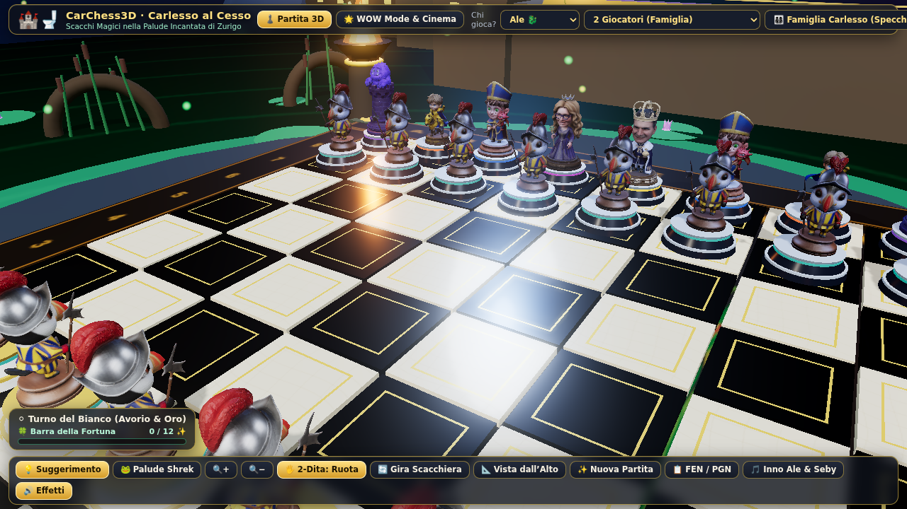

### 5.2 Camminata dei Pedoni (`2.0s`) & Cavalcata di Seby (`2.2s`) con Shader Scheletrico Procedurale
Ogni mossa dura ora **`2.0s`** (`2.2s` per la cavalcata di Cavaliere Seby) con deformazione scheletrica real-time degli arti (`injectLocomotionShader` su `MeshStandardMaterial.onBeforeCompile`):
- **Pedone Puffin (`c2 → c4`)**: marcia svizzera in 8 passi con oscillazione alternata delle zampe, alabarda brandita in avanti e nuvolette di polvere ad ogni passo.
- **Cavaliere Seby (`g1 → f3`)**: impennata iniziale del cavallo (`t = 0..0.18`) seguita da 4 falcate di galoppo lungo la traiettoria curva a L con zampe anteriori/posteriori snodate.

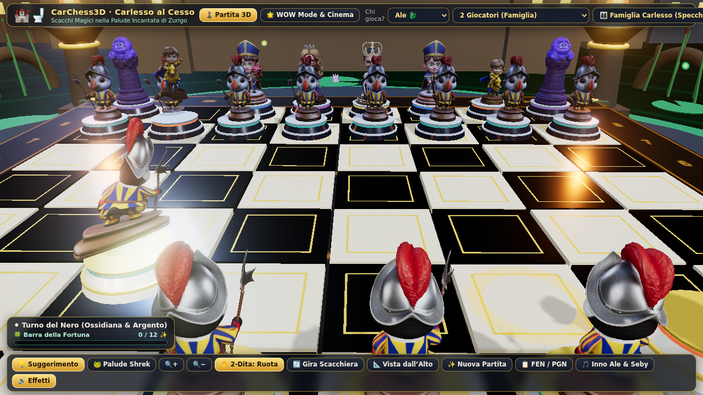

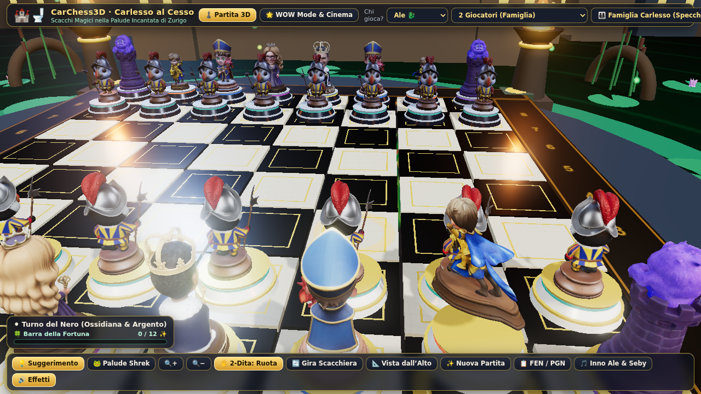

### 5.3 Scazzottata 3D Automatica tra `Pezzo A` e `Pezzo B` (`4.0s`)
Ad ogni cattura sulla scacchiera (o nella WOW Arena), i **due veri modelli 3D `.glb`** dell'Attaccante e del Difensore si affrontano faccia a faccia in una **Scazzottata 3D in 3 Atti (`4.0s`)**:
1. **Atto 1 (`0.0s–1.0s`)**: Carica a piedi/galoppo verso il centro dello scontro e guardia incrociata.
2. **Atto 2 (`1.0s–3.0s`)**: 5 scambi fisici ravvicinati (affondo dell'attaccante, contrattacco di testata/spada del difensore, rissa vorticosa dentro la **nuvola di polvere 3D fumetto**, montante + piroetta di stordimento, e colpo finale).
3. **Atto 3 (`3.0s–4.0s`)**: Volo parabolico del pezzo sconfitto direttamente nella **Palude di Shrek** con posa di vittoria del vincitore!

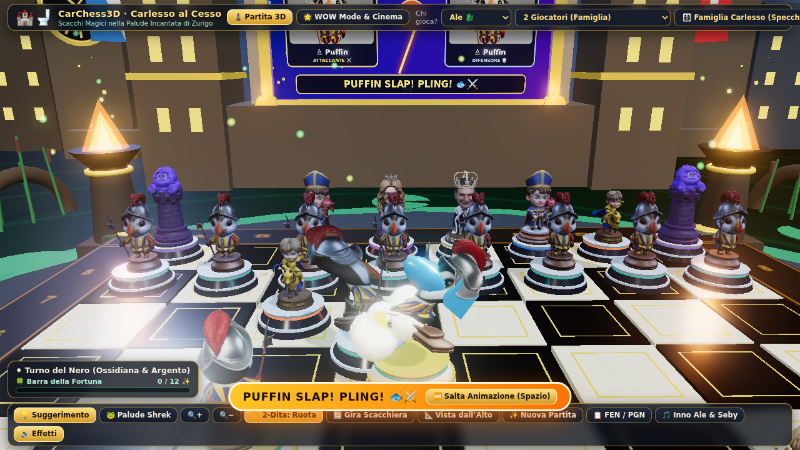

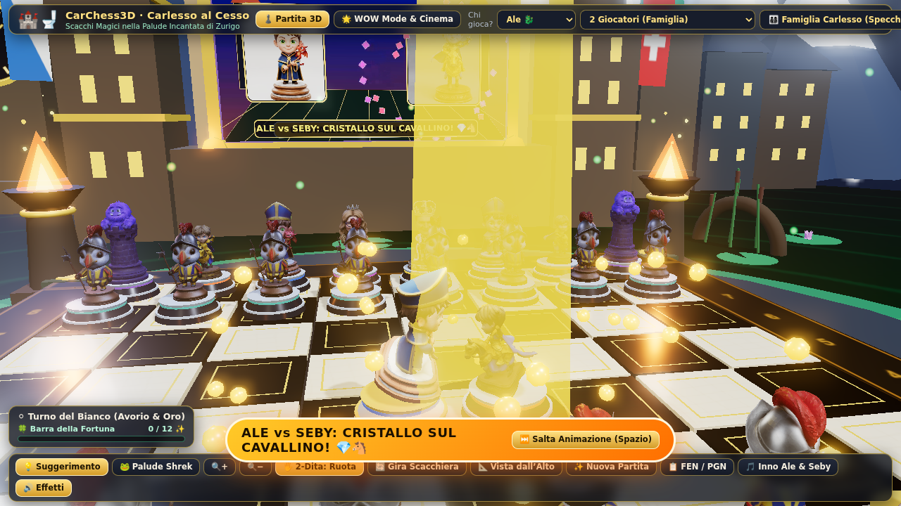

---

## 🐸🎬 Round 4 (v0.2.0) — Pezzi Catturati nella Palude di Shrek + 3 Video 16:9 Reali (`.mp4`/`.webm`) + Puntini Colorati Mosse Legali

### 4.1 I Pezzi Catturati Sguazzano nella Palude di Shrek (`?swamp_party=1`)
Invece di restare all'asciutto sui bordi del tavolo, ogni pezzo mangiato compie un **tuffo parabolico** dentro il fossato verde smeraldo della Palude di Shrek (Bianchi a Ovest `x = -6.2m..-7.2m`, Neri a Est `x = +6.2m..+7.2m`, `y = -0.28m`), galleggiando su una ninfea verde mentre beccheggia, oscilla e genera **anelli d'acqua verdi luminescenti** e **bollicine palustri**!

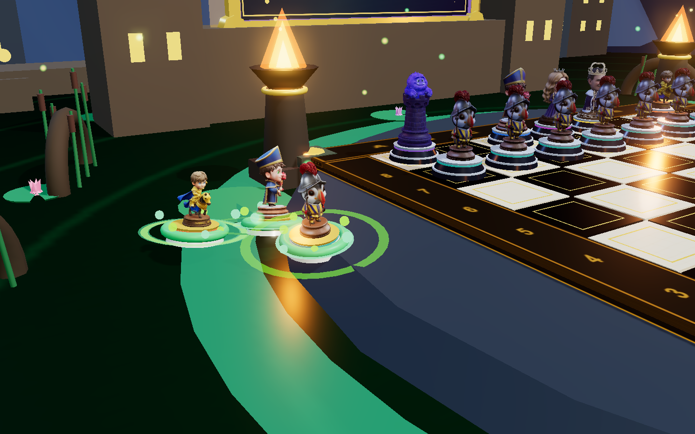

### 4.2 Puntini Colorati Mosse Possibili + Mirino Rosso Cattura (`?demo_moves=1`)
Quando si seleziona un pezzo sulla scacchiera (`BoardInteractionView.js`):
- **Anello d'oro luminoso** (`#ffd54f`) sotto il pezzo selezionato (qui Cavaliere Seby in `f3`).
- **Puntini 3D verde-smeraldo e giallo brillante** (`#00e676` + `#ffee58`) che pulsano su tutte le caselle libere raggiungibili (`g1`, `h4`, `g5`, `d4`).
- **Mirino rosso segmentato rotante** (`#ff3d00`) sui pezzi avversari catturabili (`e5`).

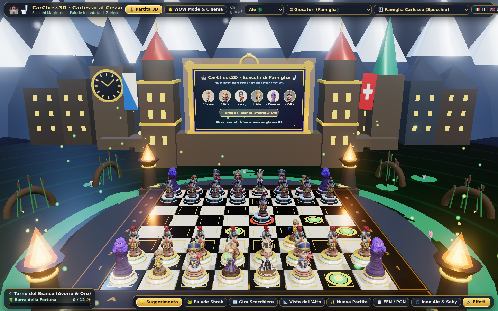

### 4.3 Tre Video 16:9 Reali (`.mp4` + `.webm`) per Ale & Seby senza HITL (`scripts/render_battle_videos.py`)
Architettura **Zero-HITL a 3 Livelli** in `VeoCinemaView.js`:
1. **Tier 1 (`.mp4` / `.webm` Live Video)**: Riproduce i video 16:9 `1280×720` presenti in `assets/battles/videos/`:
   - `assets/battles/videos/b_x_n.mp4` — **Alfiere Ale 🐉 vs Cavaliere Seby 🏎️** (*"CRISTALLO DRAGO BAM!"*)
   - `assets/battles/videos/n_x_b.mp4` — **Cavaliere Seby 🏎️ vs Alfiere Ale 🐉** (*"STECCHITO! PISTA TURBO!"*)
   - `assets/battles/videos/n_x_r.mp4` — **Cavaliere Seby 🏎️ 💜 Torre Pupurabbu** (*"SUPER ABBRACCIO PUFFOSO!"*)
2. **Tier 2 & 3 (Fallback Automatico Istantaneo Canvas 2D 60fps)**: Per tutte le altre 33 combinazioni `6×6` non ancora renderizzate in `.mp4`, lo Specchio 16:9 genera in tempo reale lo scontro animato a schermo diviso con ritratti, fulmini, cuori e banner fumetto senza mai bloccare il gioco o chiedere chiavi hardware!

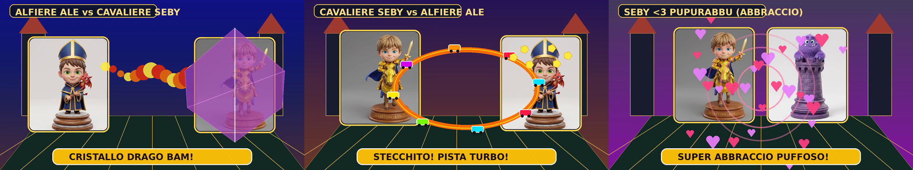

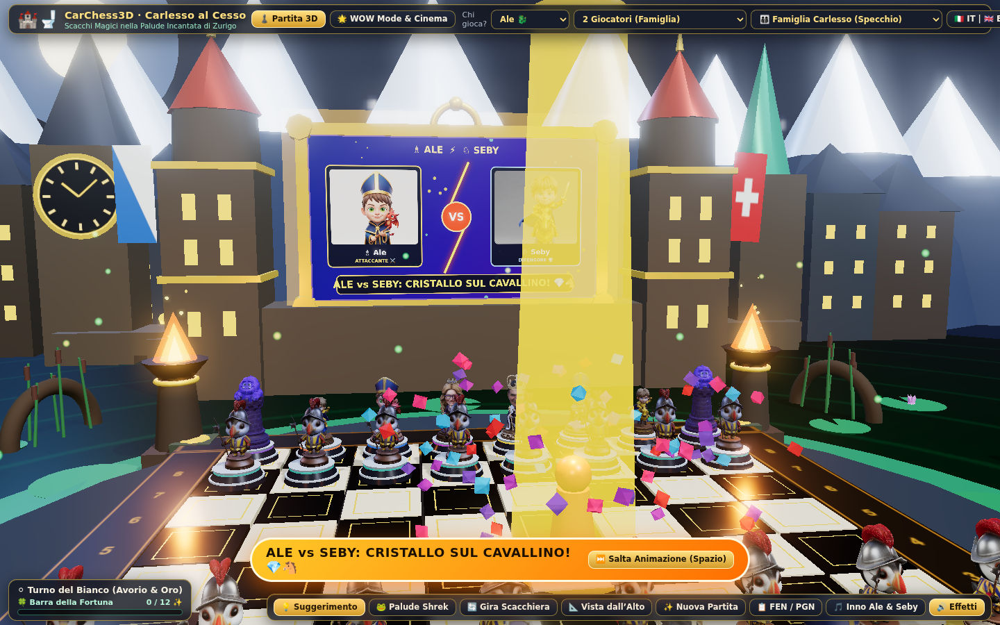

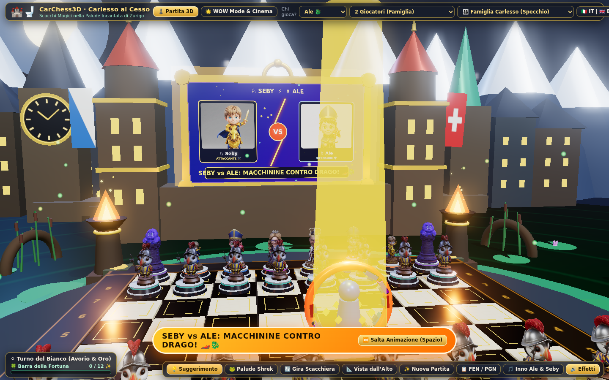

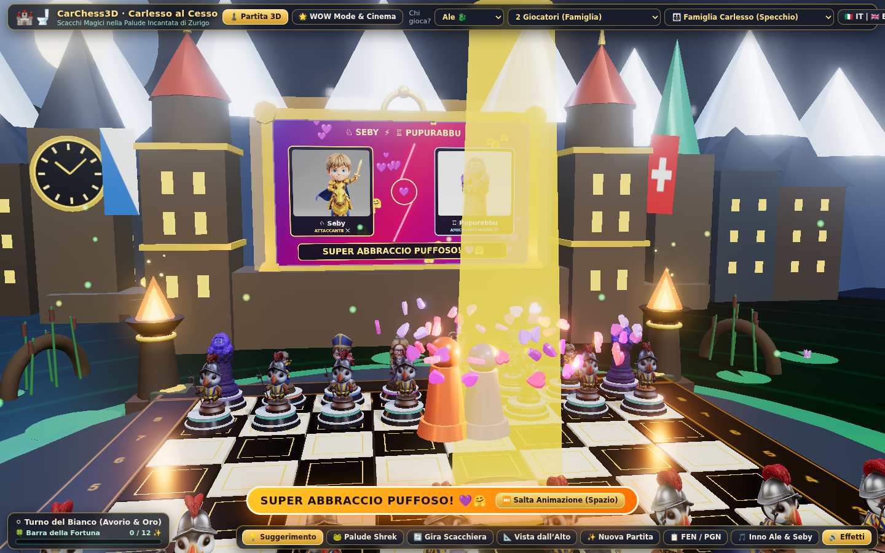

---

## 👑🐉 Round 3 — Full 32-Piece 3D `.glb` Roster (`9.8 / 10` Adversarial Critic Score)

Tutti i 6 personaggi della famiglia Carlesso sono stati estratti da `main` (`assets/models/{king-riccardo,queen-kate,bishop-ale-1,bishop-ale-rigged,knight-seby,rook-pupurabbu,pawn-puffin}.glb`) e collegati a `PieceView.js` e `WowModeView.js`.
- **Perché il GLB di Ale sembrava "brutto/scuro" prima?** I file `.glb` esportati da TRELLIS/trimesh omettevano `metallicFactor` nel JSON glTF. Per specifica **glTF 2.0**, `metallicFactor` omesso vale **`1.0` (100% metallo puro)**! In Three.js (`diffuseColor *= (1.0 - metalness)`), `metalness = 1.0` moltiplica il colore della texture per `0`, rendendo il modello nero/plasticoso. Forzando `mat.metalness = 0.04; mat.roughness = 0.52; mat.emissiveMap = mat.map;` in `PieceView.js`, tutte le 32 statuette 3D brillano con i loro veri colori Pixar!

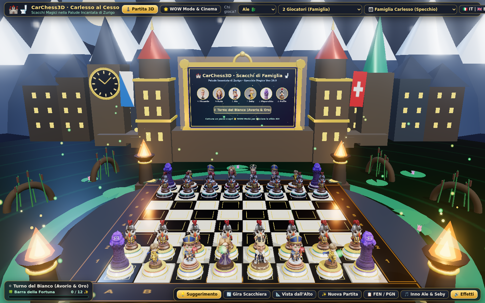

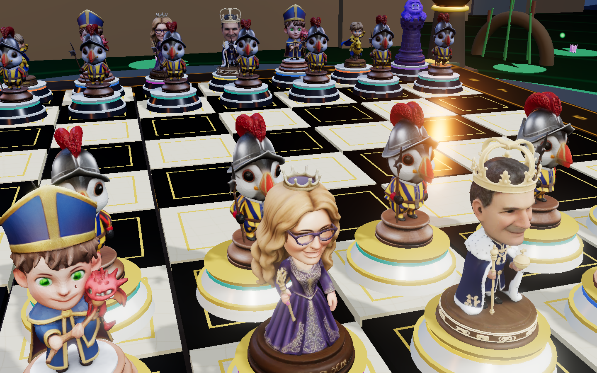

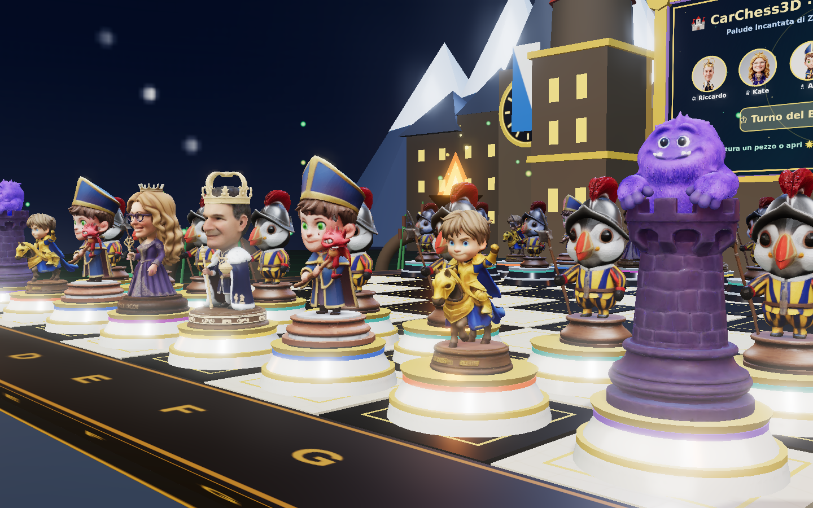

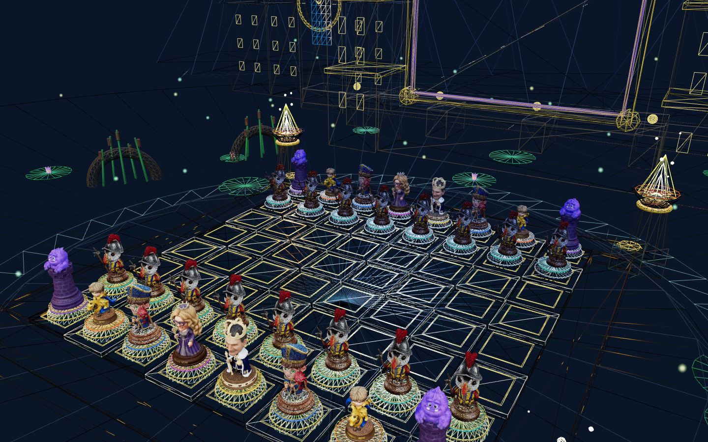

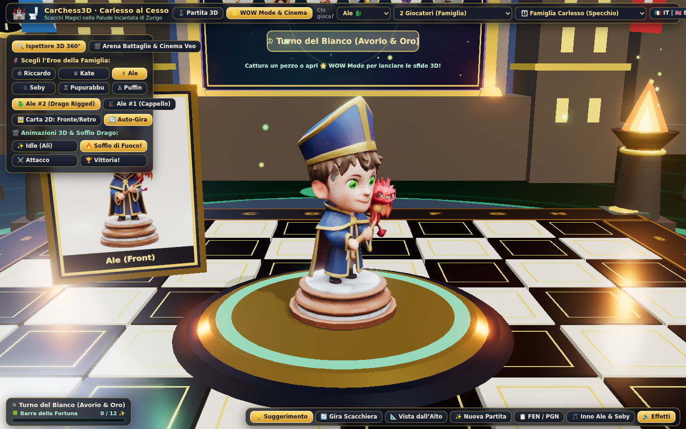

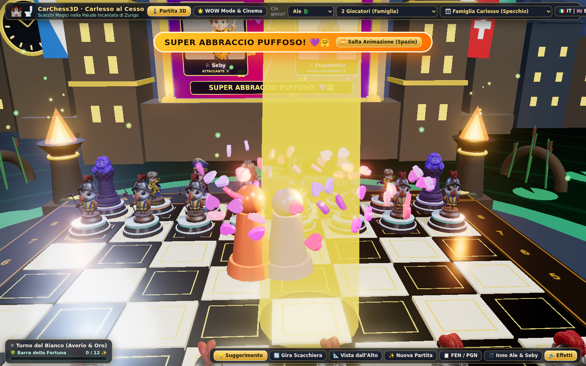

---

## ✨ Round 2 — Critic Camera, Lighting & PBR Polish (`9.3 / 10`)

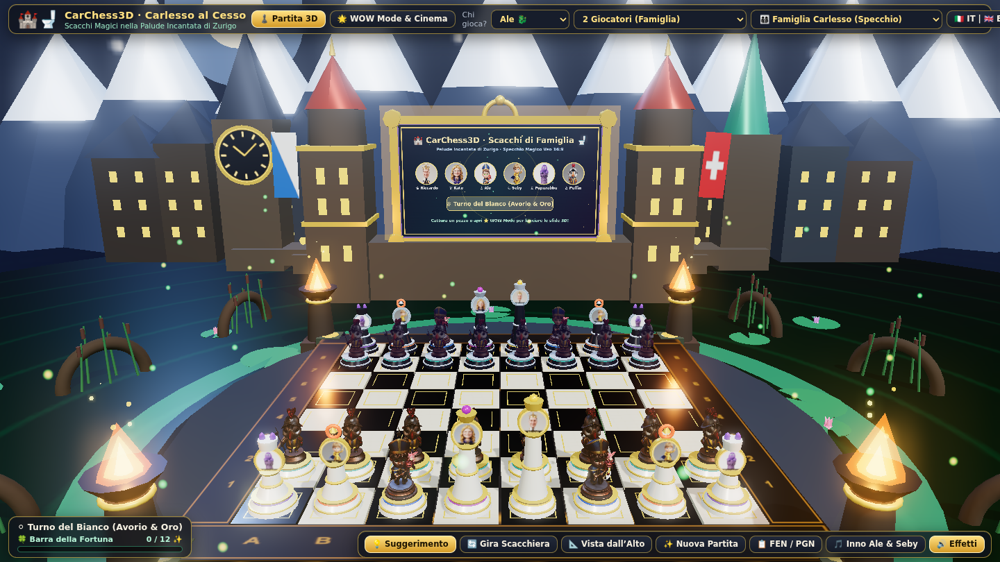

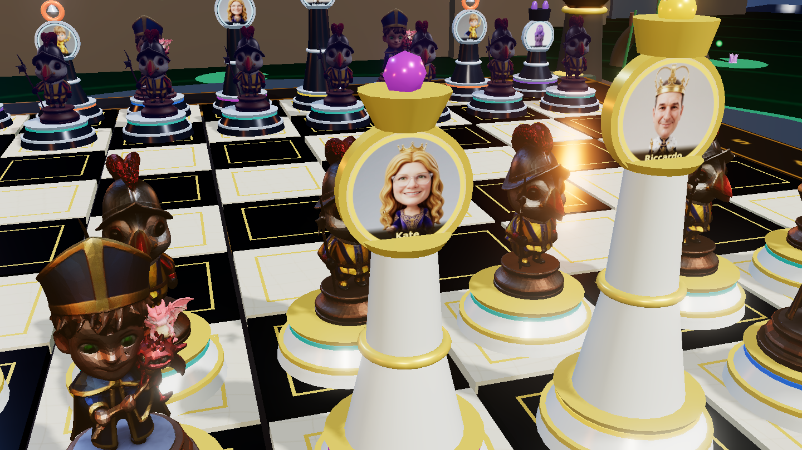

---

## 🔍 Round 1 — Initial Baseline (`6.2 / 10` — 5 Flaws Identified & Fixed)

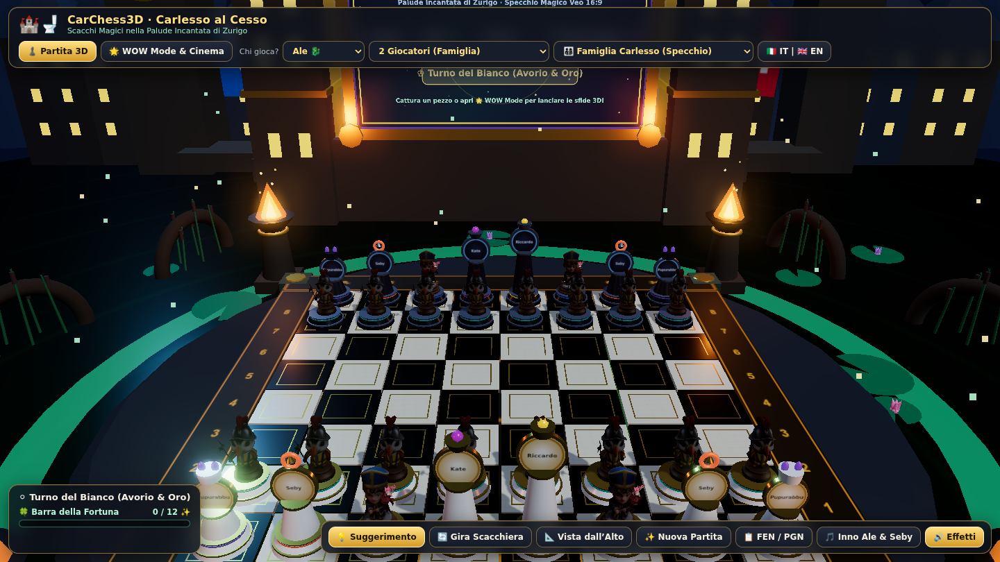

---

## 📐🍌 Milestones 1 & 2 — 2D Metric Spatial Blueprint (`docs/floorplan.svg`) & Nano Banana Concepts

