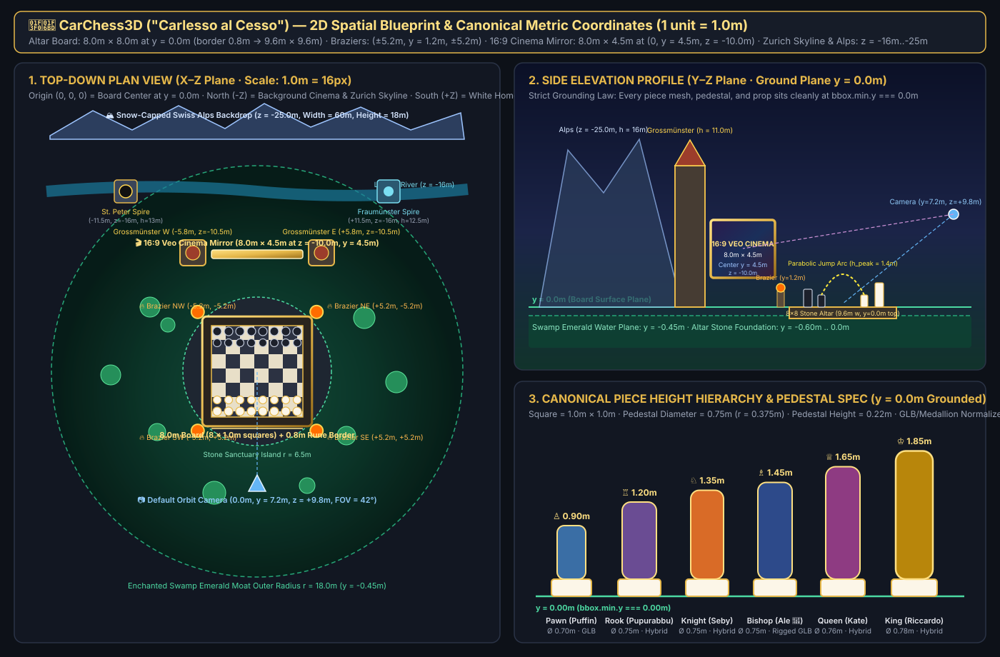
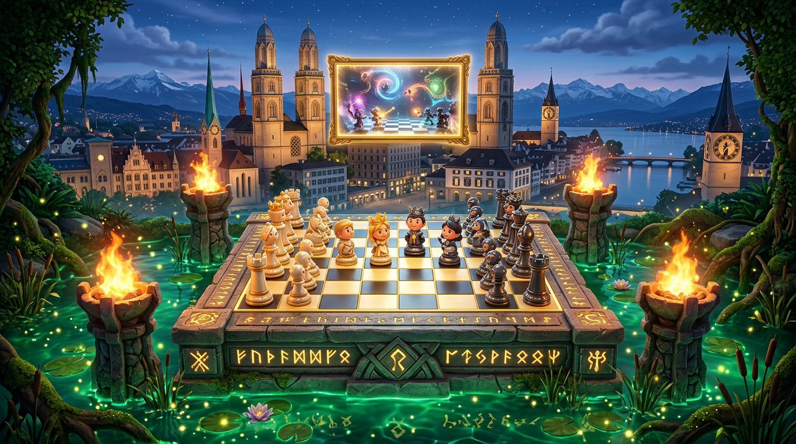
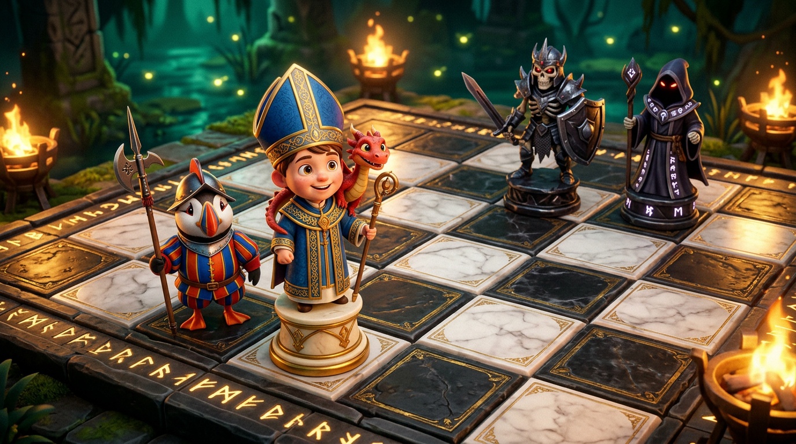

# 🎨📸 CarChess3D — Growing Visual Progress Log (`docs/VISUAL_PROGRESS.md`)

> **Live HTML Gallery:** Open [`progress.html`](../progress.html) (or `http://localhost:8000/progress.html` via `just serve`) to inspect every visual milestone side-by-side in the browser!
> **Growing Asset Folder:** [`docs/visual-progress/`](./visual-progress/)

---

## Milestone 1 — 2D Metric Spatial Blueprint (`docs/floorplan.svg`)

Exact meter coordinates grounding all 3D subagents:
- **8×8 Carved Stone & Marble Altar (`y = 0.00m`)**: `8.0m × 8.0m` (`1.0m` per square), surrounded by a `0.8m` golden-rune stone border (`9.6m × 9.6m` footprint).
- **Canonical Piece Height Hierarchy (`bbox.min.y === 0.00m`)**:
  - `Pawn (Puffin)` = `0.90m` · `Rook (Pupurabbu)` = `1.20m` · `Knight (Seby)` = `1.35m` · `Bishop (Ale + Red Dragon)` = `1.45m` · `Queen (Kate)` = `1.65m` · `King (Riccardo)` = `1.85m`
  - Pedestal diameter = `0.75m` (`r = 0.375m`, `h = 0.22m`).
- **4 Corner Flaming Braziers**: `(±5.2m, y = 1.2m, ±5.2m)`.
- **Enchanted Swamp Emerald Moat**: `r = 6.0m .. 18.0m` at `y = -0.45m` with lily pads, lotus flowers, cattails, and 68 floating fireflies.
- **16:9 Veo Magic Cinema Mirror**: `8.0m × 4.5m` at `(0, y = 4.5m, z = -10.0m)` suspended between the twin towers of the **Zurich Grossmünster** (`±5.8m, z = -10.5m, h = 11.0m`), flanked by **St. Peter** (`-11.5m, z = -16.0m`), **Fraumünster** (`+11.5m, z = -16.0m`), the **Limmat River**, and the **Swiss Alps** (`z = -25.0m`).

---

## Milestone 2 — Nano Banana 2D Concept Target Renders (`docs/concepts/`)

### 2.1 Overview Concept (`01_concept_zurich_swamp_overview.png`)
Locks in the twilight Zurich skyline, Grossmünster twin towers framing the golden 16:9 Magic Cinema Mirror, the 4 corner *Wizard Chess* flaming braziers, glowing golden runes on the altar border, and the emerald swamp moat.

### 2.2 Board & Character Close-Up (`02_concept_board_closeup.png`)
Locks in the warm torchlight vs cool emerald swamp contrast, Bishop Ale with his blue-and-gold mitre and friendly red shoulder dragon, Swiss-Guard Puffin with halberd, Ivory-Gold vs Obsidian-Silver pedestals, and carved stone rival warriors.

---

## Milestone 3 — Live 3D Scene Renders & Adversarial Art Director Critic Rounds

*(Updated automatically after each 4-angle headless WebGL capture round: `1: 3/4 Overview`, `2: Close-Up Details`, `3: Low-Angle y=0 Grounding Check`, `4: Wireframe Collision Check`, plus Mode 2 WOW Turntable & Capture Spectacle shots.)*
